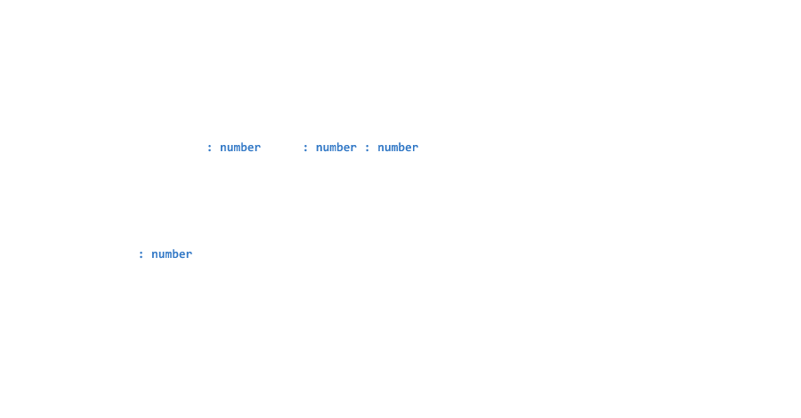
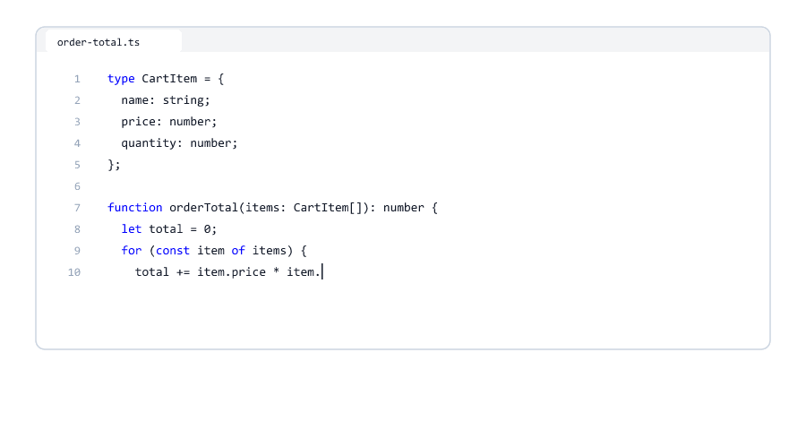

# Introduction to TypeScript

> **Session 1 of 33** | Part 1: Getting Started | [All sessions](README.md#course-outline)

## Table of Contents
- [What is TypeScript?](#what-is-typescript)
- [Why TypeScript Exists](#why-typescript-exists)
- [Why Companies Use TypeScript](#why-companies-use-typescript)
- [JavaScript and TypeScript Side by Side](#javascript-and-typescript-side-by-side)
- [Checked Before It Runs](#checked-before-it-runs)
- [Types Disappear When the Code Runs](#types-disappear-when-the-code-runs)
- [Node.js Runs TypeScript, but Does Not Check It](#nodejs-runs-typescript-but-does-not-check-it)
- [Your Editor Uses TypeScript Too](#your-editor-uses-typescript-too)
- [What TypeScript Cannot Catch](#what-typescript-cannot-catch)
- [TypeScript Versions](#typescript-versions)
- [What You Need from JavaScript](#what-you-need-from-javascript)
- [How This Course Works](#how-this-course-works)
- [Try It Yourself](#try-it-yourself)
- [Mini Example 1: The Order Total](#mini-example-1-the-order-total)
- [Mini Example 2: Renaming a Field Safely](#mini-example-2-renaming-a-field-safely)
- [Beginner Mistakes](#beginner-mistakes)
- [Practice Exercises](#practice-exercises)
- [Interview Questions](#interview-questions)

---

## What is TypeScript?

**TypeScript** is JavaScript with **types**. A type says what kind of value something is: a number, a text, a list of products, an object with a name and a price.

```typescript
let price: number = 499;
```

`: number` is a **type annotation**. It says: `price` must always be a number. Everything else on that line is the JavaScript you already know.

| Thing                     | What it is                                                        |
| ------------------------- | ----------------------------------------------------------------- |
| TypeScript                | JavaScript plus types. Files end in `.ts`                         |
| A type                    | A description of a value: `number`, `string`, a list of products  |
| `tsc`                     | The TypeScript compiler. It **checks** the types and can turn `.ts` into `.js` |
| Type checking             | Finding mistakes by reading the code, **before** it runs           |

TypeScript does not replace JavaScript. Every `if`, loop, function, array, object, class, promise and module from the JavaScript course works exactly the same. TypeScript only **adds** something: types, and a checker that reads them.


TypeScript was created by Microsoft in 2012 and is free and open source. Almost every modern tool for JavaScript understands it.

---

## Why TypeScript Exists

JavaScript finds most mistakes only **when the code runs**. In the JavaScript course you saw many of them:

| Mistake                                   | What JavaScript does                                    | JavaScript course |
| ----------------------------------------- | ------------------------------------------------------- | ----------------- |
| A typo in a property name: `user.emial`   | Gives `undefined`, and the program carries on            | [13](https://github.com/mohin-sheikh/javascript-basics-to-advanced/blob/main/13-objects.md) |
| A number sent as text: `"5" + 1`          | Gives `"51"`, not `6`                                    | [05](https://github.com/mohin-sheikh/javascript-basics-to-advanced/blob/main/05-type-conversion.md) |
| Calling a method that does not exist      | Crashes: `TypeError: ... is not a function`             | [10](https://github.com/mohin-sheikh/javascript-basics-to-advanced/blob/main/10-functions.md) |
| Reading a property of `undefined`         | Crashes: `Cannot read properties of undefined`          | [13](https://github.com/mohin-sheikh/javascript-basics-to-advanced/blob/main/13-objects.md) |
| A missing argument                        | The parameter is `undefined`, and the result is wrong   | [10](https://github.com/mohin-sheikh/javascript-basics-to-advanced/blob/main/10-functions.md) |

On your own computer that is fine: you see the crash and fix it. On a server it is a problem. The code that crashes may run only once a week, for one customer, at night. Then the **user** finds the bug, not you.

TypeScript reads your code **before** it runs and reports these mistakes while you are still at your desk.


---

## Why Companies Use TypeScript

Most companies that build with JavaScript today use TypeScript, especially for backends. These are the reasons

| Reason                          | What it means in daily work                                       |
| ------------------------------- | ----------------------------------------------------------------- |
| Bugs are found earlier          | Typos, wrong types and missing fields are reported before the code runs |
| Better editor help              | The editor knows the type of every value, so it can suggest names and show what a function needs |
| Safe changes                    | Rename a field, and TypeScript lists every place that must change ([Mini Example 2](#mini-example-2-renaming-a-field-safely)) |
| Types are documentation         | `function createUser(name: string, age: number)` tells you what to pass, without reading the body |
| Big teams                       | When ten people change the same code base, the checker catches the mismatches between their parts |

TypeScript also has costs: there is one more tool to set up, you write a little more, and you must learn to read its error messages. This course helps with all three.

---

## JavaScript and TypeScript Side by Side

The same function, first in JavaScript, then in TypeScript

greet.js

```javascript
function greet(name) {
  return "Hello, " + name.toUpperCase();
}

console.log(greet("Riya"));
console.log(greet(42));
```

greet.ts

```typescript
function greet(name: string): string {
  return "Hello, " + name.toUpperCase();
}

console.log(greet("Riya"));
console.log(greet(42));
```

Only two things are new

| Part                | Meaning                                           |
| ------------------- | ------------------------------------------------- |
| `name: string`      | The parameter `name` must be a text               |
| `): string`         | The function returns a text                       |

Both files have the same bug: `greet(42)` passes a number, and numbers have no `toUpperCase()`. JavaScript finds it when that line runs. TypeScript finds it by reading the file.

What `tsc` says about greet.ts (you install `tsc` in Session 02)

```text
greet.ts:6:19 - error TS2345: Argument of type 'number' is not assignable to parameter of type 'string'.

6 console.log(greet(42));
                    ~~


Found 1 error in greet.ts:6
```

`greet.ts:6:19` is the file, the line and the column. `TS2345` is the number of this kind of error. The `~~` under `42` shows the exact place. Session 05 is all about reading these messages.

---

## Checked Before It Runs

Working with TypeScript has two moments

| Moment             | Who does the work | What happens                                         |
| ------------------ | ----------------- | ---------------------------------------------------- |
| **Compile time**   | `tsc`             | Reads the code and checks the types. Nothing runs    |
| **Run time**       | Node.js           | Runs the program. The types are already gone         |

"Compile time" sounds technical, but it only means: while the code is being checked, before it runs.


In JavaScript you only had run time: write, run, see what happens. TypeScript adds a step in between: write, **check**, run.

---

## Types Disappear When the Code Runs

Computers do not run TypeScript. They run JavaScript. Before your code runs, the types are **removed**.

price.ts

```typescript
function addTax(price: number, rate: number): number {
  return Math.round(price * (1 + rate / 100));
}

const total: number = addTax(49900, 18);
console.log(total);
```

`tsc` can build a JavaScript file from it. This is the real file it writes, `price.js`

```javascript
function addTax(price, rate) {
    return Math.round(price * (1 + rate / 100));
}
const total = addTax(49900, 18);
console.log(total);
export {};
//# sourceMappingURL=price.js.map
```

The annotations `: number` are gone. The rest is your code. The last two lines are extras that `tsc` adds: `export {};` marks the file as a module (Session 24), and the comment helps debugging tools find the original `.ts` file (Session 02).



This is called **type erasure**, and it is the most important idea of the whole course

* Types exist only at compile time
* At run time there are no types, so TypeScript cannot check anything while the program runs
* TypeScript never changes what your JavaScript does. `addTax` works exactly like the JavaScript version

---

## Node.js Runs TypeScript, but Does Not Check It

Node.js 24 can run a `.ts` file directly. It removes the types and runs the JavaScript that is left. But it **does not check** the types first.

```bash
node greet.ts
```

Output

```text
Hello, RIYA
file:///D:/ts-practice/greet.ts:2
  return "Hello, " + name.toUpperCase();
                          ^

TypeError: name.toUpperCase is not a function
    at greet (file:///D:/ts-practice/greet.ts:2:27)
    at Object.<anonymous> (file:///D:/ts-practice/greet.ts:6:13)
    at Module._compile (node:internal/modules/cjs/loader:1872:14)
    at Object..js (node:internal/modules/cjs/loader:2003:10)
    at Module.load (node:internal/modules/cjs/loader:1594:32)
    at Module._load (node:internal/modules/cjs/loader:1396:12)
    at wrapModuleLoad (node:internal/modules/cjs/loader:255:19)
    at Module.executeUserEntryPoint [as runMain] (node:internal/modules/run_main:154:5)
    at node:internal/main/run_main_module:33:47

Node.js v24.19.0
```

The same crash as the JavaScript file. Node.js ran `greet(42)` although the type says `name: string`.


| Command          | Runs the code | Checks the types |
| ---------------- | ------------- | ---------------- |
| `node greet.ts`  | Yes           | **No**           |
| `npx tsc`        | No            | Yes              |

Remember this table. In this course you will always use both: `tsc` to check, `node` to run.

---

## Your Editor Uses TypeScript Too

VS Code has TypeScript built in. While you type, it uses the types to help you

| Help                     | What you see                                                      |
| ------------------------ | ----------------------------------------------------------------- |
| Suggestions              | Type `item.` and VS Code lists `name`, `price`, `quantity`        |
| Hover                    | Point at a variable and see its type                              |
| Red underlines           | Type errors appear while you type, without running anything       |
| Go to definition         | Jump to where a type or function was written                      |
| Rename                   | Rename a field everywhere it is used, in every file               |



The editor shows the same errors as `tsc`. Session 02 sets this up.

---

## What TypeScript Cannot Catch

TypeScript checks **your code**. It cannot check data that arrives while the program runs, and it cannot know what you meant.

age.ts

```typescript
const body = '{ "name": "Riya", "age": "25" }'; // a request body: age is text!

const user: { name: string; age: number } = JSON.parse(body);

console.log(user.age + 1);
```

`tsc` reports **no error**, and the output is

```text
251
```

The type says `age` is a number. The real data has the text `"25"`. At run time there are no types (type erasure), so nothing stops the text, and `"25" + 1` becomes `"251"`.


email.ts

```typescript
function sendEmail(to: string, subject: string): void {
  console.log(`To: ${to} | Subject: ${subject}`);
}

sendEmail("Welcome to the shop!", "riya@example.com"); // the wrong order
```

Output

```text
To: Welcome to the shop! | Subject: riya@example.com
```

No error again. Both values are texts, so the types match, even though the order is wrong.

| TypeScript catches                          | TypeScript cannot catch                                   |
| ------------------------------------------- | --------------------------------------------------------- |
| Typos in names                              | Data from outside: request bodies, files, other servers   |
| A value of the wrong type                   | Wrong logic: `+` where you meant `-`                       |
| Missing or extra fields                     | Two values of the same type in the wrong order            |
| Calling something that is not a function    | Problems that only happen at run time, like a full disk    |

Data from outside is checked with a validation library. This course uses Joi, the same library as the Node.js course (Session 26).

---

## TypeScript Versions

Most tutorials and videos online were made with TypeScript 5. Since then two big versions came out, and this course uses the newest one

| Version  | Released        | What it means for you                                            |
| -------- | --------------- | ---------------------------------------------------------------- |
| 5.x      | 2023 to 2025    | Most tutorials online. Without a settings file, many checks were off |
| 6.0      | March 2026      | Strict checks are on by default                                   |
| 7.0      | July 2026       | The same language, with a new compiler written in Go. It runs as a native program instead of on Node.js, so it is much faster |

We tested the difference: a function with a parameter that has no type gives no error in TypeScript 5.9, and an error in 6.0 and 7.0 (you will meet this error, `TS7006`, in Session 03).


This course was tested with **TypeScript 7.0.2** and **Node.js 24**. When an older tutorial shows something different, the session tells you.

---

## What You Need from JavaScript

This course teaches TypeScript, not JavaScript. You should know these topics. Each links to the session of the [JavaScript course](https://github.com/mohin-sheikh/javascript-basics-to-advanced) where it is taught

| Topic                                                  | JavaScript course |
| ------------------------------------------------------ | ----------------- |
| Running code with `node`, reading error messages       | [01](https://github.com/mohin-sheikh/javascript-basics-to-advanced/blob/main/01-introduction-to-javascript.md) |
| Variables, data types, operators                       | [02](https://github.com/mohin-sheikh/javascript-basics-to-advanced/blob/main/02-variables-and-comments.md) to [05](https://github.com/mohin-sheikh/javascript-basics-to-advanced/blob/main/05-type-conversion.md) |
| `if`, loops, strings, numbers                          | [06](https://github.com/mohin-sheikh/javascript-basics-to-advanced/blob/main/06-conditionals.md) to [09](https://github.com/mohin-sheikh/javascript-basics-to-advanced/blob/main/09-numbers-and-math.md) |
| Functions and callbacks                                | [10](https://github.com/mohin-sheikh/javascript-basics-to-advanced/blob/main/10-functions.md), [11](https://github.com/mohin-sheikh/javascript-basics-to-advanced/blob/main/11-callbacks-and-higher-order-functions.md) |
| Arrays and objects, destructuring and spread           | [12](https://github.com/mohin-sheikh/javascript-basics-to-advanced/blob/main/12-arrays-and-array-methods.md) to [14](https://github.com/mohin-sheikh/javascript-basics-to-advanced/blob/main/14-destructuring-spread-rest.md) |
| Classes                                                | [17](https://github.com/mohin-sheikh/javascript-basics-to-advanced/blob/main/17-this-constructors-classes.md) |
| Errors, JSON, `Map` and `Set`, modules                 | [18](https://github.com/mohin-sheikh/javascript-basics-to-advanced/blob/main/18-error-handling.md) to [21](https://github.com/mohin-sheikh/javascript-basics-to-advanced/blob/main/21-modules.md) |
| Promises and `async`/`await`                           | [24](https://github.com/mohin-sheikh/javascript-basics-to-advanced/blob/main/24-promises.md), [25](https://github.com/mohin-sheikh/javascript-basics-to-advanced/blob/main/25-async-await-and-fetch.md) |

You do not need to know everything perfectly. When a session uses a JavaScript topic, it links back to it.

---

## How This Course Works

The course has 33 sessions in seven parts

| Part | Sessions  | Topic                                                       |
| ---- | --------- | ----------------------------------------------------------- |
| 1    | 01 to 05  | Getting started: setup, basic types, reading errors          |
| 2    | 06 to 11  | Typing your data: arrays, objects, unions, narrowing, null   |
| 3    | 12 to 13  | Functions, assertions, `as const` and `satisfies`            |
| 4    | 14 to 19  | Generics and the type tools: utility types, mapped types     |
| 5    | 20 to 22  | Classes, interfaces, abstract classes, decorators            |
| 6    | 23 to 29  | Real programs: async code, modules, Joi, tsconfig, testing   |
| 7    | 30 to 33  | TypeScript with Node.js, Express and MongoDB, and a final project |


Every session has the same parts

| Part                  | What it gives you                                             |
| --------------------- | ------------------------------------------------------------- |
| Short sections        | One idea at a time, with JavaScript and TypeScript side by side where it helps |
| Tested code           | A file name, the code, and the real output of `node` and `tsc` |
| Animated diagrams     | A picture of what TypeScript sees in your code                |
| Mini examples         | Small backend programs: orders, users, carts, APIs            |
| Beginner mistakes     | The wrong code, the real `tsc` error, and the fix             |
| Practice exercises    | Tasks to do on your own                                       |
| Interview questions   | Short questions with clear answers                            |

How to study: type every example yourself, run `tsc` and `node`, and compare with the output in the session. When your output is different, find out why before you go on.

---

## Try It Yourself

You can try the most important idea of this session right now. You only need Node.js 24 (check with `node -v`).

1. Make a folder called `ts-practice` and open it in VS Code
2. Create `greet.js` and `greet.ts` with the code from [JavaScript and TypeScript Side by Side](#javascript-and-typescript-side-by-side)
3. Run both in the VS Code terminal

```bash
node greet.js
```

Output

```text
Hello, RIYA
D:\ts-practice\greet.js:2
  return "Hello, " + name.toUpperCase();
                          ^

TypeError: name.toUpperCase is not a function
    at greet (D:\ts-practice\greet.js:2:27)
    at Object.<anonymous> (D:\ts-practice\greet.js:6:13)
    at Module._compile (node:internal/modules/cjs/loader:1872:14)
    at Object..js (node:internal/modules/cjs/loader:2003:10)
    at Module.load (node:internal/modules/cjs/loader:1594:32)
    at Module._load (node:internal/modules/cjs/loader:1396:12)
    at wrapModuleLoad (node:internal/modules/cjs/loader:255:19)
    at Module.executeUserEntryPoint [as runMain] (node:internal/modules/run_main:154:5)
    at node:internal/main/run_main_module:33:47

Node.js v24.19.0
```

```bash
node greet.ts
```

The output is the same crash as in [Node.js Runs TypeScript, but Does Not Check It](#nodejs-runs-typescript-but-does-not-check-it). (Your folder path will be different.)

Both files crash at run time. In Session 02 you install `tsc`, and from then on the TypeScript file is checked before it runs.

---

## Mini Example 1: The Order Total

A shop calculates the total of a cart. Prices are in rupees here to keep the numbers small.

order-total.js

```javascript
function orderTotal(items) {
  let total = 0;
  for (const item of items) {
    total += item.price * item.qty;
  }
  return total;
}

const cart = [
  { name: "Keyboard", price: 1499, quantity: 2 },
  { name: "Mouse", price: 499, quantity: 1 }
];

console.log("Total:", orderTotal(cart));
```

Output

```text
Total: NaN
```

No crash, no error, just a wrong answer: the field is called `quantity`, not `qty`. `item.qty` is `undefined`, and `1499 * undefined` is `NaN` (JavaScript course, [Session 09](https://github.com/mohin-sheikh/javascript-basics-to-advanced/blob/main/09-numbers-and-math.md)). A customer would see "Total: NaN" at checkout.

The same code in TypeScript, with a type that describes one cart item

order-total.ts

```typescript
type CartItem = {
  name: string;
  price: number;
  quantity: number;
};

function orderTotal(items: CartItem[]): number {
  let total = 0;
  for (const item of items) {
    total += item.price * item.qty;
  }
  return total;
}

const cart: CartItem[] = [
  { name: "Keyboard", price: 1499, quantity: 2 },
  { name: "Mouse", price: 499, quantity: 1 }
];

console.log("Total:", orderTotal(cart));
```

What `tsc` says

```text
order-total.ts:10:32 - error TS2339: Property 'qty' does not exist on type 'CartItem'.

10     total += item.price * item.qty;
                                  ~~~


Found 1 error in order-total.ts:10
```

| New part              | Meaning                                                  | Session |
| --------------------- | -------------------------------------------------------- | ------- |
| `type CartItem = {...}` | A name for the shape of one cart item                  | 07, 08  |
| `items: CartItem[]`   | A list of cart items                                     | 06      |
| `): number`           | The function returns a number                            | 12      |

Change `item.qty` to `item.quantity`, and the output is

```text
Total: 3497
```


---

## Mini Example 2: Renaming a Field Safely

A product list. The prices are in paise, as in the JavaScript course ([Session 09](https://github.com/mohin-sheikh/javascript-basics-to-advanced/blob/main/09-numbers-and-math.md))

products.ts

```typescript
type Product = {
  name: string;
  price: number;
};

const products: Product[] = [
  { name: "Keyboard", price: 149900 },
  { name: "Mouse", price: 49900 }
];

function formatPrice(product: Product): string {
  return `${product.name}: Rs. ${product.price / 100}`;
}

function totalPaise(items: Product[]): number {
  return items.reduce((sum, item) => sum + item.price, 0);
}

console.log(products.map(formatPrice));
console.log(totalPaise(products));
```

Output

```text
[ 'Keyboard: Rs. 1499', 'Mouse: Rs. 499' ]
199800
```

The team decides that `price` is not clear enough: rupees or paise? The field is renamed to `pricePaise`.

**In JavaScript** you must find every place by hand. Miss them, and nothing warns you

products.js

```javascript
// The data now uses pricePaise, but the code still reads price
const products = [
  { name: "Keyboard", pricePaise: 149900 },
  { name: "Mouse", pricePaise: 49900 }
];

function formatPrice(product) {
  return `${product.name}: Rs. ${product.price / 100}`;
}

function totalPaise(items) {
  return items.reduce((sum, item) => sum + item.price, 0);
}

console.log(products.map(formatPrice));
console.log(totalPaise(products));
```

```text
[ 'Keyboard: Rs. NaN', 'Mouse: Rs. NaN' ]
NaN
```

**In TypeScript** you change one line, the type

```typescript
type Product = {
  name: string;
  pricePaise: number;
};
```

and `tsc` lists every place that still uses the old name

```text
products.ts:7:23 - error TS2353: Object literal may only specify known properties, and 'price' does not exist in type 'Product'.

7   { name: "Keyboard", price: 149900 },
                        ~~~~~

products.ts:8:20 - error TS2353: Object literal may only specify known properties, and 'price' does not exist in type 'Product'.

8   { name: "Mouse", price: 49900 }
                     ~~~~~

products.ts:12:42 - error TS2339: Property 'price' does not exist on type 'Product'.

12   return `${product.name}: Rs. ${product.price / 100}`;
                                            ~~~~~

products.ts:16:49 - error TS2339: Property 'price' does not exist on type 'Product'.

16   return items.reduce((sum, item) => sum + item.price, 0);
                                                   ~~~~~


Found 4 errors in the same file, starting at: products.ts:7
```


Fix the four lines (`pricePaise: 149900`, `product.pricePaise`, `item.pricePaise`), and `tsc` finds no errors. The output is the same as before

```text
[ 'Keyboard: Rs. 1499', 'Mouse: Rs. 499' ]
199800
```

In a real project these four places would be spread over many files. `tsc` finds them all. This is one of the main reasons teams choose TypeScript.

---

## Beginner Mistakes

### Mistake 1: Thinking `node file.ts` checks the types

```bash
node greet.ts
```

Node.js removes the types and runs the code. A file full of type errors still runs, and crashes like JavaScript would. Always check with `tsc` (Session 02).

---

### Mistake 2: Writing types in a `.js` file

typed.js

```javascript
let age: number = 25;
console.log(age);
```

```text
D:\ts-practice\typed.js:1
let age: number = 25;
       ^

SyntaxError: Unexpected token ':'
    at wrapSafe (node:internal/modules/cjs/loader:1804:18)
    at Module._compile (node:internal/modules/cjs/loader:1846:20)
    at Object..js (node:internal/modules/cjs/loader:2003:10)
    at Module.load (node:internal/modules/cjs/loader:1594:32)
    at Module._load (node:internal/modules/cjs/loader:1396:12)
    at wrapModuleLoad (node:internal/modules/cjs/loader:255:19)
    at Module.executeUserEntryPoint [as runMain] (node:internal/modules/run_main:154:5)
    at node:internal/main/run_main_module:33:47

Node.js v24.19.0
```

Types are TypeScript syntax. They belong in `.ts` files.

---

### Mistake 3: Thinking TypeScript checks data while the program runs

The type `age: number` did not stop the text `"25"` in [What TypeScript Cannot Catch](#what-typescript-cannot-catch). Types are gone at run time. Data from outside must be checked with code (Session 26).

---

### Mistake 4: Using `enum` with `node`

role.ts

```typescript
enum Role {
  Admin,
  User
}

console.log(Role.Admin);
```

```bash
node role.ts
```

```text
file:///D:/ts-practice/role.ts:1
  > enum Role {
      Admin,
      User
  > }

SyntaxError [ERR_UNSUPPORTED_TYPESCRIPT_SYNTAX]: TypeScript enum is not supported in strip-only mode
    at parseTypeScript (node:internal/modules/typescript:68:40)
    at processTypeScriptCode (node:internal/modules/typescript:146:42)
    at stripTypeScriptModuleTypes (node:internal/modules/typescript:215:22)
    at Module._compile (node:internal/modules/cjs/loader:1826:15)
    at Object..js (node:internal/modules/cjs/loader:2003:10)
    at Module.load (node:internal/modules/cjs/loader:1594:32)
    at Module._load (node:internal/modules/cjs/loader:1396:12)
    at wrapModuleLoad (node:internal/modules/cjs/loader:255:19)
    at Module.executeUserEntryPoint [as runMain] (node:internal/modules/run_main:154:5)
    at node:internal/main/run_main_module:33:47 {
  code: 'ERR_UNSUPPORTED_TYPESCRIPT_SYNTAX'
}

Node.js v24.19.0
```

Node.js can only **remove** types ("strip-only mode"). An `enum` is not just a type: it creates a real object, so it cannot simply be removed. A few TypeScript features are like this. Session 02 turns on a setting that warns you about them, and Session 16 shows how enums work and what to use instead.

---

### Mistake 5: Running `npx tsc` before installing TypeScript

In a folder without TypeScript, `npx tsc` asks to install a package called `tsc`. That package is not TypeScript. If you say yes, you get

```text
                This is not the tsc command you are looking for

To get access to the TypeScript compiler, tsc, from the command line either:

- Use npm install typescript to first add TypeScript to your project before using npx
- Use yarn to avoid accidentally running code from un-installed packages
```

Install TypeScript in the project first (Session 02). The package is called `typescript`, the command is `tsc`.

---

### Mistake 6: Installing TypeScript globally

`npm install -g typescript` puts one version on your whole computer. Two projects may need different versions, and a teammate may have another one. Install TypeScript **in each project** (`npm install --save-dev typescript`), and run it with `npx tsc`. Session 02 shows how.

---

### Mistake 7: Following a TypeScript 5 tutorial without noticing

Older tutorials show settings and errors that have changed. For example, in TypeScript 5.9 a parameter without a type was allowed without a settings file, and in 6.0 and 7.0 it is an error. When something looks different, check the version of the tutorial (`npx tsc -v` shows yours).

---

### Mistake 8: Thinking a TypeScript program can not have bugs

`sendEmail("Welcome to the shop!", "riya@example.com")` passed the check and sent nonsense. TypeScript catches a big group of mistakes, not all of them. You still need tests (Session 29) and validation of outside data (Session 26).

---

### Mistake 9: Thinking you must relearn JavaScript

TypeScript adds types to JavaScript; it does not replace it. Your loops, functions, arrays, objects, classes and promises stay the same. Most of what you write in this course is JavaScript with a few annotations.

---

## Practice Exercises

### Exercise 1

Run `greet.js` and `greet.ts` from [Try It Yourself](#try-it-yourself). Then change `greet(42)` to `greet("42")` in both files and run them again. Why do both work now?

### Exercise 2

Copy `order-total.js` from Mini Example 1 and run it. Then fix the typo and check that the total is 3497

### Exercise 3

For each line, decide whether TypeScript can catch the mistake before the code runs, and why:
1. `user.emial` instead of `user.email`
2. `total - tax` where you meant `total + tax`
3. `greet()` called without an argument, when `greet` needs a name
4. A request body with `"age": "abc"`
5. `sendSms(message, phone)` where the function expects `(phone, message)`, both texts

### Exercise 4

Write down what `tsc` would build from this file (remove the types yourself), then compare with [Types Disappear When the Code Runs](#types-disappear-when-the-code-runs)

```typescript
function discount(price: number, percent: number): number {
  return price - (price * percent) / 100;
}

const sale: number = discount(1000, 10);
console.log(sale);
```

### Exercise 5

Create `role.ts` from Mistake 4 and run it with `node`. Read the error message: which words tell you why Node.js refused the file?

### Exercise 6

Make a list of three bugs you made in the JavaScript course. For each one, write whether TypeScript would have caught it

### Exercise 7

Read [age.ts](#what-typescript-cannot-catch) again. Explain in two sentences why `user.age + 1` printed `251`, although the type says `age: number`

---

## Interview Questions

### What is TypeScript?

JavaScript with types. A compiler, `tsc`, reads the types and reports mistakes before the code runs. The code that runs is still JavaScript.

### Is TypeScript a different language from JavaScript?

It is a superset: it keeps all of JavaScript and adds types. Removing the types from a TypeScript file leaves a JavaScript file.

### What is type checking?

Reading the code and comparing every value with its type, without running anything. It finds mistakes like a wrong argument type or a misspelled property.

### What is the difference between compile time and run time?

Compile time is when `tsc` checks the code. Run time is when the program runs. TypeScript types only exist at compile time.

### What is type erasure?

Removing the types when TypeScript becomes JavaScript. Because of it, there are no types at run time, and TypeScript cannot check values while the program runs.

### Does TypeScript make your code slower?

No. The types are removed before the code runs, and the JavaScript that is left is the same code you wrote.

### Can Node.js run TypeScript?

Node.js 24 can run `.ts` files directly. It only removes the types and does not check them, so a file with type errors still runs. Features that create real code, like `enum`, need `tsc` to build them first.

### What is tsc?

The TypeScript compiler. It checks types and can turn `.ts` files into `.js` files. It is installed with the npm package `typescript`.

### Can TypeScript catch every bug?

No. It cannot check data from outside the program, wrong logic, or two values of the same type in the wrong order. Validation and tests are still needed.

### Why do companies use TypeScript?

Bugs are found earlier, editors give better help, changes like renaming a field are safe, types document the code, and big teams can work on the same code base with fewer mistakes.

### What are the downsides of TypeScript?

One more tool to set up, a little more code to write, error messages to learn, and types that can be wrong about outside data if it is not validated.

### What changed in TypeScript 6.0 and 7.0?

6.0 turned strict checks on by default. 7.0 is the same language with a new compiler written in Go, which runs as a native program and is much faster.

### Is TypeScript compiled or interpreted?

Neither in the usual sense. TypeScript is checked and turned into JavaScript (or its types are removed), and then the JavaScript engine runs the JavaScript.

---

| Previous | All sessions | Next |
| :--- | :---: | ---: |
| This is the first session | [Course outline](README.md#course-outline) | [02. Setup: Your First TypeScript Project](02-setup-and-first-project.md) |
