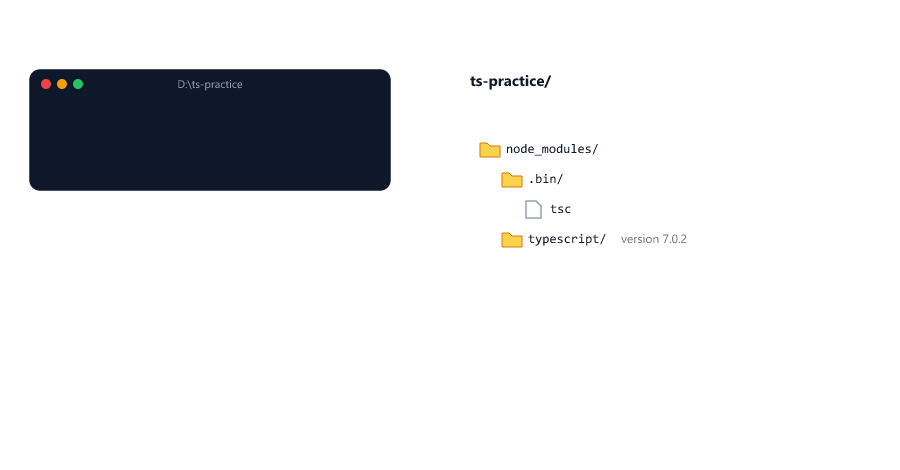
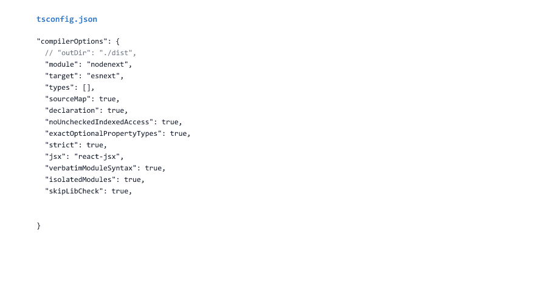
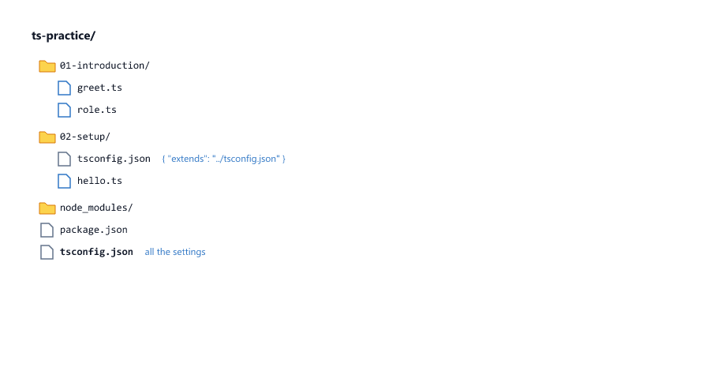
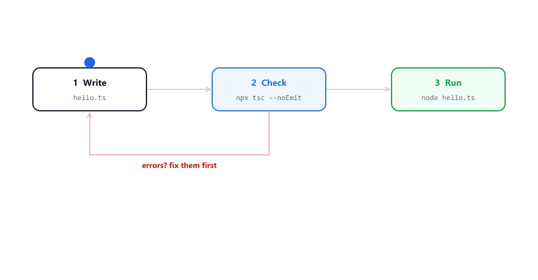
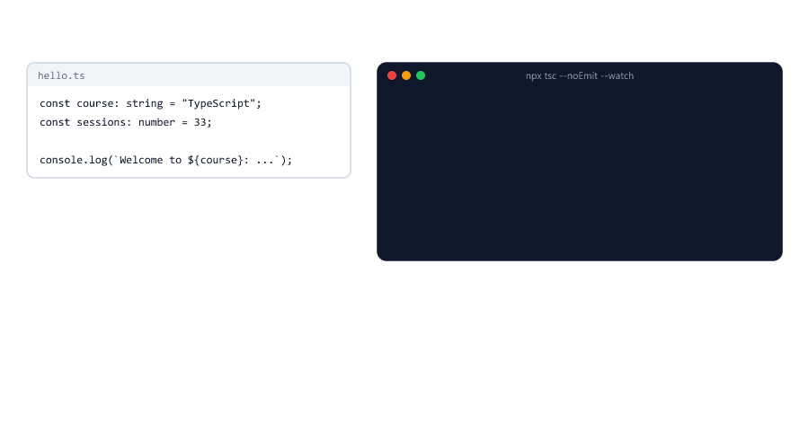

# Setup: Your First TypeScript Project

> **Session 2 of 33** | Part 1: Getting Started | [All sessions](README.md#course-outline)

## Table of Contents
- [What You Will Set Up](#what-you-will-set-up)
- [Check Node.js](#check-nodejs)
- [Create the Project](#create-the-project)
- [Switch to ES Modules](#switch-to-es-modules)
- [Install TypeScript](#install-typescript)
- [Create tsconfig.json](#create-tsconfigjson)
- [What the Settings Mean](#what-the-settings-mean)
- [Four Small Changes](#four-small-changes)
- [One Folder per Session](#one-folder-per-session)
- [Your First TypeScript File](#your-first-typescript-file)
- [Check, Then Run](#check-then-run)
- [Using Node.js Features](#using-nodejs-features)
- [Watch Mode](#watch-mode)
- [Building JavaScript with tsc](#building-javascript-with-tsc)
- [tsc Builds Even When There Are Errors](#tsc-builds-even-when-there-are-errors)
- [VS Code and TypeScript](#vs-code-and-typescript)
- [Mini Example 1: A Price Calculator in Two Files](#mini-example-1-a-price-calculator-in-two-files)
- [Mini Example 2: A Real Project with npm Scripts](#mini-example-2-a-real-project-with-npm-scripts)
- [Beginner Mistakes](#beginner-mistakes)
- [Practice Exercises](#practice-exercises)
- [Interview Questions](#interview-questions)

---

## What You Will Set Up

In this session you turn the `ts-practice` folder from Session 01 into a TypeScript project. You use it for the rest of the course.

| File or folder      | What it is                                                     |
| ------------------- | -------------------------------------------------------------- |
| `package.json`      | Describes the project and its packages (npm)                   |
| `node_modules/`     | The installed packages, including TypeScript                    |
| `tsconfig.json`     | The settings for TypeScript: how strict, where files go         |
| `02-setup/`         | One folder per session, with that session's files              |

At the end you will have two commands, and you will use them all the time

| Command              | What it does                                          |
| -------------------- | ----------------------------------------------------- |
| `npx tsc --noEmit`   | **Checks** the types. Runs nothing, writes nothing    |
| `node file.ts`       | **Runs** the file. Checks nothing                     |


---

## Check Node.js

```bash
node -v
```

```text
v24.19.0
```

You need Node.js 24 or newer: it runs `.ts` files without any extra setting, and it is the version this course was tested with. If you have an older version, install the LTS version from [nodejs.org](https://nodejs.org/) (JavaScript course, [Session 01](https://github.com/mohin-sheikh/javascript-basics-to-advanced/blob/main/01-introduction-to-javascript.md)).

---

## Create the Project

Open the `ts-practice` folder from Session 01 in VS Code, open the terminal (**Terminal > New Terminal**), and run

```bash
npm init -y
```

```text
Wrote to D:\ts-practice\package.json:

{
  "name": "ts-practice",
  "version": "1.0.0",
  "description": "",
  "main": "index.js",
  "scripts": {
    "test": "echo \"Error: no test specified\" && exit 1"
  },
  "keywords": [],
  "author": "",
  "license": "ISC",
  "type": "commonjs"
}
```

`npm init` creates `package.json`, the file that describes a Node.js project. `-y` answers "yes" to every question, so you get the default values.

Look at the last line: `"type": "commonjs"`. That is the old module system of Node.js (`require` and `module.exports`). The next step changes it.

---

## Switch to ES Modules

```bash
npm pkg set type=module
```

This prints nothing. It changes one line in `package.json`

```json
  "type": "module"
```

Now Node.js treats your files as **ES modules**: they use `import` and `export`, which you know from the JavaScript course ([Session 21](https://github.com/mohin-sheikh/javascript-basics-to-advanced/blob/main/21-modules.md)).

Why this matters for TypeScript: the settings that TypeScript 7 creates expect ES modules. With `"type": "commonjs"`, every `import` and `export` in your `.ts` files becomes an error ([Mistake 1](#mistake-1-forgetting-type-module)).

---

## Install TypeScript

```bash
npm install --save-dev typescript @types/node
```

```text
added 4 packages, and audited 5 packages in 3s

found 0 vulnerabilities
```

| Part             | Meaning                                                                |
| ---------------- | ---------------------------------------------------------------------- |
| `typescript`     | The TypeScript package. It contains the `tsc` command                  |
| `@types/node`    | The types of Node.js itself: `process`, `fs`, `path` and so on         |
| `--save-dev`     | A tool you need while writing the code, not while it runs. It goes into `devDependencies` |

`package.json` now has

```json
  "devDependencies": {
    "@types/node": "^26.6.5",
    "typescript": "^7.0.2"
  }
```

Check the version with `npx`

```bash
npx tsc -v
```

```text
Version 7.0.2
```

`npx` runs a command from the project's `node_modules`. You never install TypeScript globally: every project has its own version, written in its `package.json`, so everyone on the team uses the same one.



---

## Create tsconfig.json

```bash
npx tsc --init
```

```text
Created a new tsconfig.json

You can learn more at https://aka.ms/tsconfig
```

This is the file it creates, exactly

tsconfig.json

```json
{
  // Visit https://aka.ms/tsconfig to read more about this file
  "compilerOptions": {
    // File Layout
    // "rootDir": "./src",
    // "outDir": "./dist",

    // Environment Settings
    // See also https://aka.ms/tsconfig/module
    "module": "nodenext",
    "target": "esnext",
    "types": [],
    // For nodejs:
    // "lib": ["esnext"],
    // "types": ["node"],
    // and npm install -D @types/node

    // Other Outputs
    "sourceMap": true,
    "declaration": true,
    "declarationMap": true,

    // Stricter Typechecking Options
    "noUncheckedIndexedAccess": true,
    "exactOptionalPropertyTypes": true,

    // Style Options
    // "noImplicitReturns": true,
    // "noImplicitOverride": true,
    // "noUnusedLocals": true,
    // "noUnusedParameters": true,
    // "noFallthroughCasesInSwitch": true,
    // "noPropertyAccessFromIndexSignature": true,

    // Recommended Options
    "strict": true,
    "jsx": "react-jsx",
    "verbatimModuleSyntax": true,
    "isolatedModules": true,
    "noUncheckedSideEffectImports": true,
    "moduleDetection": "force",
    "skipLibCheck": true,
  }
}
```

`tsconfig.json` is a special kind of JSON: it allows comments (`//`) and a comma after the last item. Normal JSON files do not ([Session 19](https://github.com/mohin-sheikh/javascript-basics-to-advanced/blob/main/19-json-and-dates.md) of the JavaScript course).

Lines that start with `//` are switched off. The others are on.

---

## What the Settings Mean

You do not need to understand every setting today. Each one is explained in the session where it matters. This table is your map

| Setting                         | In short                                                         | Session |
| ------------------------------- | ---------------------------------------------------------------- | ------- |
| `rootDir`, `outDir`             | Where your `.ts` files are, and where the built `.js` files go   | 02      |
| `module: "nodenext"`            | Follow Node.js's own rules for `import` and `export`             | 24      |
| `target: "esnext"`              | Write the newest JavaScript; do not convert it to old syntax     | 27      |
| `types`                         | Which global types to load. `[]` means none, so `process` is unknown | 02, 25 |
| `sourceMap`                     | Also write `.js.map` files that point from the JavaScript back to your `.ts` lines | 02, 29 |
| `declaration`, `declarationMap` | Also write `.d.ts` files that describe the types of your code     | 02, 25  |
| `noUncheckedIndexedAccess`      | `list[0]` might be `undefined`, so TypeScript makes you check it  | 06      |
| `exactOptionalPropertyTypes`    | An optional property means "may be missing", not "may be `undefined`" | 07, 11 |
| `strict`                        | The most important group of checks. Always on                    | 04, 27  |
| `jsx`                           | For React components. Not used in this course                    | -       |
| `verbatimModuleSyntax`          | Imports stay exactly as you wrote them; type-only imports must say so | 24 |
| `isolatedModules`               | Every file must make sense on its own, as Node.js reads one file at a time | 24 |
| `noUncheckedSideEffectImports`  | Also check that `import "./setup.ts"` points to a real file       | 24      |
| `moduleDetection: "force"`      | Every file is a module, even without `import` or `export`         | 24      |
| `skipLibCheck`                  | Do not check the `.d.ts` files of installed packages: faster      | 25      |



TypeScript 5.9 and newer create this same strict file. Older tutorials show a much longer file with different defaults (Session 27 compares them).

---

## Four Small Changes

Change four things in `tsconfig.json`

| # | Change                                              | Why                                                          |
| - | --------------------------------------------------- | ------------------------------------------------------------ |
| 1 | Remove `//` before `"outDir": "./dist"`             | Built files go into a `dist` folder, not next to your code   |
| 2 | `"types": []` becomes `"types": ["node"]`           | Load the Node.js types from `@types/node`, so `process` and friends are known |
| 3 | Delete the line `"jsx": "react-jsx",`               | We do not write React                                         |
| 4 | Add `"erasableSyntaxOnly": true,` and `"rewriteRelativeImportExtensions": true,` | Warn about code that `node` cannot run ([Session 01, Mistake 4](01-introduction-to-typescript.md#mistake-4-using-enum-with-node)), and allow imports like `"./tax.ts"` ([Mini Example 1](#mini-example-1-a-price-calculator-in-two-files)) |

The finished file

tsconfig.json

```json
{
  // Visit https://aka.ms/tsconfig to read more about this file
  "compilerOptions": {
    // File Layout
    // "rootDir": "./src",
    "outDir": "./dist",

    // Environment Settings
    // See also https://aka.ms/tsconfig/module
    "module": "nodenext",
    "target": "esnext",
    "types": ["node"],
    // For nodejs:
    // "lib": ["esnext"],
    // "types": ["node"],
    // and npm install -D @types/node

    // Other Outputs
    "sourceMap": true,
    "declaration": true,
    "declarationMap": true,

    // Stricter Typechecking Options
    "noUncheckedIndexedAccess": true,
    "exactOptionalPropertyTypes": true,

    // Style Options
    // "noImplicitReturns": true,
    // "noImplicitOverride": true,
    // "noUnusedLocals": true,
    // "noUnusedParameters": true,
    // "noFallthroughCasesInSwitch": true,
    // "noPropertyAccessFromIndexSignature": true,

    // Recommended Options
    "strict": true,
    "verbatimModuleSyntax": true,
    "isolatedModules": true,
    "noUncheckedSideEffectImports": true,
    "moduleDetection": "force",
    "skipLibCheck": true,
    "erasableSyntaxOnly": true,
    "rewriteRelativeImportExtensions": true,
  }
}
```

That is the whole setup. Every session from now on uses this file.

---

## One Folder per Session

`npx tsc` checks **every** `.ts` file in the folder and its subfolders. In a practice folder that is a problem: the mistakes you try on purpose in one session would show up as errors in every later session.

So every session gets its own folder, with a tiny `tsconfig.json` of its own

02-setup/tsconfig.json

```json
{
  "extends": "../tsconfig.json"
}
```

`extends` means: use all the settings of `../tsconfig.json` (the one in `ts-practice`), but only for the files in this folder. You change settings in one place, and every session folder follows.

Also move the files from Session 01 into a folder `01-introduction`. Your project now looks like this

```text
ts-practice/
├── 01-introduction/
│   ├── greet.js
│   ├── greet.ts
│   └── role.ts
├── 02-setup/
│   └── tsconfig.json
├── node_modules/
├── package-lock.json
├── package.json
└── tsconfig.json
```

Run `npx tsc` **inside the session folder**: `cd 02-setup` in the terminal first. For every new session, make a new folder (`03-basic-types`, `04-...`) and copy this small `tsconfig.json` into it.



---

## Your First TypeScript File

02-setup/hello.ts

```typescript
const course: string = "TypeScript";
const sessions: number = 33;

console.log(`Welcome to ${course}: ${sessions} sessions`);
```

Check it

```bash
cd 02-setup
npx tsc --noEmit
```

No output. **No output means no errors.** `--noEmit` means: check only, do not write any files.

Run it

```bash
node hello.ts
```

```text
Welcome to TypeScript: 33 sessions
```

---

## Check, Then Run

Now make a mistake on purpose. Change the second line to a text

hello.ts

```typescript
const course: string = "TypeScript";
const sessions: number = "33";

console.log(`Welcome to ${course}: ${sessions} sessions`);
```

```bash
npx tsc --noEmit
```

```text
hello.ts:2:7 - error TS2322: Type 'string' is not assignable to type 'number'.

2 const sessions: number = "33";
        ~~~~~~~~


Found 1 error in hello.ts:2
```

`sessions` was declared as a `number`, and `"33"` is a `string`. "Not assignable to" means "cannot be stored in".

And `node`?

```bash
node hello.ts
```

```text
Welcome to TypeScript: 33 sessions
```

It runs as if nothing were wrong. Node.js removes the types and never looks at them (Session 01).



This is the habit for the whole course

1. Write the code
2. `npx tsc --noEmit` and fix every error
3. `node file.ts`

Change `"33"` back to `33` before you continue.

---

## Using Node.js Features

`@types/node` and `"types": ["node"]` tell TypeScript what Node.js has built in

02-setup/node-info.ts

```typescript
console.log("Node.js version:", process.version);
console.log("Folder:", process.cwd());
```

`npx tsc --noEmit` finds no errors, and

```bash
node node-info.ts
```

```text
Node.js version: v24.19.0
Folder: D:\ts-practice\02-setup
```

Without the Node.js types, TypeScript does not know `process` at all ([Mistake 5](#mistake-5-cannot-find-name-process)). Point at `process.version` in VS Code: it shows `string`. That information comes from `@types/node`.

---

## Watch Mode

Running `npx tsc --noEmit` after every change gets tiring. In watch mode, `tsc` keeps running and checks again every time you save a file

```bash
npx tsc --noEmit --watch
```

```text
[07:41:14 PM] Starting compilation in watch mode...

[07:41:14 PM] Found 0 errors. Watching for file changes.
```

Now change `33` to `"33"` in hello.ts and save. The screen is cleared and you see

```text
[07:41:17 PM] File change detected. Starting incremental compilation...

hello.ts:2:7 - error TS2322: Type 'string' is not assignable to type 'number'.

2 const sessions: number = "33";
        ~~~~~~~~


Found 1 error in hello.ts:2

[07:41:17 PM] Found 1 error. Watching for file changes.
```

Fix it, save again

```text
[07:41:20 PM] File change detected. Starting incremental compilation...

[07:41:20 PM] Found 0 errors. Watching for file changes.
```

Stop watch mode with **Ctrl+C**. On Windows you may see the same check twice after one save; that is normal.



A good way to work: watch mode in one terminal, and a second terminal (the **+** in the VS Code terminal panel) to run your files with `node`.

---

## Building JavaScript with tsc

Without `--noEmit`, `tsc` also **builds**: it writes JavaScript files into `outDir`

```bash
npx tsc
```

No output: no errors. But there is a new folder, `ts-practice/dist`

```text
ts-practice/
├── 02-setup/
│   ├── hello.ts
│   ├── node-info.ts
│   └── tsconfig.json
└── dist/
    ├── hello.d.ts
    ├── hello.d.ts.map
    ├── hello.js
    ├── hello.js.map
    └── ...
```

dist/hello.js

```javascript
const course = "TypeScript";
const sessions = 33;
console.log(`Welcome to ${course}: ${sessions} sessions`);
export {};
//# sourceMappingURL=hello.js.map
```

| File            | What it is                                                                |
| --------------- | ------------------------------------------------------------------------- |
| `hello.js`      | Your code without the types: the file that really runs                    |
| `hello.js.map`  | A **source map**: it connects every line of `hello.js` to the line in `hello.ts`, so error messages and the debugger can show your `.ts` lines (Session 29) |
| `hello.d.ts`    | A **declaration file**: it describes what this file exports and their types (Session 25). `hello.ts` exports nothing, so it only contains `export {};` |
| `hello.d.ts.map` | Connects the `.d.ts` file back to `hello.ts`                             |

`export {};` marks the file as an ES module (the `moduleDetection` setting). Run the built file like any JavaScript file

```bash
node ../dist/hello.js
```

```text
Welcome to TypeScript: 33 sessions
```


When do you need a build, if `node` can run `.ts` files directly?

| Situation                                          | Use                       |
| -------------------------------------------------- | ------------------------- |
| Practising and writing code                        | `node file.ts`            |
| Code with `enum` or other syntax Node.js cannot strip | A build with `tsc` (Session 16) |
| A server in production, a package for others       | A build (Session 30)      |

---

## tsc Builds Even When There Are Errors

Make the `"33"` mistake again and build

```bash
npx tsc
```

```text
hello.ts:2:7 - error TS2322: Type 'string' is not assignable to type 'number'.

2 const sessions: number = "33";
        ~~~~~~~~


Found 1 error in hello.ts:2
```

The error is reported, but `dist/hello.js` was **still written**. TypeScript assumes you might want the JavaScript anyway. The command tells you that something went wrong with its **exit code**: 0 means success, anything else means failure. Here it is 2.

For real projects, turn this off with one more setting

```json
    "noEmitOnError": true,
```

With it, `tsc` writes no files when there is an error (exit code 1). A broken build can then never reach a server by accident. [Mini Example 2](#mini-example-2-a-real-project-with-npm-scripts) uses it.


---

## VS Code and TypeScript

VS Code has TypeScript built in. You do not need an extension.

| What                         | How                                                            |
| ---------------------------- | -------------------------------------------------------------- |
| Red underline                | A type error, while you type. Point at it to read the message  |
| All errors in the project    | **View > Problems** (Ctrl+Shift+M)                             |
| The type of anything         | Point at it with the mouse                                     |
| Quick fix                    | Click the error, then **Ctrl+.**                               |
| Rename everywhere            | Click a name, then **F2**                                      |
| Go to definition             | **F12**, or Ctrl+click                                         |

VS Code uses its own copy of TypeScript for these hints, and it may be a different version from the one in your project. When VS Code and `npx tsc` disagree, `npx tsc` is right: it uses the version in your `package.json`, the same one your teammates and your server use.

---

## Mini Example 1: A Price Calculator in Two Files

Real code is split into files (JavaScript course, [Session 21](https://github.com/mohin-sheikh/javascript-basics-to-advanced/blob/main/21-modules.md)). The import works as in JavaScript, with one rule: **import the `.ts` file**.

02-setup/tax.ts

```typescript
// GST in India is a percentage of the price
export function addTax(pricePaise: number, ratePercent: number): number {
  return Math.round(pricePaise * (1 + ratePercent / 100));
}

export function formatRupees(paise: number): string {
  return `Rs. ${(paise / 100).toFixed(2)}`;
}
```

02-setup/app.ts

```typescript
import { addTax, formatRupees } from "./tax.ts";

const keyboard = 149900; // Rs. 1499 in paise
const withTax = addTax(keyboard, 18);

console.log("Price:", formatRupees(keyboard));
console.log("With 18% GST:", formatRupees(withTax));
```

`npx tsc --noEmit` finds no errors, and

```bash
node app.ts
```

```text
Price: Rs. 1499.00
With 18% GST: Rs. 1768.82
```

Node.js runs `app.ts`, sees `import ... from "./tax.ts"` and runs `tax.ts` too. Now build

```bash
npx tsc
```

dist/app.js

```javascript
import { addTax, formatRupees } from "./tax.js";
const keyboard = 149900; // Rs. 1499 in paise
const withTax = addTax(keyboard, 18);
console.log("Price:", formatRupees(keyboard));
console.log("With 18% GST:", formatRupees(withTax));
//# sourceMappingURL=app.js.map
```

The import now says `./tax.js`: in `dist` there is no `tax.ts`, only `tax.js`. That rewrite is what `rewriteRelativeImportExtensions` does. So the same code works both ways

| How you run it          | The import reads | And finds        |
| ----------------------- | ---------------- | ---------------- |
| `node app.ts`           | `"./tax.ts"`     | `02-setup/tax.ts` |
| `node ../dist/app.js`   | `"./tax.js"`     | `dist/tax.js`    |

```bash
node ../dist/app.js
```

```text
Price: Rs. 1499.00
With 18% GST: Rs. 1768.82
```


The build also wrote `dist/tax.d.ts`, the declaration file of `tax.ts`. It contains only the types, without the code

```typescript
export declare function addTax(pricePaise: number, ratePercent: number): number;
export declare function formatRupees(paise: number): string;
//# sourceMappingURL=tax.d.ts.map
```

Many tutorials write `import ... from "./tax.js"` in `.ts` files. That style needs a build before every run, and `node app.ts` cannot use it ([Mistake 7](#mistake-7-importing-taxjs-from-a-ts-file)).

---

## Mini Example 2: A Real Project with npm Scripts

A real project keeps its code in `src/`, builds into `dist/`, and has **npm scripts** for the commands, so nobody has to remember them. Make a new folder `price-service` **next to** `ts-practice` (not inside it) and set it up as in this session

```bash
npm init -y
npm pkg set type=module
npm install --save-dev typescript @types/node
npx tsc --init
```

Make the same four changes in `tsconfig.json`, plus two more

```json
    "rootDir": "./src",
```

(remove the `//` before it), and below `"rewriteRelativeImportExtensions": true,`

```json
    "noEmitOnError": true,
```

`rootDir` says where the code lives, so `src/index.ts` is built to `dist/index.js`.

Copy `tax.ts` from Mini Example 1 into `src/`, and create

src/index.ts

```typescript
import { addTax, formatRupees } from "./tax.ts";

type Product = {
  name: string;
  pricePaise: number;
};

const products: Product[] = [
  { name: "Keyboard", pricePaise: 149900 },
  { name: "Mouse", pricePaise: 49900 }
];

for (const product of products) {
  console.log(`${product.name}: ${formatRupees(addTax(product.pricePaise, 18))} with GST`);
}
```

Now the scripts. In `package.json`, replace the `"scripts"` part with

```json
  "scripts": {
    "check": "tsc --noEmit",
    "build": "tsc",
    "start": "node dist/index.js",
    "dev": "node --watch src/index.ts"
  },
```

| Script            | Command                       | When                                       |
| ----------------- | ----------------------------- | ------------------------------------------ |
| `npm run check`   | `tsc --noEmit`                | Before every commit: are there type errors? |
| `npm run build`   | `tsc`                         | Make the JavaScript for production         |
| `npm start`       | `node dist/index.js`          | Run the built code, like a server would    |
| `npm run dev`     | `node --watch src/index.ts`   | While you work: run again on every save    |

Try them

```bash
npm run check
```

```text
> price-service@1.0.0 check
> tsc --noEmit
```

```bash
npm run build
npm start
```

```text
> price-service@1.0.0 build
> tsc


> price-service@1.0.0 start
> node dist/index.js

Keyboard: Rs. 1768.82 with GST
Mouse: Rs. 588.82 with GST
```

(`npm start` works without `run`. Other scripts need `npm run`.)

```bash
npm run dev
```

```text
> price-service@1.0.0 dev
> node --watch src/index.ts

Keyboard: Rs. 1768.82 with GST
Mouse: Rs. 588.82 with GST
Completed running 'src/index.ts'. Waiting for file changes before restarting...
```

Change the GST rate in `src/index.ts` from 18 to 5 (and the text to "with 5% GST"), save, and the program runs again by itself

```text
Change detected in 'D:\\price-service\\src\\index.ts'
Restarting 'src/index.ts'
Keyboard: Rs. 1573.95 with 5% GST
Mouse: Rs. 523.95 with 5% GST
Completed running 'src/index.ts'. Waiting for file changes before restarting...
```

Stop it with **Ctrl+C**. Remember: `npm run dev` runs, it does not check. Keep `npx tsc --noEmit --watch` open in a second terminal while you work.


Last, a `.gitignore` file in `price-service`, so git skips what can be made again

.gitignore

```text
node_modules/
dist/
```

`npm install` brings `node_modules` back, and `npm run build` brings `dist` back.

---

## Beginner Mistakes

### Mistake 1: Forgetting "type": "module"

With `"type": "commonjs"` in `package.json`, Mini Example 1 gives

```bash
npx tsc --noEmit
```

```text
app.ts:1:10 - error TS1295: ECMAScript imports and exports cannot be written in a CommonJS file under 'verbatimModuleSyntax'. Adjust the 'type' field in the nearest 'package.json' to make this file an ECMAScript module, or adjust your 'verbatimModuleSyntax', 'module', and 'moduleResolution' settings in TypeScript.

1 import { addTax, formatRupees } from "./tax.ts";
           ~~~~~~

app.ts:1:18 - error TS1295: ECMAScript imports and exports cannot be written in a CommonJS file under 'verbatimModuleSyntax'. Adjust the 'type' field in the nearest 'package.json' to make this file an ECMAScript module, or adjust your 'verbatimModuleSyntax', 'module', and 'moduleResolution' settings in TypeScript.

1 import { addTax, formatRupees } from "./tax.ts";
                   ~~~~~~~~~~~~

tax.ts:2:1 - error TS1287: A top-level 'export' modifier cannot be used on value declarations in a CommonJS module when 'verbatimModuleSyntax' is enabled.

2 export function addTax(pricePaise: number, ratePercent: number): number {
  ~~~~~~

tax.ts:6:1 - error TS1287: A top-level 'export' modifier cannot be used on value declarations in a CommonJS module when 'verbatimModuleSyntax' is enabled.

6 export function formatRupees(paise: number): string {
  ~~~~~~


Found 4 errors in 2 files.

Errors  Files
     2  app.ts:1
     2  tax.ts:2
```

and Node.js refuses to run it

```text
(node:15904) Warning: Failed to load the ES module: D:\ts-practice\02-setup\app.ts. Make sure to set "type": "module" in the nearest package.json file or use the .mjs extension.
(Use `node --trace-warnings ...` to show where the warning was created)
D:\ts-practice\02-setup\app.ts:1
import { addTax, formatRupees } from "./tax.ts";
^^^^^^

SyntaxError: Cannot use import statement outside a module
    at wrapSafe (node:internal/modules/cjs/loader:1804:18)
    at Module._compile (node:internal/modules/cjs/loader:1846:20)
    at Object..js (node:internal/modules/cjs/loader:2003:10)
    at Module.load (node:internal/modules/cjs/loader:1594:32)
    at Module._load (node:internal/modules/cjs/loader:1396:12)
    at wrapModuleLoad (node:internal/modules/cjs/loader:255:19)
    at Module.executeUserEntryPoint [as runMain] (node:internal/modules/run_main:154:5)
    at node:internal/main/run_main_module:33:47

Node.js v24.19.0
```

Both messages say the same thing: set `"type": "module"` in `package.json` (`npm pkg set type=module`).

---

### Mistake 2: Giving tsc a file name

```bash
npx tsc hello.ts
```

```text
error TS5112: tsconfig.json is present but will not be loaded if files are specified on commandline. Use '--ignoreConfig' to skip this error.
```

With a file name, `tsc` would ignore your `tsconfig.json` and its settings. Do not use `--ignoreConfig`: run `npx tsc --noEmit` without a file name, inside the session folder.

---

### Mistake 3: Running tsc in the wrong folder

In `ts-practice` itself, instead of `02-setup`

```text
01-introduction/greet.ts:6:19 - error TS2345: Argument of type 'number' is not assignable to parameter of type 'string'.

6 console.log(greet(42));
                    ~~

01-introduction/role.ts:1:6 - error TS1294: This syntax is not allowed when 'erasableSyntaxOnly' is enabled.

1 enum Role {
       ~~~~


Found 2 errors in 2 files.

Errors  Files
     1  01-introduction/greet.ts:6
     1  01-introduction/role.ts:1
```

These are the mistakes from Session 01, not from today. The main `tsconfig.json` checks every folder. `cd` into the session folder first.

---

### Mistake 4: Forgetting the session's tsconfig.json

A session folder without its own `tsconfig.json` has the same problem: `tsc` walks up to `ts-practice/tsconfig.json` and checks every session. You recognise it by paths like `../01-introduction/greet.ts` in the errors. Copy the one-line `tsconfig.json` into every new session folder.

---

### Mistake 5: Cannot find name 'process'

With `"types": []` (the setting you changed in step 2), node-info.ts gives

```text
node-info.ts:1:33 - error TS2591: Cannot find name 'process'. Do you need to install type definitions for node? Try `npm i --save-dev @types/node` and then add 'node' to the types field in your tsconfig.

1 console.log("Node.js version:", process.version);
                                  ~~~~~~~

node-info.ts:2:24 - error TS2591: Cannot find name 'process'. Do you need to install type definitions for node? Try `npm i --save-dev @types/node` and then add 'node' to the types field in your tsconfig.

2 console.log("Folder:", process.cwd());
                         ~~~~~~~


Found 2 errors in the same file, starting at: node-info.ts:1
```

The message already says the fix: install `@types/node`, and use `"types": ["node"]`.

---

### Mistake 6: Importing without a file extension

app.ts

```typescript
import { addTax, formatRupees } from "./tax";
```

```text
app.ts:1:38 - error TS2835: Relative import paths need explicit file extensions in ECMAScript imports when '--moduleResolution' is 'node16' or 'nodenext'. Did you mean './tax.js'?

1 import { addTax, formatRupees } from "./tax";
                                       ~~~~~~~


Found 1 error in app.ts:1
```

and `node app.ts` fails with `ERR_MODULE_NOT_FOUND`. ES modules in Node.js need the full file name. In this course that is `"./tax.ts"`. The message suggests `./tax.js` because that is the older style, see the next mistake.

---

### Mistake 7: Importing "./tax.js" from a .ts file

app.ts

```typescript
import { addTax, formatRupees } from "./tax.js";
```

`npx tsc --noEmit` finds **no error**: TypeScript knows that `tax.js` will be built from `tax.ts`. But there is no `tax.js` in `02-setup`, so

```bash
node app.ts
```

```text
node:internal/modules/esm/resolve:271
    throw new ERR_MODULE_NOT_FOUND(
          ^

Error [ERR_MODULE_NOT_FOUND]: Cannot find module 'D:\ts-practice\02-setup\tax.js' imported from D:\ts-practice\02-setup\app.ts
    at finalizeResolution (node:internal/modules/esm/resolve:271:11)
    at moduleResolve (node:internal/modules/esm/resolve:865:10)
    at defaultResolve (node:internal/modules/esm/resolve:992:11)
    at #cachedDefaultResolve (node:internal/modules/esm/loader:701:20)
    at #resolveAndMaybeBlockOnLoaderThread (node:internal/modules/esm/loader:721:38)
    at ModuleLoader.resolveSync (node:internal/modules/esm/loader:759:56)
    at #resolve (node:internal/modules/esm/loader:683:17)
    at ModuleLoader.getOrCreateModuleJob (node:internal/modules/esm/loader:603:35)
    at ModuleJob.syncLink (node:internal/modules/esm/module_job:163:33)
    at ModuleJob.link (node:internal/modules/esm/module_job:253:17) {
  code: 'ERR_MODULE_NOT_FOUND',
  url: 'file:///D:/ts-practice/02-setup/tax.js'
}

Node.js v24.19.0
```

You will see `.js` imports in `.ts` files in many projects and tutorials: they only work after a build. With our setup, write `"./tax.ts"`.

---

### Mistake 8: A typo in tsconfig.json

```json
  "compilerOptions": {
    "strct": true
  }
```

```text
tsconfig.json:4:5 - error TS5023: Unknown compiler option 'strct'.

4     "strct": true
      ~~~~~~~


Found 1 error in tsconfig.json:4
```

`tsc` checks its own settings file too. Read the name in the message and compare it with the [table above](#what-the-settings-mean).

---

### Mistake 9: Running an old build

`node ../dist/hello.js` runs the JavaScript from the **last build**. If you changed `hello.ts` after that, `dist/hello.js` still has the old code. Run `npx tsc` again, or simply run the `.ts` file with `node` while you practise.

---

### Mistake 10: Ignoring the errors of a build

`npx tsc` wrote `dist/hello.js` although there was an error. Deploying that file would deploy the bug. Use `"noEmitOnError": true` in real projects, and stop when a command does not exit with 0.

---

### Mistake 11: Committing node_modules and dist

`node_modules` can be hundreds of megabytes and is made again by `npm install`. `dist` is made again by `npm run build`. Add both to `.gitignore`, as in Mini Example 2.

---

## Practice Exercises

### Exercise 1

Set up `ts-practice` exactly as in this session. Check that `npx tsc -v` prints a 7.x version and that `package.json` has `"type": "module"`

### Exercise 2

Move the Session 01 files into `01-introduction`. Run `npx tsc --noEmit` in `ts-practice` and then in `02-setup`. Explain why the results are different

### Exercise 3

Create `02-setup/hello.ts`, check it and run it. Then break it in two ways, one at a time: store `"33"` in `sessions`, and misspell `course` as `cours` in the `console.log`. Read each error message before you fix it

### Exercise 4

Start `npx tsc --noEmit --watch` in one terminal. In another, run `node hello.ts`. Break and fix the file a few times and watch both terminals

### Exercise 5

Run `npx tsc` and open every file in `dist`. Which parts of your `.ts` files are missing in the `.js` files? What is in the `.d.ts` files?

### Exercise 6

In Mini Example 1, add a function `discount(pricePaise: number, percent: number): number` to `tax.ts`, and use it in `app.ts` to print the price with a 10% discount. Check, run, build, and run the built file

### Exercise 7

In `price-service`, add a script `"check:watch": "tsc --noEmit --watch"`. Run `npm run dev` in one terminal and `npm run check:watch` in another, and make a type error in `src/index.ts`. Which terminal tells you about it?

### Exercise 8

Add `"noEmitOnError": true` to `ts-practice/tsconfig.json`. Delete the `dist` folder, make a type error in `hello.ts`, and run `npx tsc`. Is `dist/hello.js` created?

---

## Interview Questions

### What is tsconfig.json?

The settings file of a TypeScript project. It says which files to check, how strict the checks are, and where and how to write the JavaScript.

### What does tsc --noEmit do?

It checks the types and writes no files. It is the usual way to check a project when another tool runs the code.

### Why is TypeScript installed as a devDependency?

It is only needed while writing and building the code. The program that runs is JavaScript, so production does not need TypeScript.

### Why use npx tsc instead of a global tsc?

`npx` runs the version installed in the project, written in `package.json`. Everyone on the team and the build server then use the same version.

### What is @types/node?

A package with the type definitions of Node.js: `process`, `Buffer`, `fs`, `path` and the rest. Node.js itself is written without TypeScript types, so they come from this separate package.

### What is the difference between node file.ts and tsc?

`node file.ts` removes the types and runs the code without checking them. `tsc` checks the types and can write JavaScript files, but runs nothing.

### What does "type": "module" in package.json do?

It makes Node.js treat `.js` and `.ts` files as ES modules, which use `import` and `export`. Without it, Node.js uses CommonJS (`require`).

### What are outDir and rootDir?

`outDir` is the folder where `tsc` writes the built files. `rootDir` is the folder that contains the source files; the folder structure inside it is copied into `outDir`.

### What is a source map?

A `.js.map` file that connects each line of the built JavaScript to the line in the TypeScript file, so errors and the debugger can show your original code.

### What is a declaration file?

A `.d.ts` file that describes the types of a module without its code. Other TypeScript code and editors use it to know what the module exports.

### Does tsc write JavaScript when there are type errors?

Yes, by default. It reports the errors and exits with a non-zero code, but writes the files. `noEmitOnError: true` stops it from writing anything when there is an error.

### What does tsc --watch do?

It keeps running and checks (or builds) again every time a file is saved.

### Why import "./tax.ts" and not "./tax.js"?

So that `node` can run the `.ts` files directly. The setting `rewriteRelativeImportExtensions` changes the import to `"./tax.js"` in the built files, where only `.js` files exist.

### What does extends do in tsconfig.json?

It loads the settings of another `tsconfig.json`. The new file can add or change settings, and by default it applies to the files in its own folder.

---

| Previous | All sessions | Next |
| :--- | :---: | ---: |
| [01. Introduction to TypeScript](01-introduction-to-typescript.md) | [Course outline](README.md#course-outline) | [03. Basic Types and Type Inference](03-basic-types-and-inference.md) |
