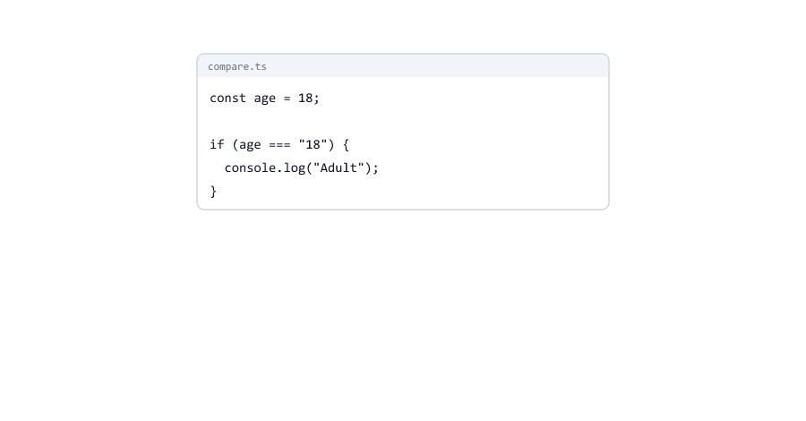

# Basic Types and Type Inference

> **Session 3 of 33** | Part 1: Getting Started | [All sessions](README.md#course-outline)

## Table of Contents
- [Your Folder for This Session](#your-folder-for-this-session)
- [Type Annotations](#type-annotations)
- [The Primitive Types](#the-primitive-types)
- [One Type for All Numbers](#one-type-for-all-numbers)
- [bigint and symbol](#bigint-and-symbol)
- [null and undefined](#null-and-undefined)
- [A Variable Keeps Its Type](#a-variable-keeps-its-type)
- [Type Inference: TypeScript Finds the Type](#type-inference-typescript-finds-the-type)
- [See the Type in VS Code](#see-the-type-in-vs-code)
- [let and const: Wide and Exact Types](#let-and-const-wide-and-exact-types)
- [Variables Without a Value](#variables-without-a-value)
- [Parameters Need a Type](#parameters-need-a-type)
- [Return Types Are Inferred Too](#return-types-are-inferred-too)
- [Text Is Not a Number](#text-is-not-a-number)
- [Comparing Different Types](#comparing-different-types)
- [Lowercase Types: string, Not String](#lowercase-types-string-not-string)
- [Types Do Not Exist at Run Time](#types-do-not-exist-at-run-time)
- [When to Write a Type](#when-to-write-a-type)
- [Mini Example 1: An Order Summary](#mini-example-1-an-order-summary)
- [Mini Example 2: Numbers from a URL](#mini-example-2-numbers-from-a-url)
- [Beginner Mistakes](#beginner-mistakes)
- [Practice Exercises](#practice-exercises)
- [Interview Questions](#interview-questions)

---

## Your Folder for This Session

Inside `ts-practice`, make a folder `03-basic-types` and copy the one-line `tsconfig.json` from Session 02 into it

03-basic-types/tsconfig.json

```json
{
  "extends": "../tsconfig.json"
}
```

Open a terminal in it (`cd 03-basic-types`). For every example: `npx tsc --noEmit` to check, `node file.ts` to run.

---

## Type Annotations

A **type annotation** tells TypeScript what kind of value a variable holds. It goes after the name, with a colon

annotations.ts

```typescript
let customerName: string = "Riya";
let ageYears: number = 25;
let isMember: boolean = true;

console.log(customerName, ageYears, isMember);
```

```bash
npx tsc --noEmit
node annotations.ts
```

```text
Riya 25 true
```


| Part           | Meaning                                                  |
| -------------- | -------------------------------------------------------- |
| `let`          | The JavaScript keyword you already know                  |
| `ageYears`     | The name                                                 |
| `: number`     | The annotation: this variable holds numbers              |
| `= 25`         | The value, exactly as in JavaScript                      |

Read `let ageYears: number = 25` as "a variable `ageYears` **of type** `number`, starting at 25".

---

## The Primitive Types

JavaScript has seven primitive types (JavaScript course, [Session 03](https://github.com/mohin-sheikh/javascript-basics-to-advanced/blob/main/03-data-types.md)). TypeScript has a type for each, with the same name that `typeof` gives you

primitives.ts

```typescript
const productName: string = "Keyboard";
const pricePaise: number = 149900;
const inStock: boolean = true;
const pageViews: bigint = 9007199254740993n;
const requestId: symbol = Symbol("request");
const discount: null = null;
const coupon: undefined = undefined;

console.log(productName, pricePaise, inStock, pageViews, requestId, discount, coupon);
```

```text
Keyboard 149900 true 9007199254740993n Symbol(request) null undefined
```

| Type         | Values                              | Used for                                   |
| ------------ | ----------------------------------- | ------------------------------------------ |
| `string`     | `"Riya"`, `'Pune'`, `` `Hi ${name}` `` | Any text                                 |
| `number`     | `25`, `4.5`, `-3`, `NaN`, `Infinity` | Every kind of number                       |
| `boolean`    | `true`, `false`                     | Yes or no                                  |
| `bigint`     | `10n`, `9007199254740993n`          | Whole numbers too big for `number`         |
| `symbol`     | `Symbol("id")`                      | Unique keys (rare in everyday code)        |
| `null`       | `null`                              | "No value", on purpose                     |
| `undefined`  | `undefined`                         | "Not set yet"                              |


The type names are all **lowercase**. `String` with a capital S means something else ([below](#lowercase-types-string-not-string)).

---

## One Type for All Numbers

TypeScript has no separate type for whole numbers and decimals. `25`, `4.5`, `-3`, `NaN` and `Infinity` are all `number`, exactly like in JavaScript.

That means TypeScript cannot stop `0.1 + 0.2` from being `0.30000000000000004`, or a price from having half a paisa. Keep using the rules from the JavaScript course ([Session 09](https://github.com/mohin-sheikh/javascript-basics-to-advanced/blob/main/09-numbers-and-math.md)): money in paise, whole numbers, `Math.round` after percentages.

---

## bigint and symbol

You will rarely write these two, but you should recognise them.

`bigint` is for whole numbers bigger than `Number.MAX_SAFE_INTEGER` (9007199254740991), for example very large ids from some databases. A `bigint` value ends with `n`, and it **cannot be mixed** with `number` ([Mistake 7](#mistake-7-mixing-bigint-and-number)).

`symbol` is a value that is guaranteed to be unique. Libraries use symbols as hidden object keys. In application code you almost never need them.

---

## null and undefined

`null` and `undefined` are types too. On their own they are not very useful: a variable of type `null` can only ever be `null`.

What matters is the rule TypeScript follows because of `strict: true`: **`null` and `undefined` do not fit into other types**

null-assign.ts

```typescript
let couponCode: string = null;
```

```text
null-assign.ts:1:5 - error TS2322: Type 'null' is not assignable to type 'string'.

1 let couponCode: string = null;
      ~~~~~~~~~~


Found 1 error in null-assign.ts:1
```

In JavaScript, "Cannot read properties of null" is one of the most common crashes. Because `string` can never be `null`, TypeScript knows that a `string` variable is always safe to use. When a value really can be missing, you say so with a union type like `string | null` (Sessions 09 and 11).

---

## A Variable Keeps Its Type

In JavaScript a variable can hold a number now and a text later. In TypeScript, a variable keeps the type it was given

wrong-type.ts

```typescript
let ageYears: number = 25;
ageYears = "twenty-six";
```

```text
wrong-type.ts:2:1 - error TS2322: Type 'string' is not assignable to type 'number'.

2 ageYears = "twenty-six";
  ~~~~~~~~


Found 1 error in wrong-type.ts:2
```

"Not assignable to" means "cannot be stored in". You can still change the **value** (`ageYears = 26` is fine), but not the **type**.


This is what makes TypeScript useful: every line that reads `ageYears` can trust that it is a number.

---

## Type Inference: TypeScript Finds the Type

You do not have to write a type everywhere. When a variable gets a value, TypeScript looks at the value and works out the type itself. This is called **type inference**

inference.ts

```typescript
let city = "Pune";          // TypeScript sees a text: string
let orders = 12;            // a number: number
let isOpen = true;          // true or false: boolean
const total = orders * 499; // the result of a calculation: number

city = "Mumbai"; // fine: still a string
orders = "many"; // not a number
```

```text
inference.ts:7:1 - error TS2322: Type 'string' is not assignable to type 'number'.

7 orders = "many"; // not a number
  ~~~~~~


Found 1 error in inference.ts:7
```

There is no annotation on `orders`, but TypeScript still knows it is a `number`, because its first value was `12`. Inferred types are exactly as strict as written ones.


`let city = "Pune"` and `let city: string = "Pune"` mean exactly the same. Most TypeScript code relies on inference for variables: it is shorter, and just as safe.

---

## See the Type in VS Code

Point at any variable with the mouse, and VS Code shows the type TypeScript found

| Code                         | VS Code shows             |
| ---------------------------- | ------------------------- |
| `let city = "Pune";`         | `let city: string`        |
| `let orders = 12;`           | `let orders: number`      |
| `const total = orders * 499;` | `const total: number`    |
| `const role = "admin";`      | `const role: "admin"`     |

Use this all the time while you learn. When you are not sure what TypeScript thinks, point at it.

The last line is interesting: the type is `"admin"`, not `string`. The next section explains why.

---

## let and const: Wide and Exact Types

let-const.ts

```typescript
let status = "pending"; // can change later, so TypeScript allows any text
const role = "admin";   // can never change, so its type is exactly "admin"

if (status === "paid") {
  console.log("Payment received");
}

if (role === "user") {
  console.log("A normal user");
}
```

```text
let-const.ts:8:5 - error TS2367: This comparison appears to be unintentional because the types '"admin"' and '"user"' have no overlap.

8 if (role === "user") {
      ~~~~~~~~~~~~~~~


Found 1 error in let-const.ts:8
```

| Declaration                | Type        | Why                                                  |
| -------------------------- | ----------- | ---------------------------------------------------- |
| `let status = "pending"`   | `string`    | `let` can get a new value later, so any text must fit |
| `const role = "admin"`     | `"admin"`   | `const` never changes, so the value is the type      |

A type like `"admin"`, which allows exactly one value, is a **literal type**. Turning `"pending"` into the wider `string` for a `let` is called **widening**.

So `role === "user"` can never be true, and TypeScript tells you: "no overlap" means the two sides can never be equal. In JavaScript this `if` would just silently never run.


Literal types are very useful: an order status that can only be `"pending"`, `"paid"` or `"shipped"`. Session 09 builds on this.

---

## Variables Without a Value

Inference needs a value. Without one, write the type

declared-ok.ts

```typescript
let total: number;

const isMember = true;
if (isMember) {
  total = 449;
} else {
  total = 499;
}

console.log(total);
```

```text
449
```

TypeScript also checks that a variable got a value before you read it

declared.ts

```typescript
let total: number;

console.log(total);
```

```text
declared.ts:3:13 - error TS2454: Variable 'total' is used before being assigned.

3 console.log(total);
              ~~~~~


Found 1 error in declared.ts:3
```

What if you write neither a value nor a type? TypeScript then lets the variable take any value, and only complains when you use it

no-value.ts

```typescript
let total;
total = 499;
total = "free";

console.log(Math.round(total));
```

```text
no-value.ts:5:24 - error TS2345: Argument of type 'string' is not assignable to parameter of type 'number'.

5 console.log(Math.round(total));
                         ~~~~~


Found 1 error in no-value.ts:5
```

`total = "free"` was accepted, and the problem appears three lines later. With `let total: number;` the mistake would be reported on the line where it happens. So: **a value, or a type**.

---

## Parameters Need a Type

TypeScript cannot guess what will be passed to a function, so parameters always need a type

param.ts

```typescript
function double(n) {
  return n * 2;
}

console.log(double(21));
```

```text
param.ts:1:17 - error TS7006: Parameter 'n' implicitly has an 'any' type.

1 function double(n) {
                  ~


Found 1 error in param.ts:1
```

`any` means "any value, no checks at all" (Session 04). "Implicitly" means TypeScript would have to choose it silently, and `strict` does not allow that. Write `function double(n: number)` and the error is gone.

---

## Return Types Are Inferred Too

A function's **return** type is inferred from what it returns

return-inference.ts

```typescript
function addGst(pricePaise: number) {
  return Math.round(pricePaise * 1.18);
}

const withGst = addGst(49900);
console.log(withGst.toUpperCase());
```

```text
return-inference.ts:6:21 - error TS2339: Property 'toUpperCase' does not exist on type 'number'.

6 console.log(withGst.toUpperCase());
                      ~~~~~~~~~~~


Found 1 error in return-inference.ts:6
```

`Math.round` returns a `number`, so `addGst` returns a `number`, so `withGst` is a `number`, and numbers have no `toUpperCase`. TypeScript followed the type through three steps. Session 12 shows when to write the return type yourself.

---

## Text Is Not a Number

text-math.ts

```typescript
const quantityText = "3"; // from a form: always text

const label = quantityText + 1;   // allowed: joins two texts
const total = quantityText * 499; // not allowed: text is not a number

console.log(label);
```

```text
text-math.ts:4:15 - error TS2362: The left-hand side of an arithmetic operation must be of type 'any', 'number', 'bigint' or an enum type.

4 const total = quantityText * 499; // not allowed: text is not a number
                ~~~~~~~~~~~~


Found 1 error in text-math.ts:4
```


| Expression              | JavaScript          | TypeScript                                           |
| ----------------------- | ------------------- | ---------------------------------------------------- |
| `"3" + 1`               | `"31"`              | Allowed: `+` joins texts, and the result is a `string` |
| `"3" * 499`             | `1497`              | Error TS2362: `*` needs numbers                       |
| `"3" - 1`               | `2`                 | Error TS2362                                          |

`+` with a text is allowed because joining texts is normal JavaScript (`"Total: " + 499`). But `label` is now a `string`, and TypeScript will not let you use it as a number. Running the file anyway prints `31`, the bug from the JavaScript course ([Session 05](https://github.com/mohin-sheikh/javascript-basics-to-advanced/blob/main/05-type-conversion.md)). Convert text yourself: `Number(quantityText)`.

---

## Comparing Different Types

compare.ts

```typescript
const age = 18;

if (age === "18") {
  console.log("Adult");
}
```

```text
compare.ts:3:5 - error TS2367: This comparison appears to be unintentional because the types 'number' and 'string' have no overlap.

3 if (age === "18") {
      ~~~~~~~~~~~~


Found 1 error in compare.ts:3
```

`===` compares type and value, so a number is never `===` a text (JavaScript course, [Session 04](https://github.com/mohin-sheikh/javascript-basics-to-advanced/blob/main/04-operators.md)). In JavaScript this `if` just never runs. TypeScript tells you before it happens.



---

## Lowercase Types: string, Not String

wrapper.ts

```typescript
const firstName: String = "Riya";
const lastName: string = firstName;
```

```text
wrapper.ts:2:7 - error TS2322: Type 'String' is not assignable to type 'string'.
  'string' is a primitive, but 'String' is a wrapper object. Prefer using 'string' when possible.

2 const lastName: string = firstName;
        ~~~~~~~~


Found 1 error in wrapper.ts:2
```

`String`, `Number` and `Boolean` with a capital letter are the types of JavaScript's **wrapper objects** (`new String("Riya")`), which you never want. Always use `string`, `number`, `boolean`. The second line of the message already says so.

---

## Types Do Not Exist at Run Time

runtime-typeof.ts

```typescript
const price: number = 499;
const product: string = "Mouse";

console.log(typeof price, typeof product);
```

```text
number string
```

`typeof` here is the JavaScript operator: it looks at the **value** while the program runs. The annotations `: number` and `: string` are already gone at that moment (type erasure, Session 01). So the run-time answer comes from the values, not from your types.

This is why TypeScript cannot fix a wrong value that arrives while the program runs: `Number("two")` still gives `NaN` ([Mini Example 2](#mini-example-2-numbers-from-a-url)).

---

## When to Write a Type

| Situation                                                 | Write a type?  | Example                                 |
| --------------------------------------------------------- | -------------- | --------------------------------------- |
| A variable with a value                                   | No, inferred   | `const city = "Pune";`                  |
| A variable that gets its value later                      | **Yes**        | `let total: number;`                    |
| A function parameter                                      | **Yes, always** | `function double(n: number)`           |
| A function's return value                                 | Optional       | Inferred (Session 12)                   |
| A value from outside: JSON, a request, a file             | Yes, and check it | Sessions 04 and 26                   |

A good rule: let TypeScript infer what it can, and write types where it cannot: parameters, empty variables, and the borders of your program.

---

## Mini Example 1: An Order Summary

An order calculation without a single annotation on the variables. TypeScript infers every type

order-summary.ts

```typescript
const productName = "Mechanical Keyboard";
const pricePaise = 149900; // Rs. 1499
const quantity = 2;
const gstPercent = 18;
const isExpress = false;

const subtotal = pricePaise * quantity;
const gst = Math.round((subtotal * gstPercent) / 100);
const delivery = isExpress ? 9900 : 0;
const total = subtotal + gst + delivery;

const rupees = (paise: number) => (paise / 100).toFixed(2);

console.log(`${productName} x ${quantity}`);
console.log(`Subtotal: Rs. ${rupees(subtotal)}`);
console.log(`GST ${gstPercent}%:  Rs. ${rupees(gst)}`);
console.log(`Delivery: Rs. ${rupees(delivery)}`);
console.log(`Total:    Rs. ${rupees(total)}`);
```

```text
Mechanical Keyboard x 2
Subtotal: Rs. 2998.00
GST 18%:  Rs. 539.64
Delivery: Rs. 0.00
Total:    Rs. 3537.64
```

Only the parameter `paise` has a type: TypeScript cannot guess parameters. Point at each variable in VS Code: `subtotal`, `gst` and `total` are `number`, because they come from calculations with numbers. `rupees(...)` returns a `string`, because `toFixed` returns a string.


Now the quantity comes from a form, as text

```typescript
const quantity = "2"; // from a form
```

```text
order-summary.ts:7:31 - error TS2363: The right-hand side of an arithmetic operation must be of type 'any', 'number', 'bigint' or an enum type.

7 const subtotal = pricePaise * quantity;
                                ~~~~~~~~


Found 1 error in order-summary.ts:7
```

If you run it anyway, the output is still correct: JavaScript quietly turned `"2"` into `2` for the `*`. But the next change, like `quantity + 1` for a free gift, would give `"21"`. TypeScript does not rely on luck: convert the text with `Number(...)` where it arrives.

---

## Mini Example 2: Numbers from a URL

A request like `/api/products?page=2&limit=10` gives your server the page and the limit as **text** (Node.js course, Session 09). Doing math with them directly

paging.ts

```typescript
// A URL like /api/products?page=2&limit=10 gives you text, never numbers
const pageText = "2";
const limitText = "10";

const skip = (pageText - 1) * limitText;
```

```text
paging.ts:5:15 - error TS2362: The left-hand side of an arithmetic operation must be of type 'any', 'number', 'bigint' or an enum type.

5 const skip = (pageText - 1) * limitText;
                ~~~~~~~~

paging.ts:5:31 - error TS2363: The right-hand side of an arithmetic operation must be of type 'any', 'number', 'bigint' or an enum type.

5 const skip = (pageText - 1) * limitText;
                                ~~~~~~~~~


Found 2 errors in the same file, starting at: paging.ts:5
```

Convert first

paging.ts

```typescript
// A URL like /api/products?page=2&limit=10 gives you text, never numbers
const pageText = "2";
const limitText = "10";

const page = Number(pageText);   // number
const limit = Number(limitText); // number
const skip = (page - 1) * limit;

console.log(`page ${page}, limit ${limit}: skip the first ${skip} products`);
```

```text
page 2, limit 10: skip the first 10 products
```

But someone can always type `?page=two`

paging-nan.ts

```typescript
const pageText = "two"; // someone typed ?page=two

const page = Number(pageText); // still the type number...

console.log(page); // ...but the value is NaN

if (Number.isNaN(page)) {
  console.log("400 Bad Request: page must be a number");
}
```

```text
NaN
400 Bad Request: page must be a number
```

`NaN` is a `number` too, so TypeScript is happy. Only a check at run time can catch it. TypeScript makes sure you **convert** the text; your code must still **check** the result. Session 26 does this properly with Joi.


---

## Beginner Mistakes

### Mistake 1: Capital-letter types

`String`, `Number` and `Boolean` are the wrapper object types. TypeScript tells you: `'string' is a primitive, but 'String' is a wrapper object. Prefer using 'string' when possible.` Always write the lowercase names.

---

### Mistake 2: Changing the type of a variable

```typescript
let ageYears: number = 25;
ageYears = "twenty-six";
```

`error TS2322: Type 'string' is not assignable to type 'number'.` If you need a text, use a new variable. If a value really can be a number or a text, that is a union type (Session 09).

---

### Mistake 3: A parameter without a type

`function double(n)` gives `error TS7006: Parameter 'n' implicitly has an 'any' type.` Give every parameter a type.

---

### Mistake 4: Comparing a const with a value it can never have

role.ts

```typescript
const role = "admin";

if (role === "user") {
  console.log("A normal user");
}
```

```text
role.ts:3:5 - error TS2367: This comparison appears to be unintentional because the types '"admin"' and '"user"' have no overlap.

3 if (role === "user") {
      ~~~~~~~~~~~~~~~


Found 1 error in role.ts:3
```

A `const` has the exact type of its value. Here TypeScript found real dead code: this `if` can never run.

---

### Mistake 5: Math with text

`"3" * 499` gives `error TS2362`. Convert first: `Number("3") * 499`. And remember that `"3" + 1` is **not** an error: it makes the text `"31"`.

---

### Mistake 6: Comparing a number with a text

`age === "18"` gives `error TS2367 ... the types 'number' and 'string' have no overlap.` Compare with a number: `age === 18`.

---

### Mistake 7: Mixing bigint and number

bigint-mix.ts

```typescript
const views: bigint = 9007199254740993n;
const more = views + 1;
```

```text
bigint-mix.ts:2:14 - error TS2365: Operator '+' cannot be applied to types 'bigint' and '1'.

2 const more = views + 1;
               ~~~~~~~~~


Found 1 error in bigint-mix.ts:2
```

JavaScript does not allow this either: `node` crashes with `TypeError: Cannot mix BigInt and other types, use explicit conversions`. Write `views + 1n`.

---

### Mistake 8: Putting null into a string

`let couponCode: string = null;` gives `error TS2322: Type 'null' is not assignable to type 'string'.` If the value can be missing, the type must say so: `string | null` (Session 11).

---

### Mistake 9: A variable with neither a value nor a type

`let total;` accepts any value. The mistake is reported later, far from where it happened, as in [no-value.ts](#variables-without-a-value). Write `let total: number;`.

---

### Mistake 10: Reading a variable before it has a value

`let total: number;` followed by `console.log(total)` gives `error TS2454: Variable 'total' is used before being assigned.` Give it a value on every path first.

---

### Mistake 11: Writing a type on every variable

```typescript
const city: string = "Pune";
const orders: number = 12;
```

Not wrong, but it adds nothing: TypeScript already knows. And for a `const`, it can even lose information: `const role: string = "admin"` has the type `string` instead of the exact `"admin"`. Let TypeScript infer variables with a value.

---

### Mistake 12: Thinking TypeScript checks converted values

`Number("two")` has the type `number` and the value `NaN`. TypeScript only knows the type. Check values from outside at run time: `Number.isNaN(page)`.

---

## Practice Exercises

### Exercise 1

In `03-basic-types`, create `profile.ts` with annotated variables for a user profile: a name, an age, whether the email is verified, and a follower count as a `bigint`. Print them with one `console.log`

### Exercise 2

Copy `profile.ts` to `profile2.ts` and remove all the annotations. Point at each variable in VS Code. Which types did TypeScript infer? Is any of them different from your annotations?

### Exercise 3

Write one `let` and one `const` with the same text value. Point at both, then write an `if` that compares the `const` with another text and read the error

### Exercise 4

Predict the error code for each line, then check with `tsc`. One line has no error, although it is still bad style: which one, and why?

```typescript
let points = 10;
points = "ten";
const total = "5" * 2;
const label: String = "Total";
let maybe: string = undefined;
```

### Exercise 5

Write a function `toPaise(rupees: number)` that returns `Math.round(rupees * 100)`. Store `toPaise(14.99)` in a variable and point at it: what is its type? Then call `.toFixed(2)` on it and `.toUpperCase()` on it: which one does TypeScript refuse, and why?

### Exercise 6

Extend Mini Example 2 with a `limit` check: when `Number(limitText)` is `NaN` or bigger than 100, print `400 Bad Request: limit must be a number up to 100`. Test it with `"10"`, `"500"` and `"ten"`

### Exercise 7

Take `calculateDiscount(totalPaise, percent)` from the JavaScript course ([Session 10](https://github.com/mohin-sheikh/javascript-basics-to-advanced/blob/main/10-functions.md)), save it as a `.ts` file, and add types until `npx tsc --noEmit` shows no errors

---

## Interview Questions

### What is a type annotation?

A colon and a type after a name, like `let age: number`. It tells TypeScript which kind of values the variable, parameter or function result may hold.

### What are the primitive types in TypeScript?

`string`, `number`, `boolean`, `bigint`, `symbol`, `null` and `undefined`: the same seven primitive types as in JavaScript, with lowercase names.

### What is type inference?

TypeScript working out a type by itself from a value or a calculation. `let city = "Pune"` has the type `string` without an annotation.

### When should you write a type annotation?

For function parameters, for variables that get their value later, and for values that come from outside the program. Variables that start with a value can rely on inference.

### What is the difference between let x = "a" and const x = "a"?

The `let` gets the wide type `string`, because it can change later. The `const` gets the literal type `"a"`, because it can never change.

### What is a literal type?

A type that allows exactly one value, like `"admin"` or `200`. A `const` with a primitive value has a literal type.

### What is widening?

TypeScript turning a literal type into its general type, for example `"pending"` into `string` for a `let` variable.

### What is the difference between string and String?

`string` is the primitive type you always use. `String` is the type of the wrapper object created by `new String()`. A `String` cannot be assigned to a `string`.

### Does TypeScript have separate types for integers and decimals?

No. Every number is `number`, as in JavaScript. Only `bigint` is separate, for very large whole numbers.

### Can a variable change its type in TypeScript?

No. It can get new values, but they must have the same type. A value that may be of two types needs a union type, like `number | string`.

### Why is "5" + 1 allowed in TypeScript, but "5" * 2 is not?

`+` with a text joins texts, which is normal JavaScript, and the result is a `string`. `*`, `-` and `/` only make sense for numbers, so TypeScript refuses a text there.

### Do TypeScript types exist at run time?

No. They are removed before the code runs. `typeof` at run time looks at the value, not at your annotation.

### What does "implicitly has an 'any' type" mean?

TypeScript could not work out a type, so it would have to use `any`, which turns off all checks. With `strict`, that is an error, and you must write the type.

---

| Previous | All sessions | Next |
| :--- | :---: | ---: |
| [02. Setup: Your First TypeScript Project](02-setup-and-first-project.md) | [Course outline](README.md#course-outline) | [04. any, unknown, never and void](04-any-unknown-never-void.md) |
