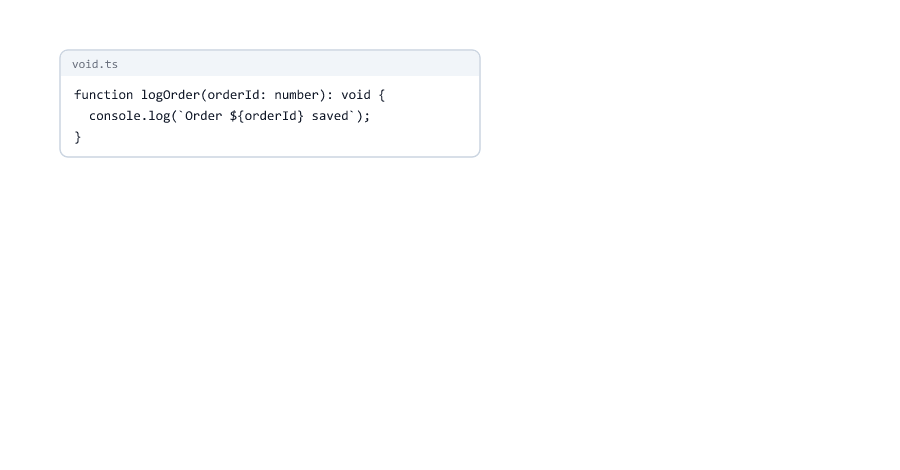
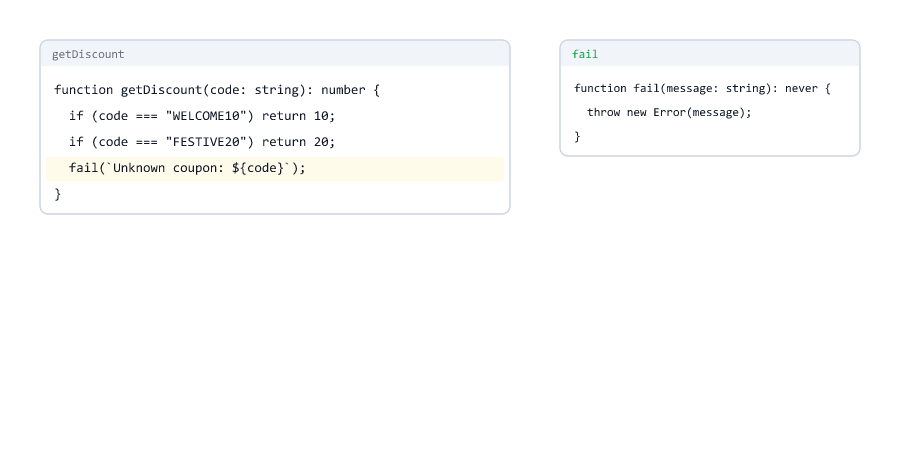

# any, unknown, never and void

> **Session 4 of 33** | Part 1: Getting Started | [All sessions](README.md#course-outline)

## Table of Contents
- [Your Folder for This Session](#your-folder-for-this-session)
- [any: Checking Turned Off](#any-checking-turned-off)
- [any Spreads](#any-spreads)
- [Where any Comes From](#where-any-comes-from)
- [unknown: The Safe "I Do Not Know Yet"](#unknown-the-safe-i-do-not-know-yet)
- [Checking an unknown Value](#checking-an-unknown-value)
- [any or unknown?](#any-or-unknown)
- [void: Functions That Return Nothing](#void-functions-that-return-nothing)
- [never: Functions That Never Return](#never-functions-that-never-return)
- [never as an Impossible Type](#never-as-an-impossible-type)
- [The Type Ladder](#the-type-ladder)
- [object, {} and Object](#object--and-object)
- [What strict Turns On](#what-strict-turns-on)
- [Mini Example 1: A Safe Port Reader](#mini-example-1-a-safe-port-reader)
- [Mini Example 2: Safe Error Messages](#mini-example-2-safe-error-messages)
- [Beginner Mistakes](#beginner-mistakes)
- [Practice Exercises](#practice-exercises)
- [Interview Questions](#interview-questions)

---

## Your Folder for This Session

Make a folder `04-special-types` inside `ts-practice`, with the one-line `tsconfig.json`

04-special-types/tsconfig.json

```json
{
  "extends": "../tsconfig.json"
}
```

This session is about four special types. Two of them describe values you do not know (`any`, `unknown`), and two describe functions (`void`, `never`).

| Type        | In one sentence                                             |
| ----------- | ----------------------------------------------------------- |
| `any`       | "Do not check this value at all." Dangerous                 |
| `unknown`   | "This could be anything. Check it before you use it." Safe  |
| `void`      | "This function returns nothing useful"                      |
| `never`     | "This never happens", like a function that always throws    |

---

## any: Checking Turned Off

`any` tells TypeScript: allow everything with this value, and check nothing

any-crash.ts

```typescript
let data: any = "Riya";

console.log(data.toFixed(2));
```

```bash
npx tsc --noEmit
```

No errors. But

```bash
node any-crash.ts
```

```text
file:///D:/ts-practice/04-special-types/any-crash.ts:3
console.log(data.toFixed(2));
                 ^

TypeError: data.toFixed is not a function
    at file:///D:/ts-practice/04-special-types/any-crash.ts:3:18
    at ModuleJob.run (node:internal/modules/esm/module_job:439:25)
    at async node:internal/modules/esm/loader:643:26
    at async asyncRunEntryPointWithESMLoader (node:internal/modules/run_main:101:5)

Node.js v24.19.0
```

A text has no `toFixed()`, which is exactly the kind of bug TypeScript exists to catch. With `any`, TypeScript stays silent and you are back to plain JavaScript.


(The stack trace looks a little different from Session 01: `ts-practice` now has `"type": "module"`, so Node.js loads the file as an ES module.)

An `any` value also fits into **every** other type

any-fits.ts

```typescript
const fromSomewhere: any = "42";

const quantity: number = fromSomewhere; // no error: any fits into every type
console.log(quantity + 1);
```

```text
421
```

`quantity` claims to be a `number`, but holds the text `"42"`, so `+ 1` joins texts.

---

## any Spreads

An `any` value makes everything it touches `any` too

any-spreads.ts

```typescript
const body = '{ "name": "Riya", "age": "25" }';

const user = JSON.parse(body); // any
const age = user.age;          // any
const nextYear = age + 1;      // any

console.log(nextYear);
```

No errors from `tsc`, and the output is

```text
251
```

Point at the variables in VS Code: `user`, `age` and `nextYear` are all `any`. `JSON.parse` returns `any`, and from there the "no checks" spread to every value that came out of it. This is the bug from Session 01, now with its cause: one `any` turned off the checks for three variables.


---

## Where any Comes From

You rarely write `any` yourself, but it still gets into code

| Source                                   | Example                                  | What to do                               |
| ---------------------------------------- | ---------------------------------------- | ---------------------------------------- |
| You write it                             | `let data: any`                          | Use a real type, or `unknown`            |
| `JSON.parse`                             | `const user = JSON.parse(body)`          | `const user: unknown = JSON.parse(body)` |
| A parameter without a type               | `function double(n)`                     | `strict` reports it: TS7006 (Session 03) |
| Packages without types                   | an old JavaScript library                | Session 25                               |

`strict` already blocks the sneakiest kind: an `any` that TypeScript would have to pick silently ("implicitly"). That is the setting `noImplicitAny`. Explicit `any` and the `any` from `JSON.parse` are allowed, so you must watch for them yourself.

---

## unknown: The Safe "I Do Not Know Yet"

`unknown` also accepts every value. The difference: you cannot **use** an `unknown` value until you have checked what it is

unknown-use.ts

```typescript
const input: unknown = JSON.parse('"pune"');

console.log(input.toUpperCase());
```

```text
unknown-use.ts:3:13 - error TS18046: 'input' is of type 'unknown'.

3 console.log(input.toUpperCase());
              ~~~~~


Found 1 error in unknown-use.ts:3
```

Anything can go **in**, but nothing comes **out** without a check

unknown-assign.ts

```typescript
let value: unknown;
value = "text";
value = 42;
value = null; // anything can go in...

const quantity: number = value; // ...but nothing comes out without a check
```

```text
unknown-assign.ts:6:7 - error TS2322: Type 'unknown' is not assignable to type 'number'.

6 const quantity: number = value; // ...but nothing comes out without a check
        ~~~~~~~~


Found 1 error in unknown-assign.ts:6
```


---

## Checking an unknown Value

Check it with the JavaScript you already know: `typeof` ([Session 03](https://github.com/mohin-sheikh/javascript-basics-to-advanced/blob/main/03-data-types.md) of the JavaScript course)

unknown-check.ts

```typescript
const input: unknown = JSON.parse('"pune"');

if (typeof input === "string") {
  console.log(input.toUpperCase()); // here TypeScript knows: a string
} else {
  console.log("Not a text:", input);
}
```

```text
PUNE
```

Inside the `if`, TypeScript knows that `input` is a `string`, so `toUpperCase()` is allowed. Outside the `if`, it is still `unknown`. Following your checks like this is called **narrowing**, and Session 10 is all about it. For now, `typeof` and `instanceof` are enough.

---

## any or unknown?

| Question                                  | `any`                        | `unknown`                         |
| ----------------------------------------- | ---------------------------- | --------------------------------- |
| Can every value be stored in it?          | Yes                          | Yes                               |
| Can you call methods on it directly?      | Yes, without any check       | No: error TS18046                 |
| Can it be stored in a `number` variable?  | Yes, even if it is not a number | No, only after a check         |
| Does TypeScript protect you?              | **No**                       | Yes                               |


The rule: **when you do not know a type, use `unknown`, never `any`**. Data from outside your program (request bodies, files, `JSON.parse`, other servers) is `unknown` until you have checked it.

---

## void: Functions That Return Nothing

`void` is the return type of a function that does not return a value

void.ts

```typescript
function logOrder(orderId: number): void {
  console.log(`Order ${orderId} saved`);
}

const result = logOrder(1001);
console.log(result);
```

```text
Order 1001 saved
undefined
```

At run time such a function returns `undefined`, as in JavaScript. But the type `void` says more: "do not use the result". Both directions are checked

void-return.ts

```typescript
function logOrder(orderId: number): void {
  console.log(`Order ${orderId} saved`);
  return orderId;
}
```

```text
void-return.ts:3:3 - error TS2322: Type 'number' is not assignable to type 'void'.

3   return orderId;
    ~~~~~~


Found 1 error in void-return.ts:3
```

void-use.ts

```typescript
function logOrder(orderId: number): void {
  console.log(`Order ${orderId} saved`);
}

const result = logOrder(1001);
console.log(result.toFixed(2));
```

```text
void-use.ts:6:20 - error TS2339: Property 'toFixed' does not exist on type 'void'.

6 console.log(result.toFixed(2));
                     ~~~~~~~


Found 1 error in void-use.ts:6
```

Without the annotation, TypeScript infers `void` by itself for a function that has no `return`: point at `logOrder` in VS Code. Writing `: void` makes your intention clear and catches a forgotten `return` value in the wrong place.



---

## never: Functions That Never Return

Some functions never finish: they always throw. Their return type is `never`

never.ts

```typescript
function fail(message: string): never {
  throw new Error(message);
}

function getDiscount(code: string): number {
  if (code === "WELCOME10") {
    return 10;
  }
  if (code === "FESTIVE20") {
    return 20;
  }
  fail(`Unknown coupon: ${code}`);
}

console.log(getDiscount("WELCOME10"));
console.log(getDiscount("FREE100"));
```

`npx tsc --noEmit` finds no errors, and

```text
10
file:///D:/ts-practice/04-special-types/never.ts:2
  throw new Error(message);
        ^

Error: Unknown coupon: FREE100
    at fail (file:///D:/ts-practice/04-special-types/never.ts:2:9)
    at getDiscount (file:///D:/ts-practice/04-special-types/never.ts:12:3)
    at file:///D:/ts-practice/04-special-types/never.ts:16:13
    at ModuleJob.run (node:internal/modules/esm/module_job:439:25)
    at async node:internal/modules/esm/loader:643:26
    at async asyncRunEntryPointWithESMLoader (node:internal/modules/run_main:101:5)

Node.js v24.19.0
```

`getDiscount` promises a `number`, but the last line returns nothing. That is fine, because `fail()` is `never`: TypeScript knows the function cannot get past that line.

Now the same code with `fail` **without** `: never`

never-missing.ts

```typescript
function fail(message: string) {
  throw new Error(message);
}

function getDiscount(code: string): number {
  if (code === "WELCOME10") {
    return 10;
  }
  if (code === "FESTIVE20") {
    return 20;
  }
  fail(`Unknown coupon: ${code}`);
}
```

```text
never-missing.ts:5:37 - error TS2366: Function lacks ending return statement and return type does not include 'undefined'.

5 function getDiscount(code: string): number {
                                      ~~~~~~


Found 1 error in never-missing.ts:5
```

Without the annotation, TypeScript infers `void` for `fail`, so it thinks the code could continue past `fail(...)` and reach the end of `getDiscount` without a number. **Always write `: never` on helper functions that only throw.**



| Return type | The function...                      | At run time         |
| ----------- | ------------------------------------ | ------------------- |
| `void`      | finishes, but returns nothing useful | returns `undefined` |
| `never`     | never finishes: it throws (or loops forever) | returns nothing at all |

---

## never as an Impossible Type

`never` is also the type of a value that cannot exist. Nothing can be stored in it

never-value.ts

```typescript
let impossible: never = 5;
```

```text
never-value.ts:1:5 - error TS2322: Type '5' is not assignable to type 'never'.

1 let impossible: never = 5;
      ~~~~~~~~~~


Found 1 error in never-value.ts:1
```

That sounds useless, but it is a powerful tool: when you handle every possible case of something, TypeScript can prove that the "anything else" branch is `never`. If someone adds a new case and forgets to handle it, TypeScript reports it. Session 10 shows this with order statuses.

---

## The Type Ladder

Types can be arranged by how many values they allow


| Place        | Type                                  | Meaning                                         |
| ------------ | ------------------------------------- | ----------------------------------------------- |
| Top          | `unknown`                             | Every value fits into it                        |
| Middle       | `string`, `number`, `boolean`, ...    | Some values                                     |
| Literals     | `"admin"`, `200`                      | One value each (Session 03)                     |
| Bottom       | `never`                               | No value fits into it; it fits into every type  |
| Outside      | `any`                                 | Breaks the rules: fits everywhere, accepts everything |

A value can always move **up** the ladder (a `string` fits into `unknown`), never **down** without a check (an `unknown` does not fit into `string`). `any` ignores the ladder completely, and that is why it is dangerous.

---

## object, {} and Object

Three more types that sound like "any object", but are not useful in daily code

object-type.ts

```typescript
const config: object = { port: 3000 };

console.log(config.port);
```

```text
object-type.ts:3:20 - error TS2339: Property 'port' does not exist on type 'object'.

3 console.log(config.port);
                     ~~~~


Found 1 error in object-type.ts:3
```

`object` only says "some object, not a primitive". It does not say which properties it has, so you cannot read any.

empty-type.ts

```typescript
let anything: {} = 42;
anything = "text";
anything = { port: 3000 };
anything = null;
```

```text
empty-type.ts:4:1 - error TS2322: Type 'null' is not assignable to type '{}'.

4 anything = null;
  ~~~~~~~~


Found 1 error in empty-type.ts:4
```

Surprise: `{}` does **not** mean "an empty object". It means "any value except `null` and `undefined`", so `42` and `"text"` are accepted. `Object` (capital O) behaves almost the same.

| Type        | Accepts                                    | Use it?                    |
| ----------- | ------------------------------------------ | -------------------------- |
| `object`    | Any object or array, no primitives         | Rarely                     |
| `{}`        | Anything except `null` and `undefined`     | No: it is confusing        |
| `Object`    | Almost the same as `{}`                    | No                         |

What you really want is to describe the **shape**: `{ port: number }`. That is Session 07.

---

## What strict Turns On

`"strict": true` in `tsconfig.json` is one switch for a group of checks. In TypeScript 7 it turns on all of these

| Setting                         | What it checks                                               | Session |
| ------------------------------- | ------------------------------------------------------------ | ------- |
| `noImplicitAny`                 | No silent `any`: parameters need types                        | 03, 04  |
| `strictNullChecks`              | `null` and `undefined` do not fit into other types            | 03, 11  |
| `useUnknownInCatchVariables`    | The `err` in `catch (err)` is `unknown`, not `any`            | 04      |
| `strictFunctionTypes`           | Functions passed around must have compatible parameter types  | 12      |
| `strictBindCallApply`           | Arguments to `bind`, `call` and `apply` are checked           | 12      |
| `noImplicitThis`                | `this` must not be silently `any`                             | 12, 20  |
| `strictPropertyInitialization`  | Class fields must get a value                                 | 20      |
| `strictBuiltinIteratorReturn`   | A detail of iterators, for advanced code                      | -       |
| `alwaysStrict`                  | The JavaScript "use strict" mode is always on                 | -       |

Keep `strict` on. Every one of these checks catches real bugs. Turning it off to make errors go away hides them, it does not fix them.

---

## Mini Example 1: A Safe Port Reader

A server's port can come from many places: a number in the code, a text from `.env` (Node.js course, Session 16), or nowhere at all. `unknown` accepts all of them, and `never` handles the bad case

port-reader.ts

```typescript
function fail(message: string): never {
  throw new Error(message);
}

// A port can come from many places: a number in code, a text from .env, or nothing at all
function parsePort(value: unknown): number {
  if (value === undefined) {
    return 3000; // the default
  }
  if (typeof value === "number" && Number.isInteger(value)) {
    return value;
  }
  if (typeof value === "string") {
    const port = Number(value);
    if (Number.isInteger(port) && port > 0 && port < 65536) {
      return port;
    }
  }
  fail(`Invalid port: ${String(value)}`);
}

console.log(parsePort(undefined));
console.log(parsePort(5000));
console.log(parsePort("8080"));
console.log(parsePort(process.env.PORT));
console.log(parsePort("eighty"));
```

```text
3000
5000
8080
3000
file:///D:/ts-practice/04-special-types/port-reader.ts:2
  throw new Error(message);
        ^

Error: Invalid port: eighty
    at fail (file:///D:/ts-practice/04-special-types/port-reader.ts:2:9)
    at parsePort (file:///D:/ts-practice/04-special-types/port-reader.ts:19:3)
    at file:///D:/ts-practice/04-special-types/port-reader.ts:26:13
    at ModuleJob.run (node:internal/modules/esm/module_job:439:25)
    at async node:internal/modules/esm/loader:643:26
    at async asyncRunEntryPointWithESMLoader (node:internal/modules/run_main:101:5)

Node.js v24.19.0
```

(The fourth line is `3000` because `PORT` is not set in the terminal.)

| Part                                     | Why                                                             |
| ---------------------------------------- | --------------------------------------------------------------- |
| `value: unknown`                         | Every caller can pass anything: a number, a text, `undefined`   |
| `typeof value === "number"`              | After this check, `value` is a `number` inside the `if`         |
| `fail(...)` with `: never`               | The function can end without a `return`, and the server stops with a clear message instead of starting on a wrong port |
| `String(value)`                          | Turns any value into text for the message, even `undefined`     |


Stopping at startup with a clear message is much better than starting a server that cannot work. Session 26 does the same for whole request bodies, with Joi.

---

## Mini Example 2: Safe Error Messages

In JavaScript, anything can be thrown: an `Error`, a text, even a number (JavaScript course, [Session 18](https://github.com/mohin-sheikh/javascript-basics-to-advanced/blob/main/18-error-handling.md)). That is why, with `strict`, the variable in `catch` is `unknown`

catch-bad.ts

```typescript
try {
  JSON.parse("{ broken json");
} catch (err) {
  console.log(err.message);
}
```

```text
catch-bad.ts:4:15 - error TS18046: 'err' is of type 'unknown'.

4   console.log(err.message);
                ~~~


Found 1 error in catch-bad.ts:4
```

A small helper turns any thrown value into a safe message

safe-errors.ts

```typescript
function readOrder(text: string): unknown {
  return JSON.parse(text); // the order comes from outside: we do not trust it
}

function errorMessage(err: unknown): string {
  if (err instanceof Error) {
    return err.message; // here TypeScript knows: an Error
  }
  if (typeof err === "string") {
    return err; // someone wrote: throw "something"
  }
  return "Unknown error";
}

try {
  readOrder("{ broken json");
} catch (err) {
  console.log("Could not read the order:", errorMessage(err));
}

try {
  throw "Payment service is down";
} catch (err) {
  console.log("Could not pay:", errorMessage(err));
}

try {
  throw 404;
} catch (err) {
  console.log("Something else:", errorMessage(err));
}
```

```text
Could not read the order: Expected property name or '}' in JSON at position 2 (line 1 column 3)
Could not pay: Payment service is down
Something else: Unknown error
```

`instanceof Error` and `typeof ... === "string"` are the checks from JavaScript; TypeScript follows them. `readOrder` returns `unknown` on purpose: whoever uses the order must check it first.


You will write a helper like `errorMessage` in almost every TypeScript backend. Session 23 builds on it.

---

## Beginner Mistakes

### Mistake 1: Using any to make an error go away

`let data: any` silenced TypeScript, and the program crashed with `TypeError: data.toFixed is not a function` ([any-crash.ts](#any-checking-turned-off)). An error from `tsc` is a gift: fix the cause, do not hide it.

---

### Mistake 2: Trusting what JSON.parse returns

`JSON.parse` returns `any`, so `const user = JSON.parse(body)` turns off every check after it, and `"25" + 1` became `251`. Write `const user: unknown = JSON.parse(body)` and check before you use it.

---

### Mistake 3: Using an unknown value without a check

`input.toUpperCase()` on an `unknown` gives `error TS18046: 'input' is of type 'unknown'.` Check it first: `if (typeof input === "string")`.

---

### Mistake 4: Reading err.message in catch

`err` is `unknown` with `strict`, so `err.message` gives `error TS18046`. Use `err instanceof Error`, or a helper like `errorMessage` from Mini Example 2.

---

### Mistake 5: Returning a value from a void function

`return orderId;` inside a `: void` function gives `error TS2322: Type 'number' is not assignable to type 'void'.` Either the function should return a number (change the type), or it should not return anything.

---

### Mistake 6: Using the result of a void function

`logOrder(1001).toFixed(2)` gives `error TS2339: Property 'toFixed' does not exist on type 'void'.` A `void` function has no useful result.

---

### Mistake 7: A function that only throws, without : never

`function fail(message: string) { throw ... }` is inferred as `void`, and the function that uses it gets `error TS2366: Function lacks ending return statement and return type does not include 'undefined'.` Write `function fail(message: string): never`.

---

### Mistake 8: Using object and then reading a property

`const config: object = { port: 3000 }` followed by `config.port` gives `error TS2339: Property 'port' does not exist on type 'object'.` Describe the shape instead: `{ port: number }` (Session 07).

---

### Mistake 9: Thinking {} means an empty object

`let anything: {} = 42;` has no error: `{}` accepts every value except `null` and `undefined`. Do not use it as a type.

---

### Mistake 10: any for "flexible" parameters

format-price.ts

```typescript
function formatPrice(value: any): string {
  return `Rs. ${value.toFixed(2)}`;
}

console.log(formatPrice(499));
console.log(formatPrice("499"));
```

```text
Rs. 499.00
file:///D:/ts-practice/04-special-types/format-price.ts:2
  return `Rs. ${value.toFixed(2)}`;
                      ^

TypeError: value.toFixed is not a function
    at formatPrice (file:///D:/ts-practice/04-special-types/format-price.ts:2:23)
    at file:///D:/ts-practice/04-special-types/format-price.ts:6:13
    at ModuleJob.run (node:internal/modules/esm/module_job:439:25)
    at async node:internal/modules/esm/loader:643:26
    at async asyncRunEntryPointWithESMLoader (node:internal/modules/run_main:101:5)

Node.js v24.19.0
```

`any` looks flexible, but nobody checks what happens inside, and `tsc` reported nothing. Use `value: unknown` and check it, as `errorMessage` does. Or, when the function works with several known types, a union type like `string | number` (Session 09).

---

### Mistake 11: Turning off strict

Setting `"strict": false` makes many errors disappear, and every bug they pointed to stays in the code. Keep `strict` on in every project.

---

## Practice Exercises

### Exercise 1

In `any-crash.ts`, change `any` to `string`. Read the error, then fix the code so it prints the name in capital letters

### Exercise 2

In `any-spreads.ts`, change the first `JSON.parse` line to `const user: unknown = JSON.parse(body);`. Which lines now have errors, and why? (Do not fix them yet: Session 10 shows how to check the properties of an object.)

### Exercise 3

Write `function describe(value: unknown): string` that returns `"text"`, `"number"`, `"true or false"` or `"something else"`, using `typeof`. Test it with `"Riya"`, `42`, `false` and `null`

### Exercise 4

Write a `void` function `logRequest(method: string, path: string, status: number)` that prints a line like `GET /api/orders 200`. Then try to return the status from it, and try to use its result. Read both errors

### Exercise 5

Write `function notFound(resource: string): never` that throws ``new Error(`${resource} not found`)``. Use it in `function userName(id: number): string`, which returns `"Riya"` for id 1, `"Sara"` for id 2, and calls `notFound("User")` for every other id. Then remove `: never` and read the error

### Exercise 6

Run Mini Example 1 with `PORT` set in the terminal: `$env:PORT = "9000"` in PowerShell, or `PORT=9000 node port-reader.ts` on macOS and Linux. Then try `"0"` and `"70000"`. Which values does `parsePort` accept?

### Exercise 7

In Mini Example 2, add one more check to `errorMessage`: when `typeof err === "number"`, return `` `Error code ${err}` ``. What does the third `try` print now?

---

## Interview Questions

### What is the any type?

A type that turns off type checking for a value. Every operation on it is allowed, and it fits into every other type, so mistakes are only found at run time.

### What is the unknown type?

A type for a value whose type is not known yet. Every value can be stored in it, but it cannot be used until a check, like `typeof` or `instanceof`, has narrowed it.

### What is the difference between any and unknown?

Both accept every value. `any` allows everything without checks; `unknown` allows nothing until you check what the value is. `unknown` is the safe choice.

### What does JSON.parse return in TypeScript?

`any`. It is good practice to store the result as `unknown` and check it, because the data comes from outside the program.

### What is the type of the error in a catch block?

With `strict` (the setting `useUnknownInCatchVariables`), it is `unknown`, because JavaScript can throw any value, not only `Error` objects.

### What is void?

The return type of a function that does not return a useful value. At run time it returns `undefined`.

### What is the difference between void and never?

A `void` function finishes and returns nothing useful. A `never` function never finishes: it always throws or runs forever.

### Why should a function that always throws be typed as never?

So TypeScript knows that the code after a call to it cannot run. Without `: never` the function is inferred as `void`, and a caller that must return a value gets error TS2366.

### What is never used for, apart from functions?

As the type of impossible values, for example in exhaustive checks that make sure every case of a union is handled.

### What does strict mode enable in TypeScript?

A group of checks, including `noImplicitAny`, `strictNullChecks`, `useUnknownInCatchVariables`, `strictFunctionTypes`, `strictBindCallApply`, `noImplicitThis`, `strictPropertyInitialization` and `alwaysStrict`.

### What is the difference between object, {} and Object?

`object` is any non-primitive value. `{}` and `Object` accept any value except `null` and `undefined`. None of them describe properties, so a specific shape like `{ port: number }` is usually what you want.

### What are the top and bottom types in TypeScript?

`unknown` is the top type: every value fits into it. `never` is the bottom type: no value fits into it, and it fits into every type.

### What does noImplicitAny do?

It reports an error when TypeScript would have to give something the type `any` silently, for example a parameter without a type.

---

| Previous | All sessions | Next |
| :--- | :---: | ---: |
| [03. Basic Types and Type Inference](03-basic-types-and-inference.md) | [Course outline](README.md#course-outline) | [05. Reading TypeScript Errors](05-reading-typescript-errors.md) |
