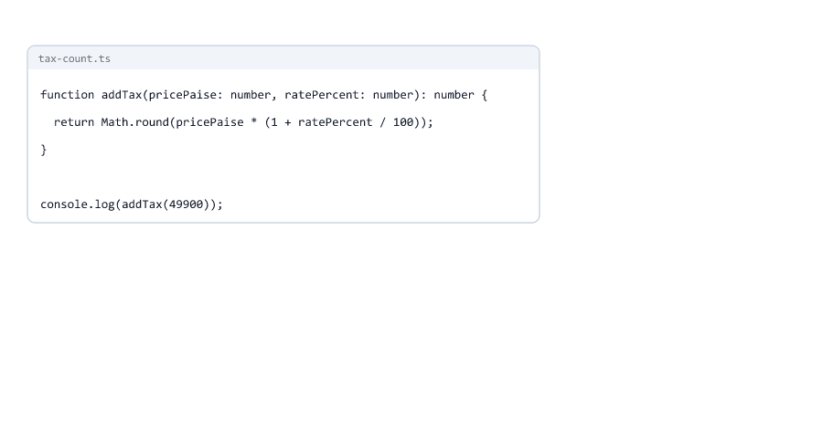
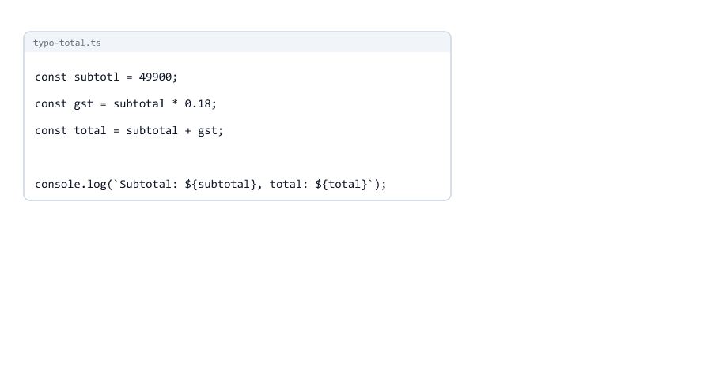
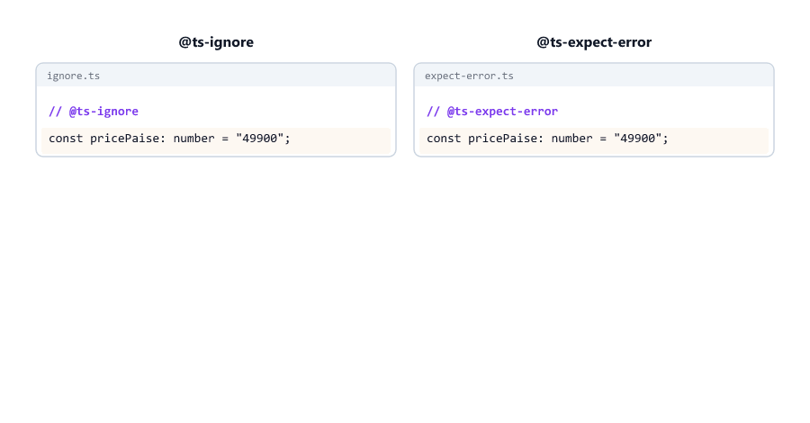

# Reading TypeScript Errors

> **Session 5 of 33** | Part 1: Getting Started | [All sessions](README.md#course-outline)

## Table of Contents
- [Your Folder for This Session](#your-folder-for-this-session)
- [The Parts of an Error](#the-parts-of-an-error)
- [Given and Expected](#given-and-expected)
- [The Extra Lines Below an Error](#the-extra-lines-below-an-error)
- [Long Errors: Read the First and the Last Line](#long-errors-read-the-first-and-the-last-line)
- [One Mistake, Many Errors](#one-mistake-many-errors)
- [Error Codes](#error-codes)
- [The 20 Errors You Will See Most](#the-20-errors-you-will-see-most)
- [Type and Name Errors](#type-and-name-errors)
- [Property Errors](#property-errors)
- [Function and Call Errors](#function-and-call-errors)
- [Missing Value Errors](#missing-value-errors)
- [Import and Syntax Errors](#import-and-syntax-errors)
- [Errors You Have Already Met](#errors-you-have-already-met)
- [Hiding an Error: @ts-expect-error and @ts-ignore](#hiding-an-error-ts-expect-error-and-ts-ignore)
- [Type Errors and Run-Time Errors](#type-errors-and-run-time-errors)
- [The Short Error Format](#the-short-error-format)
- [Errors in VS Code](#errors-in-vs-code)
- [A Plan for Any Error](#a-plan-for-any-error)
- [Mini Example 1: Fixing a Checkout File](#mini-example-1-fixing-a-checkout-file)
- [Mini Example 2: An Error Caused by Another File](#mini-example-2-an-error-caused-by-another-file)
- [Beginner Mistakes](#beginner-mistakes)
- [Practice Exercises](#practice-exercises)
- [Interview Questions](#interview-questions)

---

## Your Folder for This Session

Make a folder `05-reading-errors` inside `ts-practice`, with the one-line `tsconfig.json`

05-reading-errors/tsconfig.json

```json
{
  "extends": "../tsconfig.json"
}
```

Before you write any file, run the check

```bash
cd 05-reading-errors
npx tsc --noEmit
```

```text
error TS18003: No inputs were found in config file 'D:/ts-practice/05-reading-errors/tsconfig.json'. Specified 'include' paths were '["**/*"]' and 'exclude' paths were '["D:/ts-practice/dist"]'.

Found 1 error.
```

Your first error of this session, and an easy one: there is no `.ts` file in the folder yet. `"**/*"` means every file in this folder and its subfolders, and the `dist` folder (the `outDir`) is skipped.

Every example in this session has a mistake **on purpose**. `npx tsc --noEmit` checks every file in the folder, so read the error, then fix the file (the fix is always shown) before you write the next one. That way each check shows only the error you are studying.

---

## The Parts of an Error

price.ts

```typescript
const pricePaise: number = 49900;
const discountPaise: number = "5000";

console.log(pricePaise - discountPaise);
```

```bash
npx tsc --noEmit
```

```text
price.ts:2:7 - error TS2322: Type 'string' is not assignable to type 'number'.

2 const discountPaise: number = "5000";
        ~~~~~~~~~~~~~


Found 1 error in price.ts:2
```

| Part                                                 | Meaning                                                          |
| ---------------------------------------------------- | ---------------------------------------------------------------- |
| `price.ts`                                           | The file                                                         |
| `2`                                                  | The line                                                         |
| `7`                                                  | The column: the 7th character of the line, where `discountPaise` starts |
| `error`                                              | The type of message                                              |
| `TS2322`                                             | The error code. The same kind of mistake always has the same code |
| `Type 'string' is not assignable to type 'number'.`  | What is wrong                                                    |
| `2 const discountPaise: number = "5000";`            | The line again, with its line number                             |
| `~~~~~~~~~~~~~`                                      | The exact part the message is about                              |
| `Found 1 error in price.ts:2`                        | How many errors there are, and where the first one is            |

In the VS Code terminal, **Ctrl+click** on `price.ts:2:7` opens the file at that line and column.


The file still runs

```bash
node price.ts
```

```text
44900
```

JavaScript turned `"5000"` into a number for the `-`. With `+` instead of `-`, it would have joined the texts. The code worked here by luck, and TypeScript reports it anyway: you said `discountPaise` is a number, and it holds a text. An error does not always mean a crash. It means the code does not match what you said about it.

---

## Given and Expected

Most errors you will see say that one type "is not assignable to" another. Read it like this

> Type '**what you gave**' is not assignable to type '**what this place expects**'.

It happens in three places. When you assign a value

quantity.ts

```typescript
let quantity: number = 1;

quantity = "2";
```

```text
quantity.ts:3:1 - error TS2322: Type 'string' is not assignable to type 'number'.

3 quantity = "2";
  ~~~~~~~~


Found 1 error in quantity.ts:3
```

When you return a value

discount-label.ts

```typescript
function discountLabel(percent: number): string {
  return percent;
}
```

```text
discount-label.ts:2:3 - error TS2322: Type 'number' is not assignable to type 'string'.

2   return percent;
    ~~~~~~


Found 1 error in discount-label.ts:2
```

When you call a function

tax-argument.ts

```typescript
function addTax(pricePaise: number, ratePercent: number): number {
  return Math.round(pricePaise * (1 + ratePercent / 100));
}

const priceFromForm = "49900";
console.log(addTax(priceFromForm, 18));
```

```text
tax-argument.ts:6:20 - error TS2345: Argument of type 'string' is not assignable to parameter of type 'number'.

6 console.log(addTax(priceFromForm, 18));
                     ~~~~~~~~~~~~~


Found 1 error in tax-argument.ts:6
```

An **argument** is the value you pass, a **parameter** is the name in the function. TS2345 is TS2322 for function calls.

| File                | Given                         | Expected                          | A fix                                  |
| ------------------- | ----------------------------- | --------------------------------- | -------------------------------------- |
| `quantity.ts`       | `"2"`, a `string`             | `quantity` is a `number`          | `quantity = 2;`                        |
| `discount-label.ts` | `percent`, a `number`         | the function returns a `string`   | ``return `${percent}% off`;``          |
| `tax-argument.ts`   | `priceFromForm`, a `string`   | `pricePaise` is a `number`        | `addTax(Number(priceFromForm), 18)`    |

Before you fix it, ask **which side is wrong**. Sometimes the value is wrong. Sometimes the type you wrote is wrong: maybe `discountLabel` really should return a number. Change the side that is wrong, not the side that is easier to change.


---

## The Extra Lines Below an Error

Some errors have an indented part below them. It points to a **second place** in the code that explains the first one

tax-count.ts

```typescript
function addTax(pricePaise: number, ratePercent: number): number {
  return Math.round(pricePaise * (1 + ratePercent / 100));
}

console.log(addTax(49900));
console.log(addTax(49900, 18, 2));
```

```text
tax-count.ts:5:13 - error TS2554: Expected 2 arguments, but got 1.

5 console.log(addTax(49900));
              ~~~~~~

  tax-count.ts:1:37 - An argument for 'ratePercent' was not provided.
    1 function addTax(pricePaise: number, ratePercent: number): number {
                                          ~~~~~~~~~~~~~~~~~~~

tax-count.ts:6:31 - error TS2554: Expected 2 arguments, but got 3.

6 console.log(addTax(49900, 18, 2));
                                ~


Found 2 errors in the same file, starting at: tax-count.ts:5
```

The first error shows two places: the call on line 5, and the parameter that got no value, `ratePercent` on line 1. The second error needs no extra lines: the underline is under the extra argument `2`.

For a name that does not exist, the extra lines point to the name you probably meant

customer.ts

```typescript
const customerName = "Riya";

console.log(customername);
```

```text
customer.ts:3:13 - error TS2552: Cannot find name 'customername'. Did you mean 'customerName'?

3 console.log(customername);
              ~~~~~~~~~~~~

  customer.ts:1:7 - 'customerName' is declared here.
    1 const customerName = "Riya";
            ~~~~~~~~~~~~


Found 1 error in customer.ts:3
```

Names are case-sensitive: `customername` and `customerName` are two different names.

The extra lines can also point into TypeScript's own files

city-length.ts

```typescript
const city = "Pune";

console.log(city.lenght);
```

```text
city-length.ts:3:18 - error TS2551: Property 'lenght' does not exist on type '"Pune"'. Did you mean 'length'?

3 console.log(city.lenght);
                   ~~~~~~

  ../node_modules/@typescript/typescript-win32-x64/lib/lib.es5.d.ts:515:14 - 'length' is declared here.
    515     readonly length: number;
                     ~~~~~~


Found 1 error in city-length.ts:3
```

- `lib.es5.d.ts` is where TypeScript describes the built-in parts of JavaScript, like strings. You never change it, but it shows what exists: a string has `length`, a `number`. (`typescript-win32-x64` is the TypeScript compiler for Windows; on macOS and Linux this folder has a different name.)
- The type in the message is `'"Pune"'`, not `'string'`. `city` is a `const`, so its type is the one exact text `"Pune"` ([Session 03](03-basic-types-and-inference.md#let-and-const-wide-and-exact-types)).



---

## Long Errors: Read the First and the Last Line

Some errors take several lines

user-chain.ts

```typescript
let user = { name: "Riya", age: 25 };
const fromForm = { name: "Sara", age: "30" };

user = fromForm;
```

```text
user-chain.ts:4:1 - error TS2322: Type '{ name: string; age: string; }' is not assignable to type '{ name: string; age: number; }'.
  Types of property 'age' are incompatible.
    Type 'string' is not assignable to type 'number'.

4 user = fromForm;
  ~~~~


Found 1 error in user-chain.ts:4
```

`{ name: string; age: number; }` is how TypeScript writes the type of an object: the shape `user` got from its first value. You will write types like this yourself in Session 07.

Each indented line explains the line above it

| Line                                                              | Says                                  |
| ----------------------------------------------------------------- | ------------------------------------- |
| `Type '{ name: string; age: string; }' is not assignable to ...`  | The whole object does not fit...      |
| `Types of property 'age' are incompatible.`                       | ...because of `age`...                |
| `Type 'string' is not assignable to type 'number'.`               | ...which is a text, not a number      |

The **first line** tells you where the problem is, and the **last line** tells you why. Read those two first, and the middle lines when you need more.

When the object is written right where it is assigned, TypeScript skips the chain and underlines the exact property

user-literal.ts

```typescript
let user = { name: "Riya", age: 25 };

user = { name: "Sara", age: "30" };
```

```text
user-literal.ts:3:24 - error TS2322: Type 'string' is not assignable to type 'number'.

3 user = { name: "Sara", age: "30" };
                         ~~~

  user-literal.ts:1:28 - The expected type comes from property 'age' which is declared here on type '{ name: string; age: number; }'
    1 let user = { name: "Riya", age: 25 };
                                 ~~~~~~~


Found 1 error in user-literal.ts:3
```

In both files the fix is `age: 30`, a number.


---

## One Mistake, Many Errors

typo-total.ts

```typescript
const subtotl = 49900;
const gst = subtotal * 0.18;
const total = subtotal + gst;

console.log(`Subtotal: ${subtotal}, total: ${total}`);
```

```text
typo-total.ts:2:13 - error TS2552: Cannot find name 'subtotal'. Did you mean 'subtotl'?

2 const gst = subtotal * 0.18;
              ~~~~~~~~

  typo-total.ts:1:7 - 'subtotl' is declared here.
    1 const subtotl = 49900;
            ~~~~~~~

typo-total.ts:3:15 - error TS2552: Cannot find name 'subtotal'. Did you mean 'subtotl'?

3 const total = subtotal + gst;
                ~~~~~~~~

  typo-total.ts:1:7 - 'subtotl' is declared here.
    1 const subtotl = 49900;
            ~~~~~~~

typo-total.ts:5:26 - error TS2552: Cannot find name 'subtotal'. Did you mean 'subtotl'?

5 console.log(`Subtotal: ${subtotal}, total: ${total}`);
                           ~~~~~~~~

  typo-total.ts:1:7 - 'subtotl' is declared here.
    1 const subtotl = 49900;
            ~~~~~~~


Found 3 errors in the same file, starting at: typo-total.ts:2
```

Three errors, one mistake. The errors are on lines 2, 3 and 5, but the cause is on line 1, and the extra lines point right at it. Change `subtotl` to `subtotal`, and all three are gone

```bash
npx tsc --noEmit
node typo-total.ts
```

```text
Subtotal: 49900, total: 58882
```

- Start with the **first** error. Later errors are often caused by it.
- After each fix, run `npx tsc --noEmit` again. The count can drop by more than one, and new errors can appear that were hidden behind the old one ([Mini Example 2](#mini-example-2-an-error-caused-by-another-file)).



---

## Error Codes

Every error has a code, and the same kind of mistake always gets the same code, in every project. The first digits tell you the area

| Code starts with | Area                                              | Examples from this course                    |
| ---------------- | ------------------------------------------------- | -------------------------------------------- |
| `TS1...`         | Syntax: the code cannot be read as TypeScript     | TS1005 `')' expected.`, TS1294               |
| `TS2...`         | Types and names: the biggest group                | TS2322, TS2345, TS2339, TS2304               |
| `TS5...`         | tsconfig and command-line options                 | TS5023 `Unknown compiler option`, TS5112     |
| `TS7...`         | Values that would silently become `any`           | TS7006                                       |
| `TS18...`        | Newer errors, numbered after the others           | TS18003, TS18046, TS18048                    |

The code is also the best thing to search for. Search for `TS2554 typescript`, not for the whole message with your own names in it: other people had the same error with different names.


---

## The 20 Errors You Will See Most

| #  | Code      | The message starts with                                        | Usual cause                               | Explained in |
| -- | --------- | -------------------------------------------------------------- | ----------------------------------------- | ------------ |
| 1  | TS2322    | Type 'X' is not assignable to type 'Y'                         | A value of the wrong type                 | [Given and Expected](#given-and-expected) |
| 2  | TS2345    | Argument of type 'X' is not assignable to parameter of type 'Y' | A wrong value passed to a function       | [Given and Expected](#given-and-expected) |
| 3  | TS2367    | This comparison appears to be unintentional                    | Comparing a number with a text            | [TS2367](#ts2367-this-comparison-appears-to-be-unintentional) |
| 4  | TS2304    | Cannot find name                                               | A missing import, or a name that does not exist | [TS2304](#ts2304-cannot-find-name) |
| 5  | TS2552    | Cannot find name 'x'. Did you mean 'y'?                        | A typo in a name                          | [One Mistake, Many Errors](#one-mistake-many-errors) |
| 6  | TS2451    | Cannot redeclare block-scoped variable                         | The same name declared twice              | [TS2451](#ts2451-cannot-redeclare-block-scoped-variable) |
| 7  | TS2588    | Cannot assign to 'x' because it is a constant                  | Changing a `const`                        | [TS2588](#ts2588-cannot-assign-to-a-constant) |
| 8  | TS2339    | Property 'x' does not exist on type 'Y'                        | A property the value does not have        | [TS2339](#ts2339-property-does-not-exist) |
| 9  | TS2551    | Property 'x' does not exist on type 'Y'. Did you mean 'z'?     | A typo in a property                      | [The Extra Lines](#the-extra-lines-below-an-error) |
| 10 | TS2741    | Property 'x' is missing in type                                | An object without a required property     | [TS2741](#ts2741-property-is-missing) |
| 11 | TS2353    | Object literal may only specify known properties               | An object with an extra property          | [TS2353](#ts2353-object-literal-may-only-specify-known-properties) |
| 12 | TS2554    | Expected N arguments, but got M                                | Too few or too many arguments             | [The Extra Lines](#the-extra-lines-below-an-error) |
| 13 | TS7006    | Parameter 'x' implicitly has an 'any' type                     | A parameter without a type                | [TS7006](#ts7006-parameter-implicitly-has-an-any-type) |
| 14 | TS2349    | This expression is not callable                                | Calling something that is not a function  | [TS2349](#ts2349-this-expression-is-not-callable) |
| 15 | TS2769    | No overload matches this call                                  | Wrong arguments for a built-in function   | [TS2769](#ts2769-no-overload-matches-this-call) |
| 16 | TS18048   | 'x' is possibly 'undefined'                                    | A value that may be missing               | [TS18048](#ts18048-possibly-undefined) |
| 17 | TS2532    | Object is possibly 'undefined'                                 | The same, for a value without a name      | [TS2532](#ts2532-object-is-possibly-undefined) |
| 18 | TS18046   | 'x' is of type 'unknown'                                       | Using an `unknown` value without a check  | [TS18046](#ts18046-of-type-unknown) |
| 19 | TS2307    | Cannot find module                                             | A wrong import path                       | [TS2307](#ts2307-cannot-find-module) |
| 20 | TS1005    | 'x' expected                                                   | A missing bracket, comma or similar       | [TS1005](#ts1005-expected) |

Keep this table open while you work through the course. The sections below show each error that has not appeared yet.

---

## Type and Name Errors

### TS2367: This comparison appears to be unintentional

status-check.ts

```typescript
function isNotFound(status: number): boolean {
  return status === "404";
}
```

```text
status-check.ts:2:10 - error TS2367: This comparison appears to be unintentional because the types 'number' and 'string' have no overlap.

2   return status === "404";
           ~~~~~~~~~~~~~~~~


Found 1 error in status-check.ts:2
```

A number is never `===` a text, so this comparison is always `false`, and TypeScript says it is almost surely a mistake. "No overlap" means no value can be both. Fix: `status === 404`.

### TS2304: Cannot find name

tax.ts

```typescript
export function addTax(pricePaise: number, ratePercent: number): number {
  return Math.round(pricePaise * (1 + ratePercent / 100));
}
```

missing-import.ts

```typescript
console.log(addTax(49900, 18));
```

```text
missing-import.ts:1:13 - error TS2304: Cannot find name 'addTax'.

1 console.log(addTax(49900, 18));
              ~~~~~~


Found 1 error in missing-import.ts:1
```

`addTax` exists, but in another file, and each file sees only its own names and what it imports. Add the import

missing-import.ts

```typescript
import { addTax } from "./tax.ts";

console.log(addTax(49900, 18));
```

```text
58882
```

TS2304 also appears for a name that was never declared at all. When a similar name exists, you get TS2552 with a "Did you mean" instead.

### TS2451: Cannot redeclare block-scoped variable

redeclare.ts

```typescript
let total = 499;
let total = 999;
```

```text
redeclare.ts:1:5 - error TS2451: Cannot redeclare block-scoped variable 'total'.

1 let total = 499;
      ~~~~~

redeclare.ts:2:5 - error TS2451: Cannot redeclare block-scoped variable 'total'.

2 let total = 999;
      ~~~~~


Found 2 errors in the same file, starting at: redeclare.ts:1
```

A **block-scoped variable** is one made with `let` or `const`. Both lines are reported, because TypeScript cannot know which one you meant to keep. Fix: `total = 999;` without `let` to change the value, or use a different name.

### TS2588: Cannot assign to a constant

visits.ts

```typescript
const visits = 0;

visits = visits + 1;
```

```text
visits.ts:3:1 - error TS2588: Cannot assign to 'visits' because it is a constant.

3 visits = visits + 1;
  ~~~~~~


Found 1 error in visits.ts:3
```

Fix: `let visits = 0;` when the value must change.

---

## Property Errors

### TS2339: Property does not exist

user-email.ts

```typescript
const user = { name: "Riya", city: "Pune" };

console.log(user.email);
```

```text
user-email.ts:3:18 - error TS2339: Property 'email' does not exist on type '{ name: string; city: string; }'.

3 console.log(user.email);
                   ~~~~~


Found 1 error in user-email.ts:3
```

The message shows the type of `user`: it has `name` and `city`, and no `email`. JavaScript would not even crash here

```bash
node user-email.ts
```

```text
undefined
```

A silent `undefined` that turns up somewhere later is one of the hardest bugs to find. Fix: use a property that exists, or add `email` to the object.

### TS2741: Property is missing

user-missing.ts

```typescript
let user = { name: "Riya", age: 25 };

user = { name: "Sara" };
```

```text
user-missing.ts:3:1 - error TS2741: Property 'age' is missing in type '{ name: string; }' but required in type '{ name: string; age: number; }'.

3 user = { name: "Sara" };
  ~~~~

  user-missing.ts:1:28 - 'age' is declared here.
    1 let user = { name: "Riya", age: 25 };
                                 ~~~~~~~


Found 1 error in user-missing.ts:3
```

Given and expected again: the given object `{ name: string; }` has no `age`, and the expected type requires one. Fix: `user = { name: "Sara", age: 30 };`

### TS2353: Object literal may only specify known properties

user-extra.ts

```typescript
let user = { name: "Riya", age: 25 };

user = { name: "Sara", age: 30, email: "sara@example.com" };
```

```text
user-extra.ts:3:33 - error TS2353: Object literal may only specify known properties, and 'email' does not exist in type '{ name: string; age: number; }'.

3 user = { name: "Sara", age: 30, email: "sara@example.com" };
                                  ~~~~~


Found 1 error in user-extra.ts:3
```

An **object literal** is an object written with `{ }` right there in the code. An extra property in it is usually a typo or a mix-up, so TypeScript reports it. Fix: remove `email`, or add it to the first value of `user`.

---

## Function and Call Errors

### TS7006: Parameter implicitly has an 'any' type

format-rupees.ts

```typescript
function formatRupees(paise) {
  return `Rs. ${(paise / 100).toFixed(2)}`;
}
```

```text
format-rupees.ts:1:23 - error TS7006: Parameter 'paise' implicitly has an 'any' type.

1 function formatRupees(paise) {
                        ~~~~~


Found 1 error in format-rupees.ts:1
```

"Implicitly" means "without you writing it". Without a type, `paise` would silently be `any`, and nothing about it would be checked ([Session 04](04-any-unknown-never-void.md#any-checking-turned-off)). Fix: `function formatRupees(paise: number) {`

### TS2349: This expression is not callable

city-call.ts

```typescript
const city = "Pune";

console.log(city.length());
```

```text
city-call.ts:3:18 - error TS2349: This expression is not callable.
  Type 'Number' has no call signatures.

3 console.log(city.length());
                   ~~~~~~


Found 1 error in city-call.ts:3
```

`length` is a number, not a function, and a number cannot be called. The last line says why: a "call signature" is what makes something callable, and `Number` (the wrapper type from [Session 03](03-basic-types-and-inference.md#lowercase-types-string-not-string)) has none. Fix: `city.length`.

### TS2769: No overload matches this call

order-json.ts

```typescript
const order = { id: 1001, totalPaise: 49900 };

console.log(JSON.stringify(order, 2));
```

```text
order-json.ts:3:35 - error TS2769: No overload matches this call.
  The last overload gave the following error.
    Argument of type 'number' is not assignable to parameter of type '(string | number)[]'.

3 console.log(JSON.stringify(order, 2));
                                    ~

  ../node_modules/@typescript/typescript-win32-x64/lib/lib.es5.d.ts:1177:5 - The last overload is declared here.
    1177     stringify(value: any, replacer?: (number | string)[] | null, space?: string | number): string;
             ~~~~~~~~~~~~~~~~~~~~~~~~~~~~~~~~~~~~~~~~~~~~~~~~~~~~~~~~~~~~~~~~~~~~~~~~~~~~~~~~~~~~~~~~~~~~~~


Found 1 error in order-json.ts:3
```

Some built-in functions can be called in more than one way. Each way is an **overload**, and `JSON.stringify` has two. When no way fits, TypeScript shows the error of the last one. Read the last indented line and the declaration below it: the second argument is a `replacer` (it chooses what to include), and the number of spaces comes **third**. (`(string | number)[]` is a list of texts or numbers: lists are Session 06, and `|` is Session 09.)

order-json.ts

```typescript
const order = { id: 1001, totalPaise: 49900 };

console.log(JSON.stringify(order, null, 2));
```

```text
{
  "id": 1001,
  "totalPaise": 49900
}
```

---

## Missing Value Errors

### TS18048: possibly undefined

node-env.ts

```typescript
const mode = process.env.NODE_ENV;

console.log(mode.toUpperCase());
```

```text
node-env.ts:3:13 - error TS18048: 'mode' is possibly 'undefined'.

3 console.log(mode.toUpperCase());
              ~~~~


Found 1 error in node-env.ts:3
```

Point at `mode` in VS Code: its type is `string | undefined`, "a text, or `undefined`". When the environment variable is not set, there is no text. Run it anyway

```bash
node node-env.ts
```

```text
file:///D:/ts-practice/05-reading-errors/node-env.ts:3
console.log(mode.toUpperCase());
                 ^

TypeError: Cannot read properties of undefined (reading 'toUpperCase')
    at file:///D:/ts-practice/05-reading-errors/node-env.ts:3:18
    at ModuleJob.run (node:internal/modules/esm/module_job:439:25)
    at async node:internal/modules/esm/loader:643:26
    at async asyncRunEntryPointWithESMLoader (node:internal/modules/run_main:101:5)

Node.js v24.19.0
```

TypeScript found this crash before it happened. Give a default value with `??` (JavaScript course)

node-env.ts

```typescript
const mode = process.env.NODE_ENV ?? "development";

console.log(mode.toUpperCase());
```

```text
DEVELOPMENT
```

### TS2532: Object is possibly 'undefined'

auth-header.ts

```typescript
const header = "Bearer abc123";

console.log(header.split(" ")[1].length);

const token = header.split(" ")[1];
console.log(token.length);
```

```text
auth-header.ts:3:13 - error TS2532: Object is possibly 'undefined'.

3 console.log(header.split(" ")[1].length);
              ~~~~~~~~~~~~~~~~~~~~

auth-header.ts:6:13 - error TS18048: 'token' is possibly 'undefined'.

6 console.log(token.length);
              ~~~~~


Found 2 errors in the same file, starting at: auth-header.ts:3
```

One problem, two messages. `split(" ")[1]` reads the second part of the text, and a header like `"Basic"` has no second part. When the value has a name (`token`), the message uses it (TS18048). When it has no name, TypeScript calls it "Object" (TS2532). This check comes from `noUncheckedIndexedAccess` in your tsconfig ([Session 02](02-setup-and-first-project.md#what-the-settings-mean)).

Check before you use it

auth-header.ts

```typescript
const header = "Basic";

const token = header.split(" ")[1];

if (token === undefined) {
  console.log("No token in the header");
} else {
  console.log(token.length);
}
```

```text
No token in the header
```

Checks like this `if` get their own sessions: narrowing (Session 10) and `null` and `undefined` (Session 11).


### TS18046: of type 'unknown'

unknown-body.ts

```typescript
const body: unknown = JSON.parse('{ "id": 1001 }');

console.log(body.id);
```

```text
unknown-body.ts:3:13 - error TS18046: 'body' is of type 'unknown'.

3 console.log(body.id);
              ~~~~


Found 1 error in unknown-body.ts:3
```

You met this one in [Session 04](04-any-unknown-never-void.md#checking-an-unknown-value): an `unknown` value must be checked before it is used. Checking the properties of an object is Session 10.

---

## Import and Syntax Errors

### TS2307: Cannot find module

wrong-path.ts

```typescript
import { addTax } from "./taxes.ts";

console.log(addTax(49900, 18));
```

```text
wrong-path.ts:1:24 - error TS2307: Cannot find module './taxes.ts' or its corresponding type declarations.

1 import { addTax } from "./taxes.ts";
                         ~~~~~~~~~~~~


Found 1 error in wrong-path.ts:1
```

The file is `tax.ts`, not `taxes.ts`. Node.js would stop too, with `Error [ERR_MODULE_NOT_FOUND]: Cannot find module 'D:\ts-practice\05-reading-errors\taxes.ts'`. Fix: `"./tax.ts"`. In VS Code, type `./` between the quotes, and it lists the files that exist.

("Type declarations" are files that describe a JavaScript library to TypeScript: Session 25.)

### TS1005: expected

tax-syntax.ts

```typescript
function addTax(pricePaise: number, ratePercent: number): number {
  return Math.round(pricePaise * (1 + ratePercent / 100);
}
```

```text
tax-syntax.ts:2:57 - error TS1005: ')' expected.

2   return Math.round(pricePaise * (1 + ratePercent / 100);
                                                          ~


Found 1 error in tax-syntax.ts:2
```

Two `(` are opened and only one `)` is closed. The underline is where TypeScript noticed the problem (the `;`); the missing `)` belongs just before it. Fix: `ratePercent / 100));`

A syntax error is different from all the errors above: the code cannot even be read. Node.js refuses to run it

```bash
node tax-syntax.ts
```

```text
SyntaxError [ERR_INVALID_TYPESCRIPT_SYNTAX]: Expected ',', got ';'
```

(The full output also shows the line and a long stack trace.)

---

## Errors You Have Already Met

| Code             | The message starts with                                                    | Session |
| ---------------- | -------------------------------------------------------------------------- | ------- |
| TS1294           | This syntax is not allowed when 'erasableSyntaxOnly' is enabled            | [02](02-setup-and-first-project.md#mistake-3-running-tsc-in-the-wrong-folder) |
| TS1295, TS1287   | ECMAScript imports and exports cannot be written in a CommonJS file        | [02](02-setup-and-first-project.md#mistake-1-forgetting-type-module) |
| TS2591           | Cannot find name 'process'. Do you need to install type definitions for node? | [02](02-setup-and-first-project.md#mistake-5-cannot-find-name-process) |
| TS2835           | Relative import paths need explicit file extensions                        | [02](02-setup-and-first-project.md#mistake-6-importing-without-a-file-extension) |
| TS5023           | Unknown compiler option                                                    | [02](02-setup-and-first-project.md#mistake-8-a-typo-in-tsconfigjson) |
| TS5112           | tsconfig.json is present but will not be loaded if files are specified on commandline | [02](02-setup-and-first-project.md#mistake-2-giving-tsc-a-file-name) |
| TS2362, TS2363   | The left-hand (right-hand) side of an arithmetic operation must be of type 'any', 'number', 'bigint' or an enum type | [03](03-basic-types-and-inference.md#text-is-not-a-number) |
| TS2365           | Operator '+' cannot be applied to types                                    | [03](03-basic-types-and-inference.md#mistake-7-mixing-bigint-and-number) |
| TS2454           | Variable 'x' is used before being assigned                                 | [03](03-basic-types-and-inference.md#variables-without-a-value) |
| TS2366           | Function lacks ending return statement                                     | [04](04-any-unknown-never-void.md#never-functions-that-never-return) |
| TS18003          | No inputs were found in config file                                        | [05](#your-folder-for-this-session) |

---

## Hiding an Error: @ts-expect-error and @ts-ignore

Two special comments switch off the error on the next line

ignore.ts

```typescript
// @ts-ignore
const pricePaise: number = "49900";

console.log(pricePaise + 100);
```

```bash
npx tsc --noEmit
```

No errors. But

```bash
node ignore.ts
```

```text
49900100
```

The error is gone. The bug is not: `"49900" + 100` joins the texts.

`@ts-expect-error` hides the error too

expect-error.ts

```typescript
// @ts-expect-error: checking what tsc says about a wrong type
const pricePaise: number = "49900";
```

No errors. The difference shows when the line is fixed

expect-error.ts

```typescript
// @ts-expect-error: checking what tsc says about a wrong type
const pricePaise: number = 49900;
```

```text
expect-error.ts:1:1 - error TS2578: Unused '@ts-expect-error' directive.

1 // @ts-expect-error: checking what tsc says about a wrong type
  ~~~~~~~~~~~~~~~~~~~~~~~~~~~~~~~~~~~~~~~~~~~~~~~~~~~~~~~~~~~~~~


Found 1 error in expect-error.ts:1
```

`@ts-expect-error` says "I expect an error here". When there is none anymore, it complains, so you remember to remove it. `@ts-ignore` stays silent forever, and it will also hide any new mistake someone makes on that line later.

|                         | `// @ts-ignore`      | `// @ts-expect-error`               |
| ----------------------- | -------------------- | ----------------------------------- |
| The next line has an error | Hidden            | Hidden                              |
| The next line has no error | Nothing happens   | `error TS2578`                      |
| When to use it          | Do not               | Rarely, with a reason after the `:` |

The rule: **fix errors, do not hide them**. `@ts-expect-error` is for the rare line where an error is expected, for example a test that passes a wrong value on purpose (Session 29). `any` hides errors too ([Session 04](04-any-unknown-never-void.md#any-checking-turned-off)).



---

## Type Errors and Run-Time Errors

The same mistake, reported twice

price-upper.ts

```typescript
let pricePaise = 49900;

console.log(pricePaise.toUpperCase());
```

```bash
npx tsc --noEmit
```

```text
price-upper.ts:3:24 - error TS2339: Property 'toUpperCase' does not exist on type 'number'.

3 console.log(pricePaise.toUpperCase());
                         ~~~~~~~~~~~


Found 1 error in price-upper.ts:3
```

```bash
node price-upper.ts
```

```text
file:///D:/ts-practice/05-reading-errors/price-upper.ts:3
console.log(pricePaise.toUpperCase());
                       ^

TypeError: pricePaise.toUpperCase is not a function
    at file:///D:/ts-practice/05-reading-errors/price-upper.ts:3:24
    at ModuleJob.run (node:internal/modules/esm/module_job:439:25)
    at async node:internal/modules/esm/loader:643:26
    at async asyncRunEntryPointWithESMLoader (node:internal/modules/run_main:101:5)

Node.js v24.19.0
```

|              | Type error                                     | Run-time error                                       |
| ------------ | ---------------------------------------------- | ---------------------------------------------------- |
| Comes from   | `npx tsc --noEmit`                             | `node price-upper.ts`                                |
| When         | Before the code runs                           | While it runs                                        |
| Looks like   | `price-upper.ts:3:24 - error TS2339: ...`      | `TypeError: ...` and a stack trace                   |
| Where        | `file:line:column` in the first line           | The first `at ...` line: `price-upper.ts:3:24`       |
| What it finds | Every mistake in every file, also in code that rarely runs | Only code that actually runs, and only the first crash |

Both point to line 3, column 24. TypeScript tells you while you write the code; Node.js tells you when the code runs, maybe on a server, in front of your users.

Remember from Session 01: `node` does not check types, so a file with type errors still runs. Only syntax errors, like [TS1005](#ts1005-expected), stop it.


---

## The Short Error Format

When the output of `tsc` does not go straight to a terminal, for example in the logs of an automatic build on a server, or when it is saved to a file, `tsc` prints a shorter format. `--pretty false` shows it in your terminal

```bash
npx tsc --noEmit --pretty false
```

```text
tax-count.ts(5,13): error TS2554: Expected 2 arguments, but got 1.
tax-count.ts(6,31): error TS2554: Expected 2 arguments, but got 3.
```

`(5,13)` means line 5, column 13. The errors are the same, but there are no code lines, no underlines and no extra lines. When you see this format, open the file at that line to see the rest.

---

## Errors in VS Code

VS Code runs the same checks while you type ([Session 02](02-setup-and-first-project.md#vs-code-and-typescript)).

| What                     | How                                                                                    |
| ------------------------ | -------------------------------------------------------------------------------------- |
| Read an error            | Point at the red underline. The message ends with its code, like `ts(2322)`            |
| See all errors           | **View > Problems** (Ctrl+Shift+M)                                                     |
| Go to the next error     | **F8**                                                                                 |
| Fix a typo               | On a "Did you mean" error, press **Ctrl+.** and choose **Change spelling to 'length'** |
| See where a name comes from | **F12** on it, for example on `toFixed` (it opens `lib.es5.d.ts`)                   |
| Unused names             | Shown faded, not red: `'total' is declared but its value is never read. ts(6133)`. A hint, not an error |

Two things to know

- VS Code checks the files you have **open**. `npx tsc --noEmit` checks every file in the project, so run it before you commit.
- VS Code may use a different TypeScript version from your project (Session 02). When they disagree, `npx tsc` is right.

---

## A Plan for Any Error

1. Go to the **first** error: `file:line:column`.
2. Look at the underlined part.
3. Read the message. For "not assignable", find what you **gave** and what is **expected**.
4. For a long error, read the first line (where) and the last line (why).
5. Read the extra lines: they point to a second place, often the cause.
6. Decide which side is wrong, fix it, and run `npx tsc --noEmit` again.
7. Still stuck? Search for the code, like `TS2769 typescript`.

---

## Mini Example 1: Fixing a Checkout File

A checkout script with four mistakes. Read the output first, and try to find each fix before you look at the table

checkout.ts

```typescript
function addTax(pricePaise: number, ratePercent: number): number {
  return Math.round(pricePaise * (1 + ratePercent / 100));
}

function formatRupees(paise: number): string {
  return `Rs. ${(paise / 100).toFixed(2)}`;
}

const quantityFromForm = "2";
const pricePaise = 149900;
const couponCode = process.env.COUPON;

const subtotal = pricePaise * quantityFromForm;
const total = addTax(subtotal);

console.log("Coupon: " + couponCode.toUpperCase());
console.log("Total: " + formatRupee(total));
```

```bash
npx tsc --noEmit
```

```text
checkout.ts:13:31 - error TS2363: The right-hand side of an arithmetic operation must be of type 'any', 'number', 'bigint' or an enum type.

13 const subtotal = pricePaise * quantityFromForm;
                                 ~~~~~~~~~~~~~~~~

checkout.ts:14:15 - error TS2554: Expected 2 arguments, but got 1.

14 const total = addTax(subtotal);
                 ~~~~~~

  checkout.ts:1:37 - An argument for 'ratePercent' was not provided.
    1 function addTax(pricePaise: number, ratePercent: number): number {
                                          ~~~~~~~~~~~~~~~~~~~

checkout.ts:16:26 - error TS18048: 'couponCode' is possibly 'undefined'.

16 console.log("Coupon: " + couponCode.toUpperCase());
                            ~~~~~~~~~~

checkout.ts:17:25 - error TS2552: Cannot find name 'formatRupee'. Did you mean 'formatRupees'?

17 console.log("Total: " + formatRupee(total));
                           ~~~~~~~~~~~

  checkout.ts:5:10 - 'formatRupees' is declared here.
    5 function formatRupees(paise: number): string {
               ~~~~~~~~~~~~


Found 4 errors in the same file, starting at: checkout.ts:13
```

| Line | Code    | What it says                                       | Fix                                              |
| ---- | ------- | -------------------------------------------------- | ------------------------------------------------ |
| 13   | TS2363  | The right side of `*` is not a number              | `Number(quantityFromForm)`                       |
| 14   | TS2554  | `ratePercent` was not given (see the extra lines)  | `addTax(subtotal, 18)`                           |
| 16   | TS18048 | `COUPON` may not be set                            | `process.env.COUPON ?? "none"`                   |
| 17   | TS2552  | No `formatRupee`, did you mean `formatRupees`?     | `formatRupees(total)`                            |

checkout.ts

```typescript
function addTax(pricePaise: number, ratePercent: number): number {
  return Math.round(pricePaise * (1 + ratePercent / 100));
}

function formatRupees(paise: number): string {
  return `Rs. ${(paise / 100).toFixed(2)}`;
}

const quantityFromForm = "2";
const pricePaise = 149900;
const couponCode = process.env.COUPON ?? "none";

const subtotal = pricePaise * Number(quantityFromForm);
const total = addTax(subtotal, 18);

console.log("Coupon: " + couponCode.toUpperCase());
console.log("Total: " + formatRupees(total));
```

```bash
npx tsc --noEmit
node checkout.ts
```

```text
Coupon: NONE
Total: Rs. 3537.64
```

Without TypeScript, the first run of the broken file would have crashed on `couponCode.toUpperCase()`. After that fix, the next run would have crashed on `formatRupee`, and the missing tax rate would have printed `Total: Rs. NaN` without any crash at all. `tsc` showed all four at once, before anything ran.


---

## Mini Example 2: An Error Caused by Another File

An error is reported where something is **used**. The cause can be in another file. Make a folder `order-app` inside `05-reading-errors` with three files

order-app/tax.ts

```typescript
export function addTax(pricePaise: number, ratePercent: number): number {
  return Math.round(pricePaise * (1 + ratePercent / 100));
}
```

order-app/cart.ts

```typescript
import { addTax } from "./tax.ts";

const keyboardPaise = 149900;
const mousePaise = 49900;

console.log("Keyboard:", addTax(keyboardPaise, 18));
console.log("Mouse:", addTax(mousePaise, 18));
```

order-app/invoice.ts

```typescript
import { addTax } from "./tax.ts";

const orderSubtotalPaise = 199800;

console.log("Invoice total:", addTax(orderSubtotalPaise, 18));
```

```bash
npx tsc --noEmit
node order-app/cart.ts
node order-app/invoice.ts
```

```text
Keyboard: 176882
Mouse: 58882
Invoice total: 235764
```

Now a teammate changes `tax.ts`: GST is always 18%, so the rate is no longer needed, and the function gets a clearer name

order-app/tax.ts

```typescript
// GST is now always 18%
export function addGst(pricePaise: number): number {
  return Math.round(pricePaise * 1.18);
}
```

```bash
npx tsc --noEmit
```

```text
order-app/cart.ts:1:10 - error TS2305: Module '"./tax.ts"' has no exported member 'addTax'.

1 import { addTax } from "./tax.ts";
           ~~~~~~

order-app/invoice.ts:1:10 - error TS2305: Module '"./tax.ts"' has no exported member 'addTax'.

1 import { addTax } from "./tax.ts";
           ~~~~~~


Found 2 errors in 2 files.

Errors  Files
     1  order-app/cart.ts:1
     1  order-app/invoice.ts:1
```

When there are errors in several files, the summary ends with a table: how many errors each file has, and where its first one is. Nothing changed in `cart.ts` or `invoice.ts`, but both have errors, because the file they import changed. "Module" means a file that imports or exports, and `tax.ts` no longer exports `addTax`.

Change `addTax` to `addGst` in both files, on the import line and in the calls, and check again

```text
order-app/cart.ts:6:48 - error TS2554: Expected 1 arguments, but got 2.

6 console.log("Keyboard:", addGst(keyboardPaise, 18));
                                                 ~~

order-app/cart.ts:7:42 - error TS2554: Expected 1 arguments, but got 2.

7 console.log("Mouse:", addGst(mousePaise, 18));
                                           ~~

order-app/invoice.ts:5:58 - error TS2554: Expected 1 arguments, but got 2.

5 console.log("Invoice total:", addGst(orderSubtotalPaise, 18));
                                                           ~~


Found 3 errors in 2 files.

Errors  Files
     2  order-app/cart.ts:6
     1  order-app/invoice.ts:5
```

Two errors fixed, three new ones. They were there all along: while the import was broken, TypeScript did not know what `addTax` was, so it could not check the calls. This is why you run `npx tsc --noEmit` again after every fix. Remove the `, 18` from the three calls

order-app/cart.ts

```typescript
import { addGst } from "./tax.ts";

const keyboardPaise = 149900;
const mousePaise = 49900;

console.log("Keyboard:", addGst(keyboardPaise));
console.log("Mouse:", addGst(mousePaise));
```

order-app/invoice.ts

```typescript
import { addGst } from "./tax.ts";

const orderSubtotalPaise = 199800;

console.log("Invoice total:", addGst(orderSubtotalPaise));
```

```bash
npx tsc --noEmit
node order-app/cart.ts
node order-app/invoice.ts
```

```text
Keyboard: 176882
Mouse: 58882
Invoice total: 235764
```

No errors, and the same results as before. In a real project, `npx tsc --noEmit` finds every file that a change breaks, in seconds, before any of them runs.


---

## Beginner Mistakes

### Mistake 1: Starting with the last error

The last error in the output is often caused by an earlier one. In [typo-total.ts](#one-mistake-many-errors), one typo made three errors. Start with the first error, fix it, and check again.

---

### Mistake 2: Fixing the line instead of the cause

In `typo-total.ts`, the errors are on lines 2, 3 and 5. Changing `subtotal` to `subtotl` three times would make them go away, and leave the typo in the code. The extra lines (`'subtotl' is declared here.`) point to the real cause on line 1.

---

### Mistake 3: Changing the type to match a wrong value

`const discountPaise: number = "5000";` gives TS2322. Changing it to `const discountPaise: string = "5000";` removes the error, but a discount is a number, and the math is still wrong. Decide which side is wrong before you fix it.

---

### Mistake 4: Hiding errors with @ts-ignore

`// @ts-ignore` above `const pricePaise: number = "49900";` removed the error, and the program printed `49900100`. Fix the code instead, or, in the rare case where an error is expected, use `@ts-expect-error` with a reason.

---

### Mistake 5: Using any to make an error go away

`any` switches off every check for that value ([Session 04](04-any-unknown-never-void.md#any-checking-turned-off)). The error disappears, and the bug moves to run time.

---

### Mistake 6: Ignoring an error because the program works

`price.ts` printed the right answer, `44900`, with a type error in it. It worked because `-` turns texts into numbers. Change `-` to `+` one day, and the result is wrong without any crash. An error means the code does not match what you said, even when the output looks right.

---

### Mistake 7: Thinking errors stop the program

`node` runs a file with type errors without complaining (Session 01). A program that runs is not a program without errors. Run `npx tsc --noEmit`, or keep watch mode open (Session 02).

---

### Mistake 8: Not checking again after a fix

In [Mini Example 2](#mini-example-2-an-error-caused-by-another-file), fixing two errors showed three new ones that had been hidden. After every fix, run `npx tsc --noEmit` again until it prints nothing.

---

### Mistake 9: Trusting only the red underlines in VS Code

VS Code checks the files you have open. A change in `tax.ts` can break `invoice.ts`, which is not open. `npx tsc --noEmit` checks them all.

---

### Mistake 10: Giving up on a long error

A three-line error is one error explained in three steps. Read the first line (where) and the last line (why) first.

---

### Mistake 11: Searching for the whole message

`Cannot find name 'formatRupee'. Did you mean 'formatRupees'?` contains your own names, and nobody else has those. Search for the code: `TS2552 typescript`.

---

## Practice Exercises

### Exercise 1

Read each line of this file and write down the error code you expect, using [the table of the 20 errors](#the-20-errors-you-will-see-most). Then run `npx tsc --noEmit` and compare. Then fix all five lines

quiz.ts

```typescript
let count = 0;
const shopName = "Riya Store";

count = "1";
console.log(shopname);
console.log(shopName.size);
shopName = "Sara Store";
console.log(Math.round(4.6, 1));
```

### Exercise 2

In `typo-total.ts` (fixed), make one new typo: change `gst` to `GST` on line 3 only. How many errors do you expect? Which line do the extra lines point to?

### Exercise 3

In `tax-count.ts`, look at the error on line 6. Why does it have no extra lines, while the error on line 5 has them?

### Exercise 4

In `user-chain.ts`, change `fromForm` to `{ name: 30, age: 30 }`, and then to `{ name: "Sara" }`. Read both errors. Which one is long, and what does its last line say? Where do the extra lines of the other one point?

### Exercise 5

Run `npx tsc --noEmit --pretty false` with the broken `checkout.ts` from Mini Example 1. Which information is missing compared to the normal output?

### Exercise 6

Put `// @ts-expect-error` above a line that has no error, and read the result. Then change it to `// @ts-ignore`. What does `tsc` say now?

### Exercise 7

In VS Code, open `city-length.ts` with the `lenght` typo. Fix it with **Ctrl+.** and **Change spelling to 'length'**. Then press **F12** on `length`: which file opens, and what does the line say?

### Exercise 8

In Mini Example 2, start again from the first `tax.ts`. This time, change only the type of the second parameter to `ratePercent: string`. Predict which files get errors, and which code they have. Then check.

---

## Interview Questions

### How do you read a TypeScript error message?

Start with the location (`file:line:column`) and the underlined code. Then read the code and the message. For "not assignable" errors, find the given type and the expected type. Long errors are read from the first line (where) to the last line (why), and the extra indented lines point to a related place, often the cause.

### What does "Type 'X' is not assignable to type 'Y'" mean?

A value of type X was put where type Y is expected, and X does not fit into Y. X is what you gave, Y is what the place expects. Either the value or the expected type is wrong.

### What is the difference between TS2322 and TS2345?

They describe the same problem in different places. TS2322 is for assignments and return values, TS2345 is for arguments passed to a function: "Argument of type 'X' is not assignable to parameter of type 'Y'".

### Why are error codes useful?

Each kind of mistake has a fixed code, like TS2322, so you can recognize it quickly and search for it. Searching for the code finds answers even though other people used different names.

### What is the related information in a TypeScript error?

The indented lines below an error. They show a second location that explains the error, for example the parameter that got no argument, or the declaration of the name TypeScript thinks you meant. They can also point into TypeScript's own library files.

### Why can one mistake cause many errors?

One wrong declaration, like a misspelled variable name, makes every use of that name fail. That is why you fix the first error first and check again. Fixing one error can also reveal errors that were hidden, because TypeScript can check more code once it understands it.

### What does "Object is possibly 'undefined'" mean?

The value might be `undefined`, so using it directly could crash at run time. With `noUncheckedIndexedAccess`, it appears when you read an item by position, like `parts[1]`. When the value has a name, the message is "'x' is possibly 'undefined'" (TS18048). Fix it with a check or a default value.

### What does "No overload matches this call" mean?

The function can be called in several ways (overloads), and your arguments fit none of them. TypeScript shows the error of the last overload, and the declaration of that overload shows which arguments are expected.

### What is the difference between @ts-ignore and @ts-expect-error?

Both hide the error on the next line. `@ts-expect-error` reports TS2578 when the line has no error anymore, so it cannot be forgotten. `@ts-ignore` stays silent even when there is nothing to hide, and also hides future mistakes on that line. Prefer fixing the code, and use `@ts-expect-error` with a reason when an error is really expected.

### What is the difference between a type error and a run-time error?

A type error is reported by `tsc` before the code runs, with a file, line, column and code, and it covers all the code. A run-time error, like a `TypeError`, happens while the code runs, and only for code that actually runs.

### Does a TypeScript error stop the code from running?

No. Type errors do not stop `node` (or the `tsc` build, unless `noEmitOnError` is set). Only syntax errors stop it, because the code cannot be read.

### Why do VS Code and tsc sometimes show different errors?

VS Code checks the open files and may use a different TypeScript version from the project. `npx tsc --noEmit` checks every file with the project's own version, so it is the one to trust.

### What does "Cannot find name" mean?

The name is not declared in this file and not imported. Common causes are a typo (TS2552 then suggests the right name), a missing import, or a variable used outside the block where it was declared.

---

| Previous | All sessions | Next |
| :--- | :---: | ---: |
| [04. any, unknown, never and void](04-any-unknown-never-void.md) | [Course outline](README.md#course-outline) | [06. Arrays and Tuples](06-arrays-and-tuples.md) |
