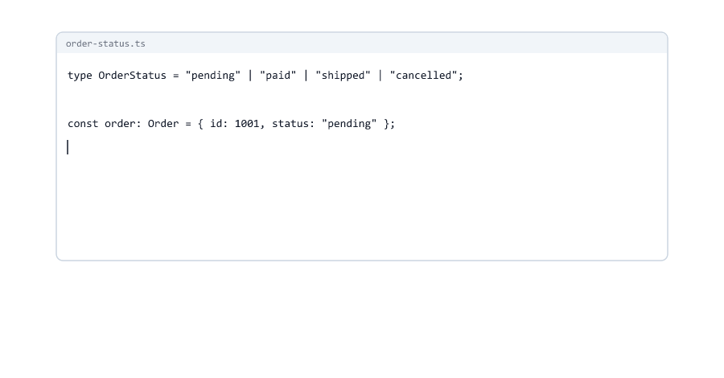

# Union and Literal Types

> **Session 9 of 33** | Part 2: Typing Your Data | [All sessions](README.md#course-outline)

## Table of Contents
- [Your Folder for This Session](#your-folder-for-this-session)
- [A Value That Can Be One of Several Types](#a-value-that-can-be-one-of-several-types)
- [Give a Union a Name](#give-a-union-a-name)
- [What You Can Do with a Union](#what-you-can-do-with-a-union)
- [Unions and Arrays: Where the Brackets Go](#unions-and-arrays-where-the-brackets-go)
- [Literal Types](#literal-types)
- [Unions of Literals](#unions-of-literals)
- [Number Literals](#number-literals)
- [A Literal Union Is Still a String](#a-literal-union-is-still-a-string)
- [Comparing with a Value That Is Not in the Union](#comparing-with-a-value-that-is-not-in-the-union)
- [Where Literal Types Get Lost](#where-literal-types-get-lost)
- [switch over a Literal Union](#switch-over-a-literal-union)
- [Looking Up a Value with a Literal Key](#looking-up-a-value-with-a-literal-key)
- [Unions of Object Types](#unions-of-object-types)
- [Union or Intersection?](#union-or-intersection)
- [You Have Seen Unions Already](#you-have-seen-unions-already)
- [Literal Unions in the Libraries You Use](#literal-unions-in-the-libraries-you-use)
- [Mini Example 1: An Order Status Board](#mini-example-1-an-order-status-board)
- [Mini Example 2: A Logger with Levels](#mini-example-2-a-logger-with-levels)
- [Beginner Mistakes](#beginner-mistakes)
- [Practice Exercises](#practice-exercises)
- [Interview Questions](#interview-questions)

---

## Your Folder for This Session

Make a folder `09-unions-literals` inside `ts-practice`, with the one-line `tsconfig.json`

09-unions-literals/tsconfig.json

```json
{
  "extends": "../tsconfig.json"
}
```

---

## A Value That Can Be One of Several Types

Orders placed in the shop get number ids like `1001`. Orders that come from a partner website get text ids like `"WEB-1002"`. A function that prints an order id must accept both.

Since Session 03, every variable and parameter had **one** type. A **union type** says "one of these types": write the types with `|` between them, and read `|` as "or".

union.ts

```typescript
function formatOrderId(id: string | number): string {
  return `Order #${id}`;
}

console.log(formatOrderId(1001));
console.log(formatOrderId("WEB-1002"));
```

```bash
npx tsc --noEmit
node union.ts
```

```text
Order #1001
Order #WEB-1002
```

`string | number` means: a string or a number. Anything else is refused

union-wrong.ts

```typescript
function formatOrderId(id: string | number): string {
  return `Order #${id}`;
}

console.log(formatOrderId(true));
```

```text
union-wrong.ts:5:27 - error TS2345: Argument of type 'boolean' is not assignable to parameter of type 'string | number'.

5 console.log(formatOrderId(true));
                            ~~~~


Found 1 error in union-wrong.ts:5
```

A union works for variables too

union-variable.ts

```typescript
let orderId: string | number = 1001;
orderId = "WEB-1002";
orderId = null;
```

```text
union-variable.ts:3:1 - error TS2322: Type 'null' is not assignable to type 'string | number'.

3 orderId = null;
  ~~~~~~~


Found 1 error in union-variable.ts:3
```

A number, then a text: both fine. `null` is not in the union, so it is refused. A value that may be missing has `null` or `undefined` in its union, which is Session 11.


---

## Give a Union a Name

Session 08's rule: `interface` for object shapes, `type` for everything else. A union is the most common "everything else"

order-id.ts

```typescript
type OrderId = string | number;

function formatOrderId(id: OrderId): string {
  return `Order #${id}`;
}

const ids: OrderId[] = [1001, "WEB-1002"];
for (const id of ids) {
  console.log(formatOrderId(id));
}
console.log(formatOrderId(true));
```

```text
order-id.ts:11:27 - error TS2345: Argument of type 'boolean' is not assignable to parameter of type 'OrderId'.

11 console.log(formatOrderId(true));
                             ~~~~


Found 1 error in order-id.ts:11
```

As in Session 08, the error uses the name. `OrderId[]` is an array where each item is an `OrderId`. Remove the last line, and the file prints the same two lines as `union.ts`.

---

## What You Can Do with a Union

Try to make the id upper case

union-method.ts

```typescript
function shortId(id: string | number): string {
  return id.toUpperCase();
}
```

```text
union-method.ts:2:13 - error TS2339: Property 'toUpperCase' does not exist on type 'string | number'.
  Property 'toUpperCase' does not exist on type 'number'.

2   return id.toUpperCase();
              ~~~~~~~~~~~


Found 1 error in union-method.ts:2
```

`id` might be a number, and numbers have no `toUpperCase`. The second line names the member that causes the problem. This is the main rule of unions: **you can use only what every member has.**

Maths fails for the same reason

union-math.ts

```typescript
function nextId(id: string | number): number {
  return id + 1;
}
function doubleId(id: string | number): number {
  return id * 2;
}
```

```text
union-math.ts:2:10 - error TS2365: Operator '+' cannot be applied to types 'string | number' and 'number'.

2   return id + 1;
           ~~~~~~

union-math.ts:5:10 - error TS2362: The left-hand side of an arithmetic operation must be of type 'any', 'number', 'bigint' or an enum type.

5   return id * 2;
           ~~


Found 2 errors in the same file, starting at: union-math.ts:2
```

With a string, `id + 1` would join texts (`"WEB-10021"`), and `*` needs a number. In JavaScript, both lines run and give a wrong result for text ids.

What every member has works without a problem

union-common.ts

```typescript
function describeId(id: string | number): string {
  const text = id.toString();
  return `${text} has ${text.length} characters`;
}

console.log(describeId(1001));
console.log(describeId("WEB-1002"));
```

```text
1001 has 4 characters
WEB-1002 has 8 characters
```

Both strings and numbers have `toString()`, and its result is a `string`, so `text.length` is fine.

| Code with `id: string \| number` | Allowed? | Why                                          |
| -------------------------------- | -------- | -------------------------------------------- |
| `` `Order #${id}` ``             | Yes      | A template literal accepts any value         |
| `id.toString()`                  | Yes      | Strings and numbers both have it             |
| `console.log(id)`                | Yes      | `console.log` accepts any value              |
| `id === 1001`                    | Yes      | `id` can be a number, so the comparison makes sense |
| `id.toUpperCase()`               | No       | Numbers do not have it                       |
| `id.toFixed(2)`                  | No       | Strings do not have it                       |
| `id * 2`                         | No       | `*` needs a number                           |

To use `toUpperCase`, the code must first check that `id` really is a string. Inside that `if`, TypeScript then treats `id` as a `string`. That is called **narrowing**, and it is all of Session 10.


---

## Unions and Arrays: Where the Brackets Go

union-arrays.ts

```typescript
const ids: (string | number)[] = [1001, "WEB-1002", 1003];
const batch: number[] | string[] = [1001, 1002, 1003];
const code: string | number[] = "WEB-1002";

console.log(ids, batch, code);
```

```text
[ 1001, 'WEB-1002', 1003 ] [ 1001, 1002, 1003 ] WEB-1002
```

Three different types

| Type                   | Means                                       | Fits                         |
| ---------------------- | ------------------------------------------- | ---------------------------- |
| `(string \| number)[]` | An array, each item a string or a number    | `[1001, "WEB-1002", 1003]`   |
| `number[] \| string[]` | All numbers, or all strings                 | `[1001, 1002]`, `["A", "B"]` |
| `string \| number[]`   | One string, or an array of numbers          | `"WEB-1002"`, `[1001, 1002]` |

Mixed arrays fail for the last two

union-arrays-wrong.ts

```typescript
const batch: number[] | string[] = [1001, "WEB-1002"];
const code: string | number[] = [1001, "WEB-1002"];
```

```text
union-arrays-wrong.ts:1:7 - error TS2322: Type '(string | number)[]' is not assignable to type 'string[] | number[]'.
  Type '(string | number)[]' is not assignable to type 'string[]'.
    Type 'string | number' is not assignable to type 'string'.
      Type 'number' is not assignable to type 'string'.

1 const batch: number[] | string[] = [1001, "WEB-1002"];
        ~~~~~

union-arrays-wrong.ts:2:7 - error TS2322: Type '(string | number)[]' is not assignable to type 'string | number[]'.
  Type '(string | number)[]' is not assignable to type 'number[]'.
    Type 'string | number' is not assignable to type 'number'.
      Type 'string' is not assignable to type 'number'.

2 const code: string | number[] = [1001, "WEB-1002"];
        ~~~~


Found 2 errors in the same file, starting at: union-arrays-wrong.ts:1
```

Read the indented lines from the top, as in Session 05: the array is `(string | number)[]`, it does not fit `string[]`, because an item could be a number. `tsc` tried each member of the union and shows why one of them fails.

Also notice: the code says `number[] | string[]`, the message says `string[] | number[]`. The order inside a union does not matter, and `tsc` sometimes prints it in a different order.

`[]` belongs only to the type right before it, so `string | number[]` is "a string, or an array of numbers". For an array of both, put brackets around the union: `(string | number)[]`.

![Three types side by side with example values dropping into each: (string | number)[] takes a mixed array, number[] | string[] takes only arrays of one kind, string | number[] takes a single text or an array of numbers](images/09-union-and-literal-types/array-brackets.gif)

---

## Literal Types

In Session 03 you saw that `const role = "admin"` has the type `"admin"`: a **literal type**, a type with exactly one value. You can write a literal type yourself

literal.ts

```typescript
let currency: "INR" = "INR";
currency = "INR";
currency = "USD";
```

```text
literal.ts:3:1 - error TS2322: Type '"USD"' is not assignable to type '"INR"'.

3 currency = "USD";
  ~~~~~~~~


Found 1 error in literal.ts:3
```

Notice the quotes inside the quotes: `'"USD"'` is the literal type of that exact text, while `'string'` would mean any text.

One allowed value is rarely useful. Several allowed values, joined with `|`, are one of the most useful types in TypeScript.

---

## Unions of Literals

With `status: string`, any text is a valid status

status-string.ts

```typescript
interface Order {
  readonly id: number;
  status: string;
}

const order: Order = { id: 1001, status: "pending" };
order.status = "shiped";
console.log(order);
```

```text
{ id: 1001, status: 'shiped' }
```

No error, and the typo is now saved in the order. Code that checks `status === "shipped"` will never find this order.

A union of literals lists the allowed values

order-status.ts

```typescript
type OrderStatus = "pending" | "paid" | "shipped" | "cancelled";

interface Order {
  readonly id: number;
  status: OrderStatus;
}

const order: Order = { id: 1001, status: "pending" };
order.status = "paid";
console.log(order);
```

```text
{ id: 1001, status: 'paid' }
```

Now add two lines after `order.status = "paid";`

```typescript
order.status = "shiped";
const second: Order = { id: 1002, status: "Paid" };
```

```text
order-status.ts:10:1 - error TS2820: Type '"shiped"' is not assignable to type 'OrderStatus'. Did you mean '"shipped"'?

10 order.status = "shiped";
   ~~~~~~~~~~~~

order-status.ts:11:35 - error TS2820: Type '"Paid"' is not assignable to type 'OrderStatus'. Did you mean '"paid"'?

11 const second: Order = { id: 1002, status: "Paid" };
                                     ~~~~~~

  order-status.ts:5:3 - The expected type comes from property 'status' which is declared here on type 'Order'
    5   status: OrderStatus;
        ~~~~~~


Found 2 errors in the same file, starting at: order-status.ts:10
```

Both mistakes are caught, and `tsc` even suggests the closest allowed value (TS2820). It does that only when the typo is close: a completely different text gets the plain TS2322.

VS Code helps before you make the typo: type `order.status = "` and it lists the four allowed values.



Literal unions replace "magic strings", texts that have a meaning but are spread through the code. You will use them for

| Value          | Type                                         |
| -------------- | -------------------------------------------- |
| Order status   | `"pending" \| "paid" \| "shipped" \| "cancelled"` |
| User role      | `"admin" \| "customer"`                      |
| Payment method | `"card" \| "upi" \| "cod"`                   |
| HTTP method    | `"GET" \| "POST" \| "PUT" \| "DELETE"`       |

The allowed values are written once, typos are caught, and the editor suggests them.

---

## Number Literals

Numbers can be literal types too

rating.ts

```typescript
type Rating = 1 | 2 | 3 | 4 | 5;

function stars(rating: Rating): string {
  return "*".repeat(rating) + "-".repeat(5 - rating);
}

console.log(stars(4));
console.log(stars(1));
```

```text
****-
*----
```

Each member is a number, so `rating` works with `repeat` and with `5 - rating`. Now two wrong calls

rating-wrong.ts

```typescript
type Rating = 1 | 2 | 3 | 4 | 5;

function stars(rating: Rating): string {
  return "*".repeat(rating) + "-".repeat(5 - rating);
}

console.log(stars(6));

const average = Math.round(4.4);
console.log(stars(average));
```

```text
rating-wrong.ts:7:19 - error TS2345: Argument of type '6' is not assignable to parameter of type 'Rating'.

7 console.log(stars(6));
                    ~

rating-wrong.ts:10:19 - error TS2345: Argument of type 'number' is not assignable to parameter of type 'Rating'.

10 console.log(stars(average));
                     ~~~~~~~


Found 2 errors in the same file, starting at: rating-wrong.ts:7
```

The first is clear: `6` is not a rating. The second surprises many beginners. `Math.round(4.4)` is `4`, but `tsc` does not run your code. It only knows that `Math.round` returns a `number`, and a `number` could be `6` or `-1`. A calculated number must be checked before it can be a `Rating` (Session 10).

`boolean` is a literal union too: it is the same as `true | false`. HTTP status codes are another common example: `200 | 201 | 400 | 404 | 500`.

---

## A Literal Union Is Still a String

Every member of `OrderStatus` is a string, so every string method works, unlike with `string | number`

status-tag.ts

```typescript
type OrderStatus = "pending" | "paid" | "shipped" | "cancelled";

function statusTag(status: OrderStatus): string {
  return `[${status.toUpperCase().padEnd(9)}] ${status.length} letters`;
}

console.log(statusTag("paid"));
console.log(statusTag("cancelled"));
```

```text
[PAID     ] 4 letters
[CANCELLED] 9 letters
```

An order status fits wherever a `string` is expected. The other direction does not work

narrow-wide.ts

```typescript
type OrderStatus = "pending" | "paid" | "shipped" | "cancelled";

const status: OrderStatus = "paid";
const text: string = status;

const input: string = "paid";
const next: OrderStatus = input;
```

```text
narrow-wide.ts:7:7 - error TS2322: Type 'string' is not assignable to type 'OrderStatus'.

7 const next: OrderStatus = input;
        ~~~~


Found 1 error in narrow-wide.ts:7
```

Every order status is a text, but not every text is an order status. `input` has the type `string`, so it could be `"hello"`, even though its value is `"paid"` right now. The **narrow** type fits into the **wide** one, never the other way.


---

## Comparing with a Value That Is Not in the Union

overlap.ts

```typescript
type OrderStatus = "pending" | "paid" | "shipped" | "cancelled";

function isFinished(status: OrderStatus): boolean {
  return status === "delivered";
}
```

```text
overlap.ts:4:10 - error TS2367: This comparison appears to be unintentional because the types 'OrderStatus' and '"delivered"' have no overlap.

4   return status === "delivered";
           ~~~~~~~~~~~~~~~~~~~~~~


Found 1 error in overlap.ts:4
```

The same error as `role === "user"` in Session 03. `status` can never be `"delivered"`, so this comparison is always `false`. Either it is a typo, or the union is missing a value. JavaScript would quietly return `false` for every order.

---

## Where Literal Types Get Lost

widening.ts

```typescript
type OrderStatus = "pending" | "paid" | "shipped" | "cancelled";

function setStatus(id: number, status: OrderStatus): void {
  console.log(`Order ${id} is now ${status}`);
}

setStatus(1001, "paid");

let nextStatus = "paid";
setStatus(1002, nextStatus);

const update = { id: 1003, status: "shipped" };
setStatus(update.id, update.status);
```

```text
widening.ts:10:17 - error TS2345: Argument of type 'string' is not assignable to parameter of type 'OrderStatus'.

10 setStatus(1002, nextStatus);
                   ~~~~~~~~~~

widening.ts:13:22 - error TS2345: Argument of type 'string' is not assignable to parameter of type 'OrderStatus'.

13 setStatus(update.id, update.status);
                        ~~~~~~~~~~~~~


Found 2 errors in the same file, starting at: widening.ts:10
```

The first call works: `"paid"` written directly is the literal `"paid"`. The other two fail, although the values are correct

| Code                                          | Inferred type                     | Why                                         |
| --------------------------------------------- | --------------------------------- | ------------------------------------------- |
| `let nextStatus = "paid";`                    | `string`                          | `let` can change, so it is widened (Session 03) |
| `const update = { id: 1003, status: "shipped" };` | `{ id: number; status: string; }` | Properties can change too, even in a `const` object |

Three fixes, all used in practice

widening-fixed.ts

```typescript
type OrderStatus = "pending" | "paid" | "shipped" | "cancelled";

interface StatusUpdate {
  id: number;
  status: OrderStatus;
}

function setStatus(id: number, status: OrderStatus): void {
  console.log(`Order ${id} is now ${status}`);
}

let nextStatus: OrderStatus = "paid";
setStatus(1002, nextStatus);

const update: StatusUpdate = { id: 1003, status: "shipped" };
setStatus(update.id, update.status);

const finalStatus = "cancelled";
setStatus(1004, finalStatus);
```

```text
Order 1002 is now paid
Order 1003 is now shipped
Order 1004 is now cancelled
```

| Fix                                   | Example                                              |
| ------------------------------------- | ---------------------------------------------------- |
| Annotate the `let` with the union     | `let nextStatus: OrderStatus = "paid";`              |
| Give the object a type                | `const update: StatusUpdate = { ... };`              |
| Use `const` for a single value        | `const finalStatus = "cancelled";` has the type `"cancelled"` |

Session 13 shows one more way, `as const`.


---

## switch over a Literal Union

A label for each status

status-label.ts

```typescript
type OrderStatus = "pending" | "paid" | "shipped" | "cancelled";

function statusLabel(status: OrderStatus): string {
  switch (status) {
    case "pending":
      return "Waiting for payment";
    case "paid":
      return "Paid, packing now";
    case "shipped":
      return "On the way";
    case "cancelled":
      return "Cancelled";
  }
}

console.log(statusLabel("paid"));
console.log(statusLabel("shipped"));
```

```text
Paid, packing now
On the way
```

No `default`, no `return` after the `switch`, and `tsc` is happy: each of the four possible values has a `return`, so the function always returns a string.

Now the shop adds a status. Change the first line

```typescript
type OrderStatus = "pending" | "paid" | "shipped" | "cancelled" | "delivered";
```

```text
status-label.ts:3:44 - error TS2366: Function lacks ending return statement and return type does not include 'undefined'.

3 function statusLabel(status: OrderStatus): string {
                                             ~~~~~~


Found 1 error in status-label.ts:3
```

For `"delivered"`, no `case` matches, the function reaches its end, and returns `undefined`, but it promised a `string`. This is the error you want: a value was added in one place, and `tsc` points to a function that does not handle it yet.

Change the type back, and make a typo in a `case` instead: `case "shiped":`

```text
status-label.ts:3:44 - error TS2366: Function lacks ending return statement and return type does not include 'undefined'.

3 function statusLabel(status: OrderStatus): string {
                                             ~~~~~~

status-label.ts:9:10 - error TS2678: Type '"shiped"' is not comparable to type 'OrderStatus'.

9     case "shiped":
           ~~~~~~~~


Found 2 errors in the same file, starting at: status-label.ts:3
```

Two errors for one typo: `"shiped"` can never match (TS2678), and `"shipped"` is now not handled (TS2366).

How `tsc` knows that every value has a `case` is narrowing again, Session 10.


---

## Looking Up a Value with a Literal Key

In Session 07, `priceOf(product: string)` could not read `prices[product]` (TS7053), because `product` could be any text. The fix needed a union. Here it is

price-of.ts

```typescript
const prices = { keyboard: 149900, mouse: 49900 };

function priceOf(product: "keyboard" | "mouse"): number {
  return prices[product];
}

console.log(priceOf("keyboard"));
console.log(priceOf("mouse"));
```

```text
149900
49900
```

`product` can only be `"keyboard"` or `"mouse"`, and `prices` has both properties, so `prices[product]` is a `number`. Not `number | undefined`: unlike the index signature in Session 07, every possible key exists. A product that is not in the list is refused at the call

```typescript
console.log(priceOf("monitor"));
```

```text
price-of.ts:7:21 - error TS2345: Argument of type '"monitor"' is not assignable to parameter of type '"keyboard" | "mouse"'.

7 console.log(priceOf("monitor"));
                      ~~~~~~~~~


Found 1 error in price-of.ts:7
```

Writing the keys twice, once in `prices` and once in the union, is not ideal. Session 15 shows how to get the union from the object with `keyof`.


---

## Unions of Object Types

A union can join object types. Each interface here has a `kind` property with a literal type

catalog-item.ts

```typescript
interface PhysicalProduct {
  kind: "physical";
  name: string;
  pricePaise: number;
  weightGrams: number;
}

interface DigitalProduct {
  kind: "digital";
  name: string;
  pricePaise: number;
  downloadUrl: string;
}

type CatalogItem = PhysicalProduct | DigitalProduct;

function describe(item: CatalogItem): string {
  return `${item.name} (${item.kind}): Rs. ${item.pricePaise / 100}`;
}

const items: CatalogItem[] = [
  { kind: "physical", name: "Keyboard", pricePaise: 149900, weightGrams: 900 },
  { kind: "digital", name: "TypeScript Notes", pricePaise: 29900, downloadUrl: "https://example.com/ts-notes.pdf" }
];

for (const item of items) {
  console.log(describe(item));
}
```

```text
Keyboard (physical): Rs. 1499
TypeScript Notes (digital): Rs. 299
```

`name`, `kind` and `pricePaise` exist in both interfaces, so `describe` can use them. `item.kind` has the type `"physical" | "digital"`.

A property that only one member has is the same problem as `toUpperCase` on `string | number`. Replace everything after the `type CatalogItem` line with this

catalog-item.ts

```typescript
function weightOf(item: CatalogItem): number {
  return item.weightGrams;
}

const ebook: CatalogItem = { kind: "digital", name: "TypeScript Notes", pricePaise: 29900, weightGrams: 0 };
```

```text
catalog-item.ts:18:15 - error TS2339: Property 'weightGrams' does not exist on type 'CatalogItem'.
  Property 'weightGrams' does not exist on type 'DigitalProduct'.

18   return item.weightGrams;
                 ~~~~~~~~~~~

catalog-item.ts:21:92 - error TS2353: Object literal may only specify known properties, and 'weightGrams' does not exist in type 'DigitalProduct'.

21 const ebook: CatalogItem = { kind: "digital", name: "TypeScript Notes", pricePaise: 29900, weightGrams: 0 };
                                                                                               ~~~~~~~~~~~


Found 2 errors in the same file, starting at: catalog-item.ts:18
```

The second error shows the `kind` property already at work: the object says `kind: "digital"`, so `tsc` checked it against `DigitalProduct`, where `weightGrams` does not exist.

| Session 08: `Product[]` with `extends`           | Now: `CatalogItem[]` with a union                   |
| ------------------------------------------------ | --------------------------------------------------- |
| Any object with the `Product` properties fits    | Only a physical **or** a digital product fits       |
| Nothing says which kinds of product exist        | The two kinds are listed in one place               |
| No way to find out which kind an item is         | `item.kind` says which kind it is                   |

Reading `weightGrams` needs a check on `kind` first: when `item.kind === "physical"`, the item is a `PhysicalProduct`. A union of objects with a literal property like `kind` is called a **discriminated union**, and it is the biggest topic of Session 10.


---

## Union or Intersection?

Session 08 joined types with `&`. The two look alike and mean almost the opposite

|                            | Union `A \| B`                          | Intersection `A & B`                        |
| -------------------------- | --------------------------------------- | ------------------------------------------- |
| Read as                    | A **or** B                              | A **and** B                                 |
| A value needs              | everything from **one** member          | everything from **all** parts               |
| You can use                | only what every member has              | everything from every part                  |
| Adding a member            | more values fit                         | fewer values fit                            |
| Example                    | `PhysicalProduct \| DigitalProduct`     | `Product & { downloadUrl: string }`         |

A union gives more freedom to whoever **makes** the value, and less to whoever **uses** it. An intersection is the other way around.


---

## You Have Seen Unions Already

Point at these in VS Code, and each shows a union

| Code                                        | Type                    | Session |
| ------------------------------------------- | ----------------------- | ------- |
| `names[0]` with `noUncheckedIndexedAccess`  | `string \| undefined`   | 06      |
| `customer.phone` with `phone?: string`      | `string \| undefined`   | 07      |
| `process.env.PORT`                          | `string \| undefined`   | 05      |
| `boolean`                                   | `true \| false`         | 03      |

The first three are unions with `undefined`: "a value, or nothing". They are the most common unions in real code, and Session 11 is all about handling them safely.

---

## Literal Unions in the Libraries You Use

The types of JavaScript and Node.js are full of literal unions

invoice-date.ts

```typescript
const orderDate = new Date(2026, 9, 24);

const text = orderDate.toLocaleDateString("en-IN", { day: "numeric", month: "long", year: "numeric" });
console.log(`Invoice date: ${text}`);
```

```text
Invoice date: 24 October 2026
```

(Months count from 0 in `new Date`, so `9` is October.) Point at `month` in VS Code: it can be `"numeric"`, `"2-digit"`, `"long"`, `"short"` or `"narrow"`. Change `"long"` to `"longg"`

```text
invoice-date.ts:3:70 - error TS2769: No overload matches this call.
  The last overload gave the following error.
    Type '"longg"' is not assignable to type '"2-digit" | "long" | "narrow" | "numeric" | "short" | undefined'. Did you mean '"long"'?

3 const text = orderDate.toLocaleDateString("en-IN", { day: "numeric", month: "longg", year: "numeric" });
                                                                       ~~~~~

  ../node_modules/@typescript/typescript-win32-x64/lib/lib.es5.d.ts:4591:5 - The last overload is declared here.
    4591     toLocaleDateString(locales?: string | string[], options?: Intl.DateTimeFormatOptions): string;
             ~~~~~~~~~~~~~~~~~~~~~~~~~~~~~~~~~~~~~~~~~~~~~~~~~~~~~~~~~~~~~~~~~~~~~~~~~~~~~~~~~~~~~~~~~~~~~~


Found 1 error in invoice-date.ts:3
```

TS2769 from Session 05: read the last indented line. It lists every allowed value and suggests `"long"`. In JavaScript, the wrong value throws a `RangeError` only when that line runs.

The same in Node.js: the encoding in `fs.readFileSync("orders.json", "utf8")` has the type `BufferEncoding`, a literal union of names like `"utf8"` and `"base64"`.

---

## Mini Example 1: An Order Status Board

A list of orders with a label for each status, a note for orders that can still be cancelled, and a count per status

status-board.ts

```typescript
type OrderStatus = "pending" | "paid" | "shipped" | "cancelled";

interface Order {
  readonly id: number;
  customer: string;
  status: OrderStatus;
}

interface StatusCounts {
  pending: number;
  paid: number;
  shipped: number;
  cancelled: number;
}

function statusLabel(status: OrderStatus): string {
  switch (status) {
    case "pending":
      return "Waiting for payment";
    case "paid":
      return "Paid, packing now";
    case "shipped":
      return "On the way";
    case "cancelled":
      return "Cancelled";
  }
}

function canCancel(status: OrderStatus): boolean {
  return status === "pending" || status === "paid";
}

const orders: Order[] = [
  { id: 1001, customer: "Riya", status: "paid" },
  { id: 1002, customer: "Sara", status: "shipped" },
  { id: 1003, customer: "Aman", status: "pending" },
  { id: 1004, customer: "Neha", status: "paid" },
  { id: 1005, customer: "Kabir", status: "cancelled" }
];

const counts: StatusCounts = { pending: 0, paid: 0, shipped: 0, cancelled: 0 };

for (const order of orders) {
  counts[order.status] += 1;
  const note = canCancel(order.status) ? " (can cancel)" : "";
  console.log(`#${order.id}  ${order.customer.padEnd(6)} ${statusLabel(order.status)}${note}`);
}

console.log(`Pending ${counts.pending}, paid ${counts.paid}, shipped ${counts.shipped}, cancelled ${counts.cancelled}`);
```

```bash
npx tsc --noEmit
node status-board.ts
```

```text
#1001  Riya   Paid, packing now (can cancel)
#1002  Sara   On the way
#1003  Aman   Waiting for payment (can cancel)
#1004  Neha   Paid, packing now (can cancel)
#1005  Kabir  Cancelled
Pending 1, paid 2, shipped 1, cancelled 1
```

| Code                                    | What it uses from this session                          |
| --------------------------------------- | ------------------------------------------------------- |
| `status: OrderStatus` in `Order`        | A literal union as a property type                      |
| `statusLabel`                           | A `switch` that handles every value, no `default`       |
| `canCancel`                             | Comparisons with values that are in the union           |
| `counts[order.status] += 1`             | A literal key: every status is a property of `StatusCounts` |

Now the shop starts confirming deliveries. Change the first line

```typescript
type OrderStatus = "pending" | "paid" | "shipped" | "cancelled" | "delivered";
```

```text
status-board.ts:16:44 - error TS2366: Function lacks ending return statement and return type does not include 'undefined'.

16 function statusLabel(status: OrderStatus): string {
                                              ~~~~~~

status-board.ts:44:3 - error TS7053: Element implicitly has an 'any' type because expression of type 'OrderStatus' can't be used to index type 'StatusCounts'.
  Property 'delivered' does not exist on type 'StatusCounts'.

44   counts[order.status] += 1;
     ~~~~~~~~~~~~~~~~~~~~


Found 2 errors in the same file, starting at: status-board.ts:16
```

A to-do list for the new status, made by `tsc`

1. `statusLabel` has no `case "delivered"`: add one that returns `"Delivered"`.
2. `StatusCounts` has no `delivered`: add `delivered: number;`, and then `delivered: 0` in `counts` (the next `tsc` run reminds you of that one with TS2741).

`canCancel` has no error, and it is right: a delivered order cannot be cancelled. In JavaScript, a delivered order would print the label `undefined`, and `counts.delivered` would become `NaN`, with no error anywhere.


---

## Mini Example 2: A Logger with Levels

Backend apps log a lot of messages, and each message has a level. In production you usually hide the `debug` messages and keep the rest

logger.ts

```typescript
type LogLevel = "debug" | "info" | "warn" | "error";

interface LevelRanks {
  debug: number;
  info: number;
  warn: number;
  error: number;
}

const ranks: LevelRanks = { debug: 10, info: 20, warn: 30, error: 40 };
const minimumLevel: LogLevel = "info";

function log(level: LogLevel, message: string): void {
  if (ranks[level] < ranks[minimumLevel]) {
    return;
  }
  console.log(`[${level.toUpperCase().padEnd(5)}] ${message}`);
}

log("debug", "Cart loaded with 3 items");
log("info", "Order 1001 placed by Riya");
log("warn", "Low stock: Mouse (2 left)");
log("error", "Payment failed for order 1002");
```

```bash
npx tsc --noEmit
node logger.ts
```

```text
[INFO ] Order 1001 placed by Riya
[WARN ] Low stock: Mouse (2 left)
[ERROR] Payment failed for order 1002
```

`debug` has rank 10, below the minimum `info` (20), so that message is skipped. `level.toUpperCase()` works because every member of `LogLevel` is a string. While you look for a bug, show everything

```typescript
const minimumLevel: LogLevel = "debug";
```

```text
[DEBUG] Cart loaded with 3 items
[INFO ] Order 1001 placed by Riya
[WARN ] Low stock: Mouse (2 left)
[ERROR] Payment failed for order 1002
```

Now the most common logging typo. Add a line at the end

```typescript
log("warning", "Disk almost full");
```

```text
logger.ts:24:5 - error TS2345: Argument of type '"warning"' is not assignable to parameter of type 'LogLevel'.

24 log("warning", "Disk almost full");
       ~~~~~~~~~


Found 1 error in logger.ts:24
```

`"warning"` is too different from `"warn"` for a "Did you mean", but the error is clear. A level that does not exist is caught in the setting too

```typescript
const minimumLevel: LogLevel = "verbose";
```

```text
logger.ts:11:7 - error TS2322: Type '"verbose"' is not assignable to type 'LogLevel'.

11 const minimumLevel: LogLevel = "verbose";
         ~~~~~~~~~~~~


Found 1 error in logger.ts:11
```

In plain JavaScript, `ranks["warning"]` is `undefined`, and `undefined < 40` is `false`, so the message is never skipped: it prints as `[WARNING] Disk almost full` even when the minimum level is `"error"`. Real logging libraries type their levels the same way.

A real app would read the minimum level from `process.env.LOG_LEVEL`. But that is `string | undefined`, and a `string` does not fit `LogLevel`, as you saw in `narrow-wide.ts`. Checking it first is Session 10.


---

## Beginner Mistakes

### Mistake 1: Using string when only a few values are allowed

`status: string` accepted `"shiped"`, and the typo was saved in the order. When only some texts are valid, list them: `type OrderStatus = "pending" | "paid" | "shipped" | "cancelled"`.

---

### Mistake 2: Using what only one member of the union has

`id.toUpperCase()` on `string | number` gives `error TS2339: Property 'toUpperCase' does not exist on type 'string | number'.` Use what all members have, like `toString()`, or check the type first (Session 10).

---

### Mistake 3: Forgetting the brackets around a union in an array

`string | number[]` is one string or an array of numbers. An array of both is `(string | number)[]`.

---

### Mistake 4: Adding | string to a literal union

`type Role = "admin" | "customer" | string` accepts any text: `const role: Role = "superman"` gives no error, because `string` already includes `"admin"` and `"customer"`. Leave `| string` out.

---

### Mistake 5: Losing the literal type in a let or an object

`let nextStatus = "paid"` is a `string`, and so is `status` in `const update = { status: "shipped" }`. Both give `error TS2345: Argument of type 'string' is not assignable to parameter of type 'OrderStatus'.` Annotate the variable, or give the object an interface.

---

### Mistake 6: The wrong case

`"Paid"` is not `"paid"`. `tsc` says `Did you mean '"paid"'?`. Pick one style for literal values, usually lower case, and keep it.

---

### Mistake 7: Passing a calculated number as a number literal union

`stars(Math.round(4.4))` gives `Argument of type 'number' is not assignable to parameter of type 'Rating'.` `tsc` does not run the code, so it only knows the result is a number. Check the value first (Session 10).

---

### Mistake 8: Comparing with a value that is not in the union

`status === "delivered"` gives `error TS2367: This comparison appears to be unintentional`, because it can never be `true`. Fix the typo, or add the value to the union.

---

### Mistake 9: A default that hides new values

With `default: return "Unknown";` in `statusLabel`, adding `"delivered"` to the union gives **no** error, and delivered orders print `Unknown`. When the `switch` handles every value, leave the `default` out, so `tsc` can tell you about new values.

---

### Mistake 10: Expecting a union of objects to have every property

`item.weightGrams` on `PhysicalProduct | DigitalProduct` gives `error TS2339`, because a digital product has no weight. Only shared properties can be used until you check `item.kind` (Session 10).

---

### Mistake 11: Confusing | and &

`A | B` is a value that is one of them; `A & B` is a value that is both. `PhysicalProduct & DigitalProduct` would need a weight **and** a download link.

---

## Practice Exercises

### Exercise 1

Write `type PaymentMethod = "card" | "upi" | "cod";` and a function `paymentLabel(method: PaymentMethod): string` with a `switch` that returns `"Card"`, `"UPI"` and `"Cash on delivery"`. Then add `"wallet"` to the type and read the error.

### Exercise 2

Write `formatAmount(amount: number | string): string` that returns `Rs. 1499` for both `1499` and `"1499"`. Which of `amount.toString()`, `amount.toFixed(2)` and `` `Rs. ${amount}` `` can you use?

### Exercise 3

Write `type Size = "S" | "M" | "L" | "XL";` and `interface TShirt { color: string; size: Size }`. Create three T-shirts. Then try the sizes `"XXL"`, `"m"` and `"Medium"`. Which of them gets a "Did you mean"?

### Exercise 4

Write `type HttpStatus = 200 | 201 | 400 | 404 | 500;` and `statusText(code: HttpStatus): string` that returns `"OK"`, `"Created"`, `"Bad Request"`, `"Not Found"` and `"Server Error"`. Call it with `418`. Then call it with `Number("200")`, and explain the error.

### Exercise 5

This code has two errors. Fix each in a different way

```typescript
let method = "upi";
const order = { id: 1001, method: "card" };
```

The function is `pay(id: number, method: PaymentMethod): void`, called as `pay(1001, method)` and `pay(order.id, order.method)`.

### Exercise 6

In `price-of.ts`, add `"monitor"` only to the parameter type of `priceOf`, not to `prices`. Read the error: which line does it point to, and what does the second line say? Then add `monitor: 1299900` to `prices`.

### Exercise 7

In Mini Example 1, add `"delivered"` and fix both errors. Then add `default: return "Unknown";` to the `switch` and add one more status, `"returned"`. What does `tsc` say now, and why is that worse?

### Exercise 8

In Mini Example 2, add a `"fatal"` level with rank 50. Let `tsc` show you every place that must change. Then log `log("fatal", "Database connection lost")` and check the output.

---

## Interview Questions

### What is a union type?

A type that allows values of several types, written with `|`, like `string | number`. A value of that type is one of the members at a time.

### What can you do with a value of a union type?

Only what every member of the union supports. On `string | number` you can call `toString()`, but not `toUpperCase()`. To use member-specific features, you check the type first, which is called narrowing.

### What is a literal type?

A type with exactly one value, like `"paid"`, `404` or `true`. A `const` with a primitive value gets a literal type, and literal types are usually combined into unions.

### Why use a union of string literals instead of string?

Only the listed values are allowed, so typos are caught by `tsc` (often with a "Did you mean"), the editor suggests the values, and adding a value shows every place that must handle it.

### What is the difference between (string | number)[] and string[] | number[]?

`(string | number)[]` is one array where each item can be a string or a number. `string[] | number[]` is either an array of only strings or an array of only numbers.

### Why does let status = "paid" not fit a parameter of type OrderStatus?

A `let` gets the widened type `string`, because it can change later, and a `string` does not fit a literal union. Annotating it, `let status: OrderStatus = "paid"`, keeps the union.

### How does TypeScript catch a missing case in a switch?

If the function has a return type like `string` and some value of the union has no `case`, the function can reach its end and return `undefined`, so `tsc` reports TS2366. A `case` with a value that is not in the union gives TS2678.

### What is the difference between a union and an intersection?

A union `A | B` accepts a value that is one of the members, and only shared properties can be used. An intersection `A & B` needs a value that has everything from all parts, and all properties can be used.

### What happens when you write "admin" | string?

The union is the same as `string`, because `string` already includes `"admin"`. Any text is accepted, so the literal member adds no checking.

### Can a union contain object types? What can you access on it?

Yes, like `PhysicalProduct | DigitalProduct`. Without a check, you can access only the properties that all members have.

### What is a discriminated union?

A union of object types that all have the same property with a different literal type in each, like `kind: "physical"` and `kind: "digital"`. Checking that property tells TypeScript which member you have.

### Literal union or enum?

Both describe a fixed set of values. A literal union is only a type, so it disappears when the code runs, and Node.js can run it directly. An `enum` creates real JavaScript code, and Node.js cannot run it without a build step. Session 16 compares them.

---

| Previous | All sessions | Next |
| :--- | :---: | ---: |
| [08. Type Aliases and Interfaces](08-type-aliases-and-interfaces.md) | [Course outline](README.md#course-outline) | [10. Narrowing](10-narrowing.md) |
