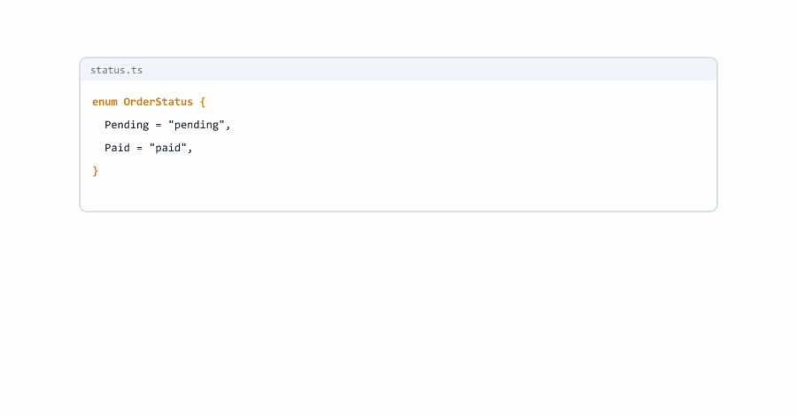

# Enums and Constant Objects

> **Session 16 of 33** | Part 4: Generics and Type Tools | [All sessions](README.md#course-outline)

## Table of Contents
- [Your Folder for This Session](#your-folder-for-this-session)
- [What an Enum Is](#what-an-enum-is)
- [Why This Project Refuses Enums](#why-this-project-refuses-enums)
- [What an Enum Turns Into](#what-an-enum-turns-into)
- [String Enums Refuse Plain Strings](#string-enums-refuse-plain-strings)
- [Numeric Enums](#numeric-enums)
- [const enum](#const-enum)
- [Running Enums Anyway](#running-enums-anyway)
- [The Modern Alternative: A Constant Object](#the-modern-alternative-a-constant-object)
- [Without as const, It Does Not Work](#without-as-const-it-does-not-work)
- [Literal Union, Constant Object or Enum?](#literal-union-constant-object-or-enum)
- [Turning an Enum into a Constant Object](#turning-an-enum-into-a-constant-object)
- [Mini Example 1: An Order Workflow](#mini-example-1-an-order-workflow)
- [Mini Example 2: HTTP Status Constants](#mini-example-2-http-status-constants)
- [Beginner Mistakes](#beginner-mistakes)
- [Practice Exercises](#practice-exercises)
- [Interview Questions](#interview-questions)

---

## Your Folder for This Session

Make a folder `16-enums` inside `ts-practice`, with the one-line `tsconfig.json`

16-enums/tsconfig.json

```json
{
  "extends": "../tsconfig.json"
}
```

Later in this session you make a second folder, `16-enums-build`, to look inside enums.

---

## What an Enum Is

An **enum** gives names to a fixed set of values. You will see enums in many existing TypeScript projects, so you need to read them

status-enum.ts

```typescript
enum OrderStatus {
  Pending = "pending",
  Paid = "paid",
  Shipped = "shipped",
  Cancelled = "cancelled"
}

function setStatus(id: number, status: OrderStatus): void {
  console.log(`Order ${id} is now ${status}`);
}

setStatus(1001, OrderStatus.Paid);
```

`OrderStatus` is both a type (the parameter `status: OrderStatus`) and a value (`OrderStatus.Paid`, which is `"paid"`). It looks like the literal union from Session 09 with names on top. But in this course project it does not even pass `tsc`.

---

## Why This Project Refuses Enums

```bash
npx tsc --noEmit
node status-enum.ts
```

```text
status-enum.ts:1:6 - error TS1294: This syntax is not allowed when 'erasableSyntaxOnly' is enabled.

1 enum OrderStatus {
       ~~~~~~~~~~~


Found 1 error in status-enum.ts:1
```

And Node.js refuses to run it at all

```text
node:internal/modules/run_main:107
    triggerUncaughtException(
    ^

file:///D:/ts-practice/16-enums/status-enum.ts:1
  > enum OrderStatus {
      Pending = "pending",
      Paid = "paid",
      Shipped = "shipped",
      Cancelled = "cancelled"
  > }

SyntaxError [ERR_UNSUPPORTED_TYPESCRIPT_SYNTAX]: TypeScript enum is not supported in strip-only mode
    at parseTypeScript (node:internal/modules/typescript:68:40)
    at processTypeScriptCode (node:internal/modules/typescript:146:42)
    at stripTypeScriptModuleTypes (node:internal/modules/typescript:215:22)
    at ModuleLoader.<anonymous> (node:internal/modules/esm/translators:680:29)
    at #translate (node:internal/modules/esm/loader:434:20)
    at afterLoad (node:internal/modules/esm/loader:502:29)
    at ModuleLoader.loadAndTranslate (node:internal/modules/esm/loader:507:12)
    at #getOrCreateModuleJobAfterResolve (node:internal/modules/esm/loader:560:36)
    at afterResolve (node:internal/modules/esm/loader:607:52)
    at ModuleLoader.getOrCreateModuleJob (node:internal/modules/esm/loader:613:12) {
  code: 'ERR_UNSUPPORTED_TYPESCRIPT_SYNTAX'
}

Node.js v24.19.0
```

You saw this in Session 01. Node.js runs `.ts` files by **removing** the types ("strip-only mode"), and everything you learned so far can simply be removed: annotations, interfaces, `type`, `as`, `satisfies`. An enum is different: it must **create** an object at run time, so there is nothing to remove. In Session 02 you turned on `erasableSyntaxOnly`, which makes `tsc` report every piece of syntax like this, before Node.js trips over it.


---

## What an Enum Turns Into

Session 02 said that code with enums needs a build with `tsc`. To see what an enum really is, make a second folder `16-enums-build`, with a `tsconfig.json` that allows enums and writes JavaScript files

16-enums-build/tsconfig.json

```json
{
  "extends": "../tsconfig.json",
  "compilerOptions": {
    "erasableSyntaxOnly": false,
    "outDir": "./dist",
    "sourceMap": false,
    "declaration": false,
    "declarationMap": false
  }
}
```

Copy `status-enum.ts` into it, add one line at the end, and build

16-enums-build/status-enum.ts

```typescript
enum OrderStatus {
  Pending = "pending",
  Paid = "paid",
  Shipped = "shipped",
  Cancelled = "cancelled"
}

function setStatus(id: number, status: OrderStatus): void {
  console.log(`Order ${id} is now ${status}`);
}

setStatus(1001, OrderStatus.Paid);
console.log(Object.values(OrderStatus));
```

```bash
npx tsc
node dist/status-enum.js
```

```text
Order 1001 is now paid
[ 'pending', 'paid', 'shipped', 'cancelled' ]
```

Open `dist/status-enum.js`

dist/status-enum.js

```javascript
var OrderStatus;
(function (OrderStatus) {
    OrderStatus["Pending"] = "pending";
    OrderStatus["Paid"] = "paid";
    OrderStatus["Shipped"] = "shipped";
    OrderStatus["Cancelled"] = "cancelled";
})(OrderStatus || (OrderStatus = {}));
function setStatus(id, status) {
    console.log(`Order ${id} is now ${status}`);
}
setStatus(1001, OrderStatus.Paid);
console.log(Object.values(OrderStatus));
export {};
```

The types of `setStatus` were removed, but the enum became seven lines of real code: a variable, and a function that fills it. This is the code Node.js would have to write itself, and strip-only mode does not write code.

(The `export {};` at the end comes from `moduleDetection: "force"` in your tsconfig: it makes every file a module.)


---

## String Enums Refuse Plain Strings

In the same build folder, add a call with the plain text

```typescript
setStatus(1002, "shipped");
```

```text
status-enum.ts:14:17 - error TS2345: Argument of type '"shipped"' is not assignable to parameter of type 'OrderStatus'.

14 setStatus(1002, "shipped");
                   ~~~~~~~~~


Found 1 error in status-enum.ts:14
```

`OrderStatus.Shipped` **is** `"shipped"` at run time, yet the text itself is refused. A string enum only accepts its own members. Sometimes that is wanted, but it hurts in backend code: a status from JSON, a database or a query string is a plain `string`, so it never fits without extra work.

Compare with Session 09's literal union, where `setStatus(1002, "shipped")` is fine.


---

## Numeric Enums

Without values, enum members are numbered from 0

16-enums-build/priority.ts

```typescript
enum Priority {
  Low,
  Normal,
  High
}

function priorityLine(id: number, priority: Priority): string {
  return `Order ${id}: priority ${priority} (${Priority[priority]})`;
}

console.log(priorityLine(1001, Priority.High));
console.log(priorityLine(1002, Priority.Low));
console.log(Object.keys(Priority));
```

```text
Order 1001: priority 2 (High)
Order 1002: priority 0 (Low)
[ '0', '1', '2', 'Low', 'Normal', 'High' ]
```

`Priority[priority]` works backwards, from the number to the name. That is why the object has six keys, as the compiled code shows

dist/priority.js

```javascript
var Priority;
(function (Priority) {
    Priority[Priority["Low"] = 0] = "Low";
    Priority[Priority["Normal"] = 1] = "Normal";
    Priority[Priority["High"] = 2] = "High";
})(Priority || (Priority = {}));
function priorityLine(id, priority) {
    return `Order ${id}: priority ${priority} (${Priority[priority]})`;
}
console.log(priorityLine(1001, Priority.High));
console.log(priorityLine(1002, Priority.Low));
console.log(Object.keys(Priority));
export {};
```

Numeric enums have a hole in their checks. A wrong literal is caught

```typescript
console.log(priorityLine(1004, 7));
```

```text
priority.ts:15:32 - error TS2345: Argument of type '7' is not assignable to parameter of type 'Priority'.

15 console.log(priorityLine(1004, 7));
                                  ~


Found 1 error in priority.ts:15
```

But any value of type `number` fits a numeric enum

```typescript
const fromForm: number = 7;
console.log(priorityLine(1003, fromForm));
```

```text
Order 1001: priority 2 (High)
Order 1002: priority 0 (Low)
[ '0', '1', '2', 'Low', 'Normal', 'High' ]
Order 1003: priority 7 (undefined)
```

`tsc` reported nothing, and priority 7 has no name. Every number from a form or a URL goes straight in. With numbers in a literal union, `1 | 2 | 3`, the same line is an error (Session 09).


---

## const enum

You may also see `const enum`. In this project, it is refused just like `enum`

currency.ts

```typescript
const enum Currency {
  Rupee = "INR",
  Dollar = "USD"
}

console.log(Currency.Rupee);
```

```text
currency.ts:1:12 - error TS1294: This syntax is not allowed when 'erasableSyntaxOnly' is enabled.

1 const enum Currency {
             ~~~~~~~~


Found 1 error in currency.ts:1
```

In older setups, `tsc` replaced every `Currency.Rupee` with `"INR"` and left no object behind. Build it in `16-enums-build`, and you see that with this project's settings it becomes a normal enum

dist/currency.js

```javascript
var Currency;
(function (Currency) {
    Currency["Rupee"] = "INR";
    Currency["Dollar"] = "USD";
})(Currency || (Currency = {}));
console.log(Currency.Rupee);
export {};
```

So `const enum` brings no advantage here, only the same problems.

---

## Running Enums Anyway

Two ways exist, and you have seen the first

| Way                                      | How                                               |
| ---------------------------------------- | ------------------------------------------------- |
| Build with `tsc`, then run the JavaScript | `npx tsc`, then `node dist/file.js`              |
| Let Node.js transform the code           | `node --experimental-transform-types file.ts`     |

The second works, with a warning

```bash
node --experimental-transform-types status-enum.ts
```

```text
(node:15256) ExperimentalWarning: Transform Types is an experimental feature and might change at any time
(Use `node --trace-warnings ...` to show where the warning was created)
Order 1001 is now paid
```

(The number after `node:` is the process id, and changes each time.) "Experimental" means it may change or disappear. For new code there is a simpler answer: do not use enums.

---

## The Modern Alternative: A Constant Object

Everything an enum gives you, names for values in one place, can be written with tools you already know: an object with `as const` (Session 13) and a type built from it (Session 15)

status-object.ts

```typescript
const OrderStatus = {
  Pending: "pending",
  Paid: "paid",
  Shipped: "shipped",
  Cancelled: "cancelled"
} as const;

type OrderStatus = (typeof OrderStatus)[keyof typeof OrderStatus];

function setStatus(id: number, status: OrderStatus): void {
  console.log(`Order ${id} is now ${status}`);
}

setStatus(1001, OrderStatus.Paid);
setStatus(1002, "shipped");
console.log(Object.values(OrderStatus));
```

```bash
npx tsc --noEmit
node status-object.ts
```

```text
Order 1001 is now paid
Order 1002 is now shipped
[ 'pending', 'paid', 'shipped', 'cancelled' ]
```

No error, and Node.js runs it directly, because the object is plain JavaScript and the type line can be removed.

| Part                                                    | Gives                                                    |
| ------------------------------------------------------- | -------------------------------------------------------- |
| `const OrderStatus = { ... } as const`                  | The **value**: an object you can use and loop over       |
| `typeof OrderStatus`                                    | Its type, with readonly literal properties               |
| `keyof typeof OrderStatus`                              | `"Pending" \| "Paid" \| "Shipped" \| "Cancelled"`        |
| `(typeof OrderStatus)[keyof typeof OrderStatus]`        | The values: `"pending" \| "paid" \| "shipped" \| "cancelled"` |

The **type** and the **object** have the same name, `OrderStatus`. That is allowed: TypeScript keeps types and values apart, and picks the right one from the place you use the name. Written with an enum, you also get one name for both, so code that uses `OrderStatus.Paid` and `status: OrderStatus` looks exactly the same.

The checks are those of a literal union

```typescript
setStatus(1003, "delivered");
setStatus(1004, OrderStatus.Delivered);
```

```text
status-object.ts:17:17 - error TS2345: Argument of type '"delivered"' is not assignable to parameter of type 'OrderStatus'.

17 setStatus(1003, "delivered");
                   ~~~~~~~~~~~

status-object.ts:18:29 - error TS2339: Property 'Delivered' does not exist on type '{ readonly Pending: "pending"; readonly Paid: "paid"; readonly Shipped: "shipped"; readonly Cancelled: "cancelled"; }'.

18 setStatus(1004, OrderStatus.Delivered);
                               ~~~~~~~~~


Found 2 errors in the same file, starting at: status-object.ts:17
```

And the object cannot be changed, because `as const` made every property `readonly`

```typescript
OrderStatus.Paid = "refunded";
```

```text
status-mutate.ts:17:13 - error TS2540: Cannot assign to 'Paid' because it is a read-only property.

17 OrderStatus.Paid = "refunded";
               ~~~~


Found 1 error in status-mutate.ts:17
```

| Question                                       | String enum         | Constant object       |
| ---------------------------------------------- | ------------------- | --------------------- |
| `OrderStatus.Paid` works?                      | Yes                 | Yes                   |
| A plain `"paid"` fits?                         | No (TS2345)         | Yes                   |
| `Object.values` gives the values?              | Yes                 | Yes                   |
| Runs with `node file.ts`?                      | No                  | Yes                   |
| Extra code at run time                         | A generated function | Just the object you wrote |


---

## Without as const, It Does Not Work

status-plain.ts

```typescript
const OrderStatus = {
  Pending: "pending",
  Paid: "paid"
};

type OrderStatus = (typeof OrderStatus)[keyof typeof OrderStatus];

const status: OrderStatus = "anything";
export { status };
```

No error. Without `as const`, the properties are widened to `string` (Session 09), so `OrderStatus` is just `string`, and `"anything"` fits. Always write `as const` on a constant object.


---

## Literal Union, Constant Object or Enum?

| You need                                                 | Use                       | Example                                   |
| -------------------------------------------------------- | ------------------------- | ----------------------------------------- |
| A fixed set of values, nothing more                      | A literal union           | `type Method = "GET" \| "POST"`           |
| Names for the values, or a list to loop over at run time | A constant object         | `OrderStatus.Paid`, `Object.values(...)`  |
| Values with extra data, like a rank or a label           | A constant object         | `LEVEL_RANKS` in Session 15               |
| To read code that already uses enums                     | Know enums                | Many existing projects and libraries      |
| A new enum                                               | Rarely: prefer the above  |                                           |

The literal union stays the simplest choice. A constant object is a literal union with a run-time object attached. Enums still work in projects that build with `tsc` and do not use `erasableSyntaxOnly`, so you will meet them, but new Node.js projects increasingly avoid them.


---

## Turning an Enum into a Constant Object

Changing existing code is mechanical

| Enum                                  | Constant object                                            |
| ------------------------------------- | ---------------------------------------------------------- |
| `enum OrderStatus {`                  | `const OrderStatus = {`                                    |
| `  Paid = "paid",`                    | `  Paid: "paid",`                                          |
| `}`                                   | `} as const;`                                              |
|                                       | `type OrderStatus = (typeof OrderStatus)[keyof typeof OrderStatus];` |

Code that uses `OrderStatus.Paid` and `status: OrderStatus` stays exactly as it was. The only difference callers notice: plain strings like `"paid"` are now accepted, which is usually what you want.

Numeric enums need values written out (`Low: 0, Normal: 1, High: 2`), and the reverse lookup `Priority[2]` does not exist. When you need names from numbers, write a second object for it.



---

## Mini Example 1: An Order Workflow

An order cannot jump around: a pending order can be paid or cancelled, a shipped one can only be delivered. A constant object names the statuses, and a second object lists the allowed next steps

workflow.ts

```typescript
const OrderStatus = {
  Pending: "pending",
  Paid: "paid",
  Shipped: "shipped",
  Delivered: "delivered",
  Cancelled: "cancelled"
} as const;

type OrderStatus = (typeof OrderStatus)[keyof typeof OrderStatus];

const NEXT_STATUSES = {
  pending: ["paid", "cancelled"],
  paid: ["shipped", "cancelled"],
  shipped: ["delivered"],
  delivered: [],
  cancelled: []
} satisfies { [status: string]: readonly OrderStatus[] };

function canMove(from: OrderStatus, to: OrderStatus): boolean {
  const allowed: readonly OrderStatus[] = NEXT_STATUSES[from];
  return allowed.includes(to);
}

function move(id: number, from: OrderStatus, to: OrderStatus): OrderStatus {
  if (!canMove(from, to)) {
    console.log(`Order ${id}: cannot go from ${from} to ${to}`);
    return from;
  }
  console.log(`Order ${id}: ${from} -> ${to}`);
  return to;
}

let status: OrderStatus = OrderStatus.Pending;
status = move(1001, status, OrderStatus.Paid);
status = move(1001, status, OrderStatus.Delivered);
status = move(1001, status, OrderStatus.Shipped);
status = move(1001, status, OrderStatus.Delivered);
status = move(1001, status, OrderStatus.Cancelled);
```

```bash
npx tsc --noEmit
node workflow.ts
```

```text
Order 1001: pending -> paid
Order 1001: cannot go from paid to delivered
Order 1001: paid -> shipped
Order 1001: shipped -> delivered
Order 1001: cannot go from delivered to cancelled
```

| Code                                                       | From this session and earlier                          |
| ---------------------------------------------------------- | ------------------------------------------------------ |
| `const OrderStatus = { ... } as const` + `type OrderStatus` | The constant object pattern                           |
| `satisfies { [status: string]: readonly OrderStatus[] }`   | Every next step must be a real status (Session 13)     |
| `NEXT_STATUSES[from]`                                      | Indexing with a union key: every status must be a key  |
| `const allowed: readonly OrderStatus[] = ...`              | Widening, so `includes` accepts any status (Session 15) |

This kind of "who may go where" table is called a state machine, and it is common for orders, payments and support tickets. Now the checks. A typo in the table

```typescript
  shipped: ["delivred"],
```

```text
workflow.ts:14:13 - error TS2820: Type '"delivred"' is not assignable to type 'OrderStatus'. Did you mean '"delivered"'?

14   shipped: ["delivred"],
               ~~~~~~~~~~

workflow.ts:20:9 - error TS2322: Type '"delivred"[] | never[] | ("cancelled" | "paid")[] | ("cancelled" | "shipped")[]' is not assignable to type 'readonly OrderStatus[]'.
  Type '"delivred"[]' is not assignable to type 'readonly OrderStatus[]'.
    Type '"delivred"' is not assignable to type 'OrderStatus'. Did you mean '"delivered"'?

20   const allowed: readonly OrderStatus[] = NEXT_STATUSES[from];
           ~~~~~~~


Found 2 errors in the same file, starting at: workflow.ts:14
```

A new status in `OrderStatus`, say `Returned: "returned"`, without a line in `NEXT_STATUSES`

```text
workflow.ts:21:43 - error TS7053: Element implicitly has an 'any' type because expression of type 'OrderStatus' can't be used to index type '{ pending: ("cancelled" | "paid")[]; paid: ("cancelled" | "shipped")[]; shipped: "delivered"[]; delivered: never[]; cancelled: never[]; }'.
  Property 'returned' does not exist on type '{ pending: ("cancelled" | "paid")[]; paid: ("cancelled" | "shipped")[]; shipped: "delivered"[]; delivered: never[]; cancelled: never[]; }'.

21   const allowed: readonly OrderStatus[] = NEXT_STATUSES[from];
                                             ~~~~~~~~~~~~~~~~~~~


Found 1 error in workflow.ts:21
```

`tsc` found the missing row: `returned` is a status, but the table has no next steps for it. And a status that does not exist at all, `move(1001, status, "refunded")`

```text
workflow.ts:39:29 - error TS2345: Argument of type '"refunded"' is not assignable to parameter of type 'OrderStatus'.

39 status = move(1001, status, "refunded");
                               ~~~~~~~~~~


Found 1 error in workflow.ts:39
```


---

## Mini Example 2: HTTP Status Constants

Servers are full of "magic numbers" like `404`. A constant object gives them names, and a second object their texts

http-status.ts

```typescript
const HttpStatus = {
  Ok: 200,
  Created: 201,
  BadRequest: 400,
  NotFound: 404,
  InternalServerError: 500
} as const;

type HttpStatus = (typeof HttpStatus)[keyof typeof HttpStatus];

const STATUS_TEXT = {
  200: "OK",
  201: "Created",
  400: "Bad Request",
  404: "Not Found",
  500: "Internal Server Error"
} satisfies { [code: number]: string };

interface HttpResponse {
  status: HttpStatus;
  body: string;
}

function respond(status: HttpStatus, body: string): HttpResponse {
  return { status, body };
}

function statusLine(response: HttpResponse): string {
  return `${response.status} ${STATUS_TEXT[response.status]}: ${response.body}`;
}

const responses: HttpResponse[] = [
  respond(HttpStatus.Ok, "3 orders"),
  respond(HttpStatus.Created, "order 1004"),
  respond(HttpStatus.NotFound, "no order 9999"),
  respond(400, "quantity must be a number")
];

for (const response of responses) {
  console.log(statusLine(response));
}
```

```bash
npx tsc --noEmit
node http-status.ts
```

```text
200 OK: 3 orders
201 Created: order 1004
404 Not Found: no order 9999
400 Bad Request: quantity must be a number
```

`HttpStatus` is `200 | 201 | 400 | 404 | 500`. Both `HttpStatus.NotFound` and the plain `400` work, which a numeric enum could do too, but here, unlike an enum, a `number` variable does not slip in. A code the server does not use is refused

```typescript
respond(418, "I am a teapot");
```

```text
http-status.ts:42:9 - error TS2345: Argument of type '418' is not assignable to parameter of type 'HttpStatus'.

42 respond(418, "I am a teapot");
           ~~~


Found 1 error in http-status.ts:42
```

Add `Unauthorized: 401` to `HttpStatus` and forget the text, and `tsc` points to the lookup

```text
http-status.ts:30:32 - error TS7053: Element implicitly has an 'any' type because expression of type 'HttpStatus' can't be used to index type '{ 200: string; 201: string; 400: string; 404: string; 500: string; }'.
  Property '401' does not exist on type '{ 200: string; 201: string; 400: string; 404: string; 500: string; }'.

30   return `${response.status} ${STATUS_TEXT[response.status]}: ${response.body}`;
                                  ~~~~~~~~~~~~~~~~~~~~~~~~~~~~


Found 1 error in http-status.ts:30
```

And without `as const` on `HttpStatus`, the type becomes `number`, and the lookup can no longer be checked

```text
http-status.ts:29:32 - error TS7053: Element implicitly has an 'any' type because expression of type 'number' can't be used to index type '{ 200: string; 201: string; 400: string; 404: string; 500: string; }'.
  No index signature with a parameter of type 'number' was found on type '{ 200: string; 201: string; 400: string; 404: string; 500: string; }'.

29   return `${response.status} ${STATUS_TEXT[response.status]}: ${response.body}`;
                                  ~~~~~~~~~~~~~~~~~~~~~~~~~~~~


Found 1 error in http-status.ts:29
```

In Session 31, Express's `res.status(...)` takes these same numbers.


---

## Beginner Mistakes

### Mistake 1: Writing an enum in this project

`enum OrderStatus { ... }` gives `error TS1294: This syntax is not allowed when 'erasableSyntaxOnly' is enabled.`, and Node.js stops with `ERR_UNSUPPORTED_TYPESCRIPT_SYNTAX`. Use a constant object.

---

### Mistake 2: Turning off erasableSyntaxOnly to make the error go away

The setting is not the problem: Node.js still cannot run the file. Only turn it off in a project that builds with `tsc` before running, like `16-enums-build`.

---

### Mistake 3: Passing a plain string to a string enum

`setStatus(1002, "shipped")` with an enum parameter gives `error TS2345`, even though `OrderStatus.Shipped` is `"shipped"`. Data from JSON or a database never fits without extra work. A constant object accepts the plain value.

---

### Mistake 4: Trusting numeric enums

Any `number` fits a numeric enum: `priorityLine(1003, fromForm)` printed `priority 7 (undefined)` with no error. Use a constant object with number values, whose type is a union like `0 | 1 | 2`.

---

### Mistake 5: Expecting const enum to remove the object

With this project's settings, `const enum` compiled to the same object as `enum`, and it is refused by `erasableSyntaxOnly` too.

---

### Mistake 6: Forgetting as const on a constant object

Without `as const`, the type built from the object is `string` (or `number`), and `"anything"` fits. Always write `} as const;`.

---

### Mistake 7: Using keyof typeof instead of the values

`keyof typeof OrderStatus` is the **names**, `"Pending" | "Paid" | ...`. The values need `(typeof OrderStatus)[keyof typeof OrderStatus]`, which gives `"pending" | "paid" | ...`.

---

### Mistake 8: Giving the type a different name from the object

`const OrderStatus = { ... }` with `type Status = ...` works, but readers must remember two names. Using the same name for both is the usual pattern and reads like an enum.

---

### Mistake 9: A lookup table that forgets a value

A status or code added to the constant object but not to the lookup table gave `error TS7053` at the lookup. Read the error as a to-do: add the missing row.

---

### Mistake 10: Using a constant object where a literal union is enough

`type Method = "GET" | "POST"` needs no object. Add the object only when you need names, a list at run time, or extra data for each value.

---

## Practice Exercises

### Exercise 1

Write `enum Role { Admin = "admin", Customer = "customer" }` in `16-enums`, and read both the `tsc` error and the Node.js error. Then copy it to `16-enums-build`, build it, and read the JavaScript in `dist`.

### Exercise 2

Turn `Role` into a constant object with a type of the same name. Write `canDeleteOrders(role: Role): boolean`, and call it with `Role.Admin` and with the plain `"customer"`.

### Exercise 3

In `16-enums-build`, write a numeric `enum Size { Small, Medium, Large }` and print `Object.keys(Size)` and `Size[1]`. Then write the same as a constant object with explicit numbers, and print its keys. Why are there fewer?

### Exercise 4

Write `const PaymentMethod = { Card: "card", Upi: "upi", CashOnDelivery: "cod" } as const` and its type. Loop over `Object.values(PaymentMethod)` and print each value. Then write a type guard `isPaymentMethod` using `Object.values` and the widening trick from Session 15.

### Exercise 5

Write the type of the **names** of `PaymentMethod` (`"Card" | "Upi" | "CashOnDelivery"`) and the type of the **values**. Which one would you use for a parameter that receives data from an API?

### Exercise 6

In Mini Example 1, add `Returned: "returned"` to `OrderStatus`, read the error, and fix it: a delivered order may become returned, a returned order may go nowhere. Test `delivered -> returned` and `returned -> paid`.

### Exercise 7

In Mini Example 2, add `Unauthorized: 401` and `Forbidden: 403` with their texts. Then write `isClientError(status: HttpStatus): boolean` that is `true` for codes from 400 to 499.

### Exercise 8

Take this enum from an imaginary old project and turn it into a constant object without changing the code that uses it

```typescript
enum LogLevel { Debug = "debug", Info = "info", Warn = "warn", Error = "error" }
const level: LogLevel = LogLevel.Warn;
```

Then check that `const fromEnv: LogLevel = "info";` now works.

---

## Interview Questions

### What is an enum in TypeScript?

A named set of constant values, like `enum OrderStatus { Paid = "paid" }`. It is both a type and a real object at run time, created by code that TypeScript generates.

### Why can Node.js not run enums from a .ts file?

Node.js runs TypeScript by removing types only. An enum is not just a type: it must create an object at run time, which needs generated code. Node.js reports `ERR_UNSUPPORTED_TYPESCRIPT_SYNTAX`.

### What does erasableSyntaxOnly do?

It makes `tsc` report every piece of TypeScript syntax that cannot simply be removed, like enums, with TS1294. It keeps code runnable by Node.js type stripping.

### What is the difference between a string enum and a numeric enum?

A string enum has explicit text values and accepts only its own members, not plain strings. A numeric enum has number values, counts from 0 by default, has a reverse mapping from number to name, and accepts any `number`.

### What is a reverse mapping?

For numeric enums, the generated object maps names to numbers and numbers back to names, so `Priority[2]` is `"High"`. That is why `Object.keys` of a numeric enum lists every member twice.

### What is a const enum?

An enum marked `const`, which older setups replaced with its values at compile time. With `isolatedModules` and `erasableSyntaxOnly`, it brings no benefit and is refused like a normal enum.

### What is the modern alternative to enums?

A constant object with `as const`, plus a type built from it: `type OrderStatus = (typeof OrderStatus)[keyof typeof OrderStatus]`. It gives names, a run-time list and a union type, and it is plain JavaScript.

### Why can a type and a value have the same name?

TypeScript keeps types and values in separate spaces and picks one depending on where the name is used. `const OrderStatus` and `type OrderStatus` can therefore share a name, just like an enum does.

### When would you use a literal union instead of a constant object?

When you only need the set of allowed values as a type. A literal union is the simplest option; a constant object adds names, a list at run time and room for extra data.

### Why does as const matter for a constant object?

Without it, the property values widen to `string` or `number`, and the derived type is just `string` or `number`, so any value would fit.

### How do you migrate an enum to a constant object?

Change `enum X {` to `const X = {`, `=` to `:`, add `} as const;`, and add `type X = (typeof X)[keyof typeof X];`. Code that uses `X.Member` and `x: X` keeps working, and plain values become accepted.

### Can you still use enums?

Yes, in projects that compile with `tsc` before running, without `erasableSyntaxOnly`. But they add generated code, numeric enums have weak checks, and new Node.js projects increasingly prefer literal unions and constant objects.

---

| Previous | All sessions | Next |
| :--- | :---: | ---: |
| [15. keyof, typeof and Indexed Access](15-keyof-typeof-indexed-access.md) | [Course outline](README.md#course-outline) | [17. Utility Types](17-utility-types.md) |
