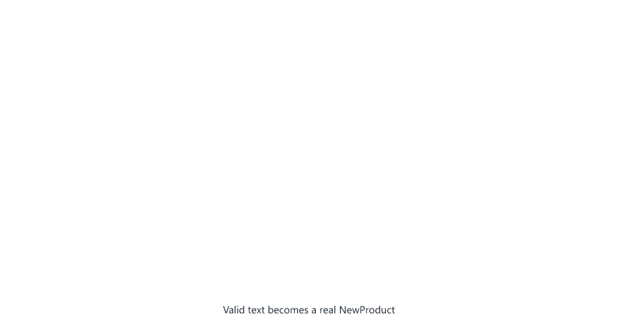

# Mapped and Conditional Types

> **Session 18 of 33** | Part 4: Generics and Type Tools | [All sessions](README.md#course-outline)

## Table of Contents
- [Your Folder for This Session](#your-folder-for-this-session)
- [Three New Tools](#three-new-tools)
- [Mapped Types: A Loop over Keys](#mapped-types-a-loop-over-keys)
- [Mapping over the Keys of Another Type](#mapping-over-the-keys-of-another-type)
- [Writing Your Own Partial, Readonly and Pick](#writing-your-own-partial-readonly-and-pick)
- [Removing readonly: Mutable](#removing-readonly-mutable)
- [Conditional Types: if and else for Types](#conditional-types-if-and-else-for-types)
- [Conditional Types and Unions](#conditional-types-and-unions)
- [Writing Your Own Exclude and Extract](#writing-your-own-exclude-and-extract)
- [infer: Taking a Type Apart](#infer-taking-a-type-apart)
- [Mapped and Conditional Together](#mapped-and-conditional-together)
- [Filtering Keys with as](#filtering-keys-with-as)
- [When to Write Your Own Type Tools](#when-to-write-your-own-type-tools)
- [Mini Example 1: Typed Form Validation](#mini-example-1-typed-form-validation)
- [Mini Example 2: An Audit Log](#mini-example-2-an-audit-log)
- [Beginner Mistakes](#beginner-mistakes)
- [Practice Exercises](#practice-exercises)
- [Interview Questions](#interview-questions)

---

## Your Folder for This Session

Make a folder `18-mapped-conditional` inside `ts-practice`, with the one-line `tsconfig.json`

18-mapped-conditional/tsconfig.json

```json
{
  "extends": "../tsconfig.json"
}
```

---

## Three New Tools

Session 17 showed how `Partial` is written in TypeScript's own `lib.es5.d.ts`

```typescript
type Partial<T> = {
    [P in keyof T]?: T[P];
};
```

`Exclude` used a second kind of syntax, `extends ? :`, and `ReturnType` and `Parameters` a third, `infer`. This session teaches all three, so you can read the built-in utility types and write your own:

| Tool                 | Looks like                     | Means                                           |
| -------------------- | ------------------------------ | ----------------------------------------------- |
| **Mapped type**      | `{ [K in Keys]: ... }`         | One property for each key, like a loop          |
| **Conditional type** | `A extends B ? X : Y`          | If `A` fits `B`, then `X`, otherwise `Y`        |
| **`infer`**          | `infer R` inside a conditional | "Whatever type is in this place, call it `R`"   |

All three work on types only. Nothing in this session exists when the code runs.

---

## Mapped Types: A Loop over Keys

A user can switch each notification channel on or off. The channels are a literal union (Session 09), and the settings need one `boolean` for each channel

notifications.ts

```typescript
type Channel = "email" | "sms" | "push";

type NotificationSettings = {
  [C in Channel]: boolean;
};

const settings: NotificationSettings = {
  email: true,
  sms: false,
  push: true
};

function enabledChannels(current: NotificationSettings): Channel[] {
  const all: Channel[] = ["email", "sms", "push"];
  return all.filter((channel) => current[channel]);
}

console.log(enabledChannels(settings));
```

```bash
npx tsc --noEmit
node notifications.ts
```

```text
[ 'email', 'push' ]
```

Read `[C in Channel]: boolean` as "for each `C` in `Channel`, a property called `C` with the type `boolean`". It works like a `for...of` loop, but over types. `C` is a name you choose; for keys, `K` is the usual name. The result is exactly this type

```typescript
type NotificationSettings = {
  email: boolean;
  sms: boolean;
  push: boolean;
};
```

When a channel is added to `Channel`, the settings type gets a new property by itself, and every settings object without it is an error. Remove `push: true` (and the comma after `sms: false`)

```text
notifications.ts:7:7 - error TS2741: Property 'push' is missing in type '{ email: true; sms: false; }' but required in type 'NotificationSettings'.

7 const settings: NotificationSettings = {
        ~~~~~~~~


Found 1 error in notifications.ts:7
```

This is exactly `Record<Channel, boolean>` from Session 17. `Record` is a mapped type too, from `lib.es5.d.ts`

```typescript
/**
 * Construct a type with a set of properties K of type T
 */
type Record<K extends keyof any, T> = {
    [P in K]: T;
};
```

A mapped type can only be written with `type`. Try it as an interface

```text
notifications.ts:4:3 - error TS7061: A mapped type may not declare properties or methods.

4   [C in Channel]: boolean;
    ~~~~~~~~~~~~~~

notifications.ts:15:34 - error TS7053: Element implicitly has an 'any' type because expression of type 'Channel' can't be used to index type 'NotificationSettings'.
  Property 'email' does not exist on type 'NotificationSettings'.

15   return all.filter((channel) => current[channel]);
                                    ~~~~~~~~~~~~~~~~


Found 2 errors in the same file, starting at: notifications.ts:4
```

This is one of the cases from Session 08: `interface` for object shapes, until you need something only `type` can do. A mapped type is such a thing.


---

## Mapping over the Keys of Another Type

The keys can come from another type. `keyof T` (Session 15) gives the keys of `T`, and `[K in keyof T]` loops over them. Data from an HTML form or a query string is always text, so a form for a new product has the same fields as the product, but every value is a `string`. Error messages for a form have the same fields too, but each one is optional

form-types.ts

```typescript
interface NewProduct {
  name: string;
  pricePaise: number;
  stock: number;
}

type FormValues<T> = {
  [K in keyof T]: string;
};

type FieldErrors<T> = {
  [K in keyof T]?: string;
};

const form: FormValues<NewProduct> = {
  name: "Keyboard",
  pricePaise: "149900",
  stock: "12"
};

const errors: FieldErrors<NewProduct> = {
  pricePaise: "Price must be a whole number"
};

console.log(form);
console.log(errors);
```

```bash
npx tsc --noEmit
node form-types.ts
```

```text
{ name: 'Keyboard', pricePaise: '149900', stock: '12' }
{ pricePaise: 'Price must be a whole number' }
```

`FormValues` and `FieldErrors` are generic (Session 14): they work for any type, not only `NewProduct`. The `?` after the key in `FieldErrors` makes every property optional, as in `Partial`.

Both types are checked. Change the stock in the form to the number `12`, and replace the two `console.log` lines with

```typescript
errors.colour = "Pick a colour";
```

```text
form-types.ts:18:3 - error TS2322: Type 'number' is not assignable to type 'string'.

18   stock: 12
     ~~~~~

  form-types.ts:4:3 - The expected type comes from property 'stock' which is declared here on type 'FormValues<NewProduct>'
    4   stock: number;
        ~~~~~

form-types.ts:25:8 - error TS2339: Property 'colour' does not exist on type 'FieldErrors<NewProduct>'.

25 errors.colour = "Pick a colour";
          ~~~~~~


Found 2 errors in the same file, starting at: form-types.ts:18
```

The related information points at `stock: number` in `NewProduct`: the key really comes from there.

### Mapping over keyof keeps ? and readonly

A mapped type over `keyof T` keeps the modifiers of each property

keep-modifiers.ts

```typescript
type FormValues<T> = {
  [K in keyof T]: string;
};

interface Customer {
  readonly id: number;
  name: string;
  phone?: string;
}

const input: FormValues<Customer> = { id: "7", name: "Asha" };
input.id = "8";
```

```text
keep-modifiers.ts:12:7 - error TS2540: Cannot assign to 'id' because it is a read-only property.

12 input.id = "8";
         ~~


Found 1 error in keep-modifiers.ts:12
```

`phone` was left out without an error, because it is still optional, and `id` is still `readonly`. Only the value types changed to `string`.


---

## Writing Your Own Partial, Readonly and Pick

With `T[K]` (indexed access, Session 15), a mapped type can keep the original type of each property. That is all you need to write the utility types from Session 17

own-utility-types.ts

```typescript
type MyPartial<T> = {
  [K in keyof T]?: T[K];
};

type MyRequired<T> = {
  [K in keyof T]-?: T[K];
};

type MyReadonly<T> = {
  readonly [K in keyof T]: T[K];
};

type MyPick<T, K extends keyof T> = {
  [P in K]: T[P];
};

type MyRecord<K extends keyof any, V> = {
  [P in K]: V;
};
```

Read them one by one:

- `MyPartial`: for each key `K` of `T`, an optional property with the type it had, `T[K]`.
- `MyRequired`: `-?` **removes** the `?`. A minus in front of a modifier takes it away.
- `MyReadonly`: `readonly` in front of the key adds it to every property.
- `MyPick`: the loop goes over the chosen keys `K`, not over all of `keyof T`. The constraint `K extends keyof T` (Session 15) only allows real keys.
- `MyRecord`: the loop goes over any keys `K`, and every value is `V`.

They give exactly the same types as the built-in ones. Use them like the built-in ones

```typescript
interface Product {
  id: number;
  name: string;
  pricePaise: number;
  stock: number;
  createdAt: string;
}

const changes: MyPartial<Product> = { pricePaise: 54900 };
const summary: MyPick<Product, "id" | "name"> = { id: 2, name: "Mouse" };
const frozen: MyReadonly<Product> = { id: 2, name: "Mouse", pricePaise: 59900, stock: 40, createdAt: "2026-10-20" };

frozen.stock = 0;
const bad: MyPick<Product, "title"> = { title: "Mouse" };
```

```text
own-utility-types.ts:33:8 - error TS2540: Cannot assign to 'stock' because it is a read-only property.

33 frozen.stock = 0;
          ~~~~~

own-utility-types.ts:34:28 - error TS2344: Type '"title"' does not satisfy the constraint 'keyof Product'.

34 const bad: MyPick<Product, "title"> = { title: "Mouse" };
                              ~~~~~~~


Found 2 errors in the same file, starting at: own-utility-types.ts:33
```

The same errors as with `Readonly` and `Pick`. In real code, keep using the built-in names: everyone knows them. Writing them once yourself is how you learn to read them.

![MyPartial loops over the keys of Product; for each key it writes the key, adds a question mark, and copies the type with T[K]](images/18-mapped-and-conditional-types/own-partial.gif)

---

## Removing readonly: Mutable

`-?` removes the `?`, and `-readonly` removes `readonly`. TypeScript has no built-in type for this, so here is your first type tool that is not a copy

mutable.ts

```typescript
type Mutable<T> = {
  -readonly [K in keyof T]: T[K];
};

interface Settings {
  readonly port: number;
  readonly host: string;
}

const live: Settings = { port: 3000, host: "localhost" };
const draft: Mutable<Settings> = { ...live };

draft.port = 8080;

console.log(live);
console.log(draft);
```

```bash
npx tsc --noEmit
node mutable.ts
```

```text
{ port: 3000, host: 'localhost' }
{ port: 8080, host: 'localhost' }
```

The live settings cannot be changed; a copy made with a spread can be edited as a draft, for example in a settings form, and saved later. Changing `live` is still refused. Add this line after `draft.port = 8080;`

```typescript
live.port = 8080;
```

```text
mutable.ts:14:6 - error TS2540: Cannot assign to 'port' because it is a read-only property.

14 live.port = 8080;
        ~~~~


Found 1 error in mutable.ts:14
```


---

## Conditional Types: if and else for Types

A **conditional type** chooses between two types

```typescript
type Describe<T> = T extends string ? "text" : T extends number ? "number" : "something else";
```

Read it like the `? :` operator from JavaScript: "if `T` fits `string`, then `"text"`; otherwise, if `T` fits `number`, then `"number"`; otherwise `"something else"`". `extends` means "fits into", the same word as in constraints like `T extends { id: number }` (Session 14).

### Seeing what a type tool gives

To see the result of a type tool, write it directly in an annotation and assign a value that is surely wrong. The error message shows the type

describe.ts

```typescript
type Describe<T> = T extends string ? "text" : T extends number ? "number" : "something else";

const a: Describe<"Keyboard"> = "number";
const b: Describe<149900> = "text";
const c: Describe<boolean> = "text";
```

```text
describe.ts:3:7 - error TS2322: Type '"number"' is not assignable to type '"text"'.

3 const a: Describe<"Keyboard"> = "number";
        ~

describe.ts:4:7 - error TS2322: Type '"text"' is not assignable to type '"number"'.

4 const b: Describe<149900> = "text";
        ~

describe.ts:5:7 - error TS2322: Type '"text"' is not assignable to type '"something else"'.

5 const c: Describe<boolean> = "text";
        ~


Found 3 errors in the same file, starting at: describe.ts:3
```

`"Keyboard"` fits `string`, `149900` fits `number`, and `boolean` fits neither. When the result has a name of its own, like `type OpenStatus = ...`, `tsc` prints that name instead of the result. So while testing, write the type tool directly after the colon. Remove the test lines when you are done.


---

## Conditional Types and Unions

Give `Describe` a union

```typescript
const d: Describe<string | number> = 0;
```

```text
describe.ts:3:7 - error TS2322: Type '0' is not assignable to type '"number" | "text"'.

3 const d: Describe<string | number> = 0;
        ~


Found 1 error in describe.ts:3
```

The result is a union too. When `T` is a union, a conditional type runs **once for each member** and joins the results: `string` gives `"text"`, `number` gives `"number"`. This is called a **distributive** conditional type. It matters when the result is built from `T`

distribute.ts

```typescript
type ToArray<T> = T extends unknown ? T[] : never;
type ToOneArray<T> = [T] extends [unknown] ? T[] : never;

const x: ToArray<string | number> = 0;
const y: ToOneArray<string | number> = 0;
```

```text
distribute.ts:4:7 - error TS2322: Type 'number' is not assignable to type 'string[] | number[]'.

4 const x: ToArray<string | number> = 0;
        ~

distribute.ts:5:7 - error TS2322: Type 'number' is not assignable to type '(string | number)[]'.

5 const y: ToOneArray<string | number> = 0;
        ~


Found 2 errors in the same file, starting at: distribute.ts:4
```

- `ToArray<string | number>` is `string[] | number[]`: either an array of texts, or an array of numbers.
- `ToOneArray<string | number>` is `(string | number)[]`: one array that may mix both.

Every type fits `unknown`, so the condition is always true; only the distribution differs. Writing `T` inside `[ ]` turns the distribution off, because `[T]` is not a union. You will rarely need that. But distribution is what makes the next section work.


---

## Writing Your Own Exclude and Extract

With distribution, filtering a union takes one line

my-exclude.ts

```typescript
type MyExclude<T, U> = T extends U ? never : T;
type MyExtract<T, U> = T extends U ? T : never;
type MyNonNullable<T> = T extends null | undefined ? never : T;

type OrderStatus = "pending" | "paid" | "shipped" | "delivered" | "cancelled";

const open: MyExclude<OrderStatus, "delivered" | "cancelled"> = "delivered";
const closed: MyExtract<OrderStatus, "delivered" | "cancelled"> = "paid";
const phone: MyNonNullable<string | null | undefined> = null;
```

```text
my-exclude.ts:7:7 - error TS2322: Type '"delivered"' is not assignable to type '"paid" | "pending" | "shipped"'.

7 const open: MyExclude<OrderStatus, "delivered" | "cancelled"> = "delivered";
        ~~~~

my-exclude.ts:8:7 - error TS2322: Type '"paid"' is not assignable to type '"cancelled" | "delivered"'.

8 const closed: MyExtract<OrderStatus, "delivered" | "cancelled"> = "paid";
        ~~~~~~

my-exclude.ts:9:7 - error TS2322: Type 'null' is not assignable to type 'string'.

9 const phone: MyNonNullable<string | null | undefined> = null;
        ~~~~~


Found 3 errors in the same file, starting at: my-exclude.ts:7
```

Follow `MyExclude<OrderStatus, "delivered" | "cancelled">` member by member:

| Member        | Fits `"delivered" \| "cancelled"`? | Result        |
| ------------- | ---------------------------------- | ------------- |
| `"pending"`   | No                                 | `"pending"`   |
| `"paid"`      | No                                 | `"paid"`      |
| `"shipped"`   | No                                 | `"shipped"`   |
| `"delivered"` | Yes                                | `never`       |
| `"cancelled"` | Yes                                | `never`       |

The results are joined: `"pending" | "paid" | "shipped" | never | never`. `never` is the type with no values (Session 04), and in a union it simply disappears: `string | never` is just `string`. What is left is `"pending" | "paid" | "shipped"` (`tsc` prints the members sorted).

Compare with the line in `lib.es5.d.ts`

```typescript
type Exclude<T, U> = T extends U ? never : T;
```

The same. The built-in `NonNullable` is written differently today

```typescript
type NonNullable<T> = T & {};
```

`{}` means "any value except `null` and `undefined`" (Session 04), so `string & {}` is `string`. Both versions give the same result.


---

## infer: Taking a Type Apart

`infer` can only be used in the `extends` part of a conditional type. It says: "if `T` has this shape, take the type in this place and call it `R`"

infer.ts

```typescript
type MyReturnType<F> = F extends (...args: any[]) => infer R ? R : never;
type ElementType<T> = T extends readonly (infer Item)[] ? Item : never;

function quoteShipping(weightGrams: number): { costPaise: number; days: number } {
  return weightGrams <= 500 ? { costPaise: 4000, days: 4 } : { costPaise: 7000, days: 4 };
}

const quote: MyReturnType<typeof quoteShipping> = 0;
const level: ElementType<["debug", "info", "warn"]> = 0;
const nothing: ElementType<string> = 0;
```

```text
infer.ts:8:7 - error TS2322: Type 'number' is not assignable to type '{ costPaise: number; days: number; }'.

8 const quote: MyReturnType<typeof quoteShipping> = 0;
        ~~~~~

infer.ts:9:7 - error TS2322: Type '0' is not assignable to type '"debug" | "info" | "warn"'.

9 const level: ElementType<["debug", "info", "warn"]> = 0;
        ~~~~~

infer.ts:10:7 - error TS2322: Type '0' is not assignable to type 'never'.

10 const nothing: ElementType<string> = 0;
         ~~~~~~~


Found 3 errors in the same file, starting at: infer.ts:8
```

- `MyReturnType`: "if `F` is a function, with any parameters, that returns something, call that something `R` and give `R`". `any[]` only describes the shape to match. No value gets the type `any`.
- `ElementType`: "if `T` is an array (or tuple), call the item type `Item`". For the tuple of three levels, `Item` is the union of all three.
- `ElementType<string>`: `string` is not an array, so the pattern does not match, and the result is the "otherwise" branch, `never`.

The built-in `ReturnType` from Session 17 works the same way

```typescript
type ReturnType<T extends (...args: any) => any> = T extends (...args: any) => infer R ? R : any;
```

### A practical use: the value inside a Result

Session 14 built a `Result<T>` type. A module from another team returns one, with the user type written inline and no name for it

users.ts

```typescript
export type Result<T> = { ok: true; value: T } | { ok: false; error: string };

export function findUser(email: string): Result<{ id: number; name: string; email: string }> {
  if (email === "asha@example.com") {
    return { ok: true, value: { id: 7, name: "Asha", email } };
  }
  return { ok: false, error: `No user with email ${email}` };
}
```

Your code needs the user type. `infer` takes it out of the result

greeting.ts

```typescript
import { findUser } from "./users.ts";

type ResultValue<R> = R extends { ok: true; value: infer V } ? V : never;
type User = ResultValue<ReturnType<typeof findUser>>;

function greet(user: User): string {
  return `Hello, ${user.name} (${user.email})`;
}

for (const email of ["asha@example.com", "ravi@example.com"]) {
  const result = findUser(email);
  if (result.ok) {
    console.log(greet(result.value));
  } else {
    console.log(result.error);
  }
}
```

```bash
npx tsc --noEmit
node greeting.ts
```

```text
Hello, Asha (asha@example.com)
No user with email ravi@example.com
```

Read `User` from the inside out:

1. `ReturnType<typeof findUser>` is the `Result` union: `{ ok: true; value: {...} } | { ok: false; error: string }`.
2. `ResultValue` runs once for each member. The success member fits the pattern, and `V` is the user type. The error member does not fit, and gives `never`.
3. `{ id: number; name: string; email: string } | never` is just the user type.

The type is really checked. Use `user.phone` in `greet`

```typescript
  return `Hello, ${user.name} (${user.phone})`;
```

```text
greeting.ts:7:39 - error TS2339: Property 'phone' does not exist on type '{ id: number; name: string; email: string; }'.

7   return `Hello, ${user.name} (${user.phone})`;
                                        ~~~~~


Found 1 error in greeting.ts:7
```


---

## Mapped and Conditional Together

Some functions only make sense for some keys. Adding up `stock` or `pricePaise` makes sense; adding up `name` does not. A type tool can find the keys whose values are numbers

sum.ts

```typescript
interface Product {
  id: number;
  name: string;
  pricePaise: number;
  stock: number;
  createdAt: string;
}

type KeysOfType<T, V> = {
  [K in keyof T]: T[K] extends V ? K : never;
}[keyof T];

type NumberKey = KeysOfType<Product, number>;

function sum(products: Product[], key: NumberKey): number {
  let total = 0;
  for (const product of products) {
    total += product[key];
  }
  return total;
}

const products: Product[] = [
  { id: 1, name: "Keyboard", pricePaise: 149900, stock: 12, createdAt: "2026-10-18" },
  { id: 2, name: "Mouse", pricePaise: 59900, stock: 40, createdAt: "2026-10-20" }
];

console.log(sum(products, "stock"));
console.log(sum(products, "pricePaise"));
```

```bash
npx tsc --noEmit
node sum.ts
```

```text
52
209800
```

A key whose value is not a number is refused

```typescript
sum(products, "name");
```

```text
sum.ts:30:15 - error TS2345: Argument of type '"name"' is not assignable to parameter of type 'NumberKey'.

30 sum(products, "name");
                 ~~~~~~


Found 1 error in sum.ts:30
```

`KeysOfType` works in two steps.

**Step 1**, the mapped type: for each key, the value becomes the key itself if `T[K]` fits `V`, otherwise `never`. For `Product` and `number`:

| Key         | `Product[K]` | Fits `number`? | Value in step 1 |
| ----------- | ------------ | -------------- | --------------- |
| `id`        | `number`     | Yes            | `"id"`          |
| `name`      | `string`     | No             | `never`         |
| `pricePaise` | `number`    | Yes            | `"pricePaise"`  |
| `stock`     | `number`     | Yes            | `"stock"`       |
| `createdAt` | `string`     | No             | `never`         |

**Step 2**, `[keyof T]` after the mapped type: indexed access with all keys gives all the values as one union (the same trick as `(typeof X)[keyof typeof X]` in Session 16). The `never` values disappear, and `NumberKey` is `"id" | "pricePaise" | "stock"`.

Here `tsc` prints the name `NumberKey`, not the members, even when the tool is written after the colon. When the error message does not show the result, test with values: a right value passes, and a wrong one is refused, as above.

Inside `sum`, `product[key]` is a `number`, so `total += product[key]` is allowed. With `key: keyof Product`, it would be `string | number`.


---

## Filtering Keys with as

A mapped type can also change the keys, with `as` after the loop. When the new key is `never`, the property is left out

pick-by-type.ts

```typescript
interface Product {
  id: number;
  name: string;
  pricePaise: number;
  stock: number;
  createdAt: string;
}

type PickByType<T, V> = {
  [K in keyof T as T[K] extends V ? K : never]: T[K];
};

const numbers: PickByType<Product, number> = {};
```

```text
pick-by-type.ts:13:7 - error TS2739: Type '{}' is missing the following properties from type 'PickByType<Product, number>': id, pricePaise, stock

13 const numbers: PickByType<Product, number> = {};
         ~~~~~~~


Found 1 error in pick-by-type.ts:13
```

The `{}` trick from Session 17 shows the result: only `id`, `pricePaise` and `stock` are left, each with its own type. Session 19 uses `as` again, to **rename** keys, for example `name` to `getName`.

---

## When to Write Your Own Type Tools

Type tools are powerful, and easy to overdo. Some rules of thumb:

1. **Use the built-in utility types first** (Session 17). Everyone can read `Partial<T>`.
2. **Write your own when the same idea repeats**, like `FormValues`, `FieldErrors` or the `Changes` type in Mini Example 2.
3. **Keep each one small and named.** Three short tools are easier to read than one clever line.
4. **Test them** with a right value and a wrong value, as in this session.
5. **Stop when it needs a long explanation.** Your teammates have to read and fix this code too. A simpler type with one more check in the code is often the better choice.

---

## Mini Example 1: Typed Form Validation

A form to create a product sends text. The server checks each field, and sends back either the product or one message per wrong field. Both the form and the messages are mapped types built from `NewProduct`

validate-product.ts

```typescript
interface NewProduct {
  name: string;
  pricePaise: number;
  stock: number;
}

type FormValues<T> = {
  [K in keyof T]: string;
};

type FieldErrors<T> = {
  [K in keyof T]?: string;
};

type Validation<T> = { ok: true; value: T } | { ok: false; errors: FieldErrors<T> };

function toWholeNumber(text: string): number | undefined {
  const value = Number(text);
  if (text.trim() === "" || !Number.isInteger(value) || value < 0) {
    return undefined;
  }
  return value;
}

function validateProduct(form: FormValues<NewProduct>): Validation<NewProduct> {
  const errors: FieldErrors<NewProduct> = {};
  const name = form.name.trim();
  const pricePaise = toWholeNumber(form.pricePaise);
  const stock = toWholeNumber(form.stock);

  if (name === "") {
    errors.name = "Name is required";
  }
  if (pricePaise === undefined) {
    errors.pricePaise = "Price must be a whole number of paise";
  }
  if (stock === undefined) {
    errors.stock = "Stock must be a whole number";
  }

  if (name === "" || pricePaise === undefined || stock === undefined) {
    return { ok: false, errors };
  }
  return { ok: true, value: { name, pricePaise, stock } };
}

console.log(validateProduct({ name: "Keyboard", pricePaise: "149900", stock: "12" }));
console.log(validateProduct({ name: "  ", pricePaise: "1499.50", stock: "12" }));
console.log(validateProduct({ name: "Mouse", pricePaise: "59900", stock: "" }));
```

```bash
npx tsc --noEmit
node validate-product.ts
```

```text
{
  ok: true,
  value: { name: 'Keyboard', pricePaise: 149900, stock: 12 }
}
{
  ok: false,
  errors: {
    name: 'Name is required',
    pricePaise: 'Price must be a whole number of paise'
  }
}
{ ok: false, errors: { stock: 'Stock must be a whole number' } }
```

| Code                                        | From this session and earlier                                     |
| ------------------------------------------- | ----------------------------------------------------------------- |
| `FormValues<NewProduct>`                    | Every field of the product, as text                               |
| `FieldErrors<NewProduct>`                   | At most one message for each field                                |
| `Validation<T>`                             | A discriminated union like `Result<T>` (Sessions 10 and 14)       |
| `toWholeNumber(...): number \| undefined`   | `undefined` means "not a valid number" (Session 11)               |
| `text.trim() === ""`                        | `Number("")` is `0`, so an empty field would pass without this check |
| `if (name === "" \|\| pricePaise === undefined ...)` | After this check, `pricePaise` and `stock` are narrowed to `number` (Session 10), so `value` is a real `NewProduct` |

A typo in a field name is caught, with a suggestion

```text
validate-product.ts:35:12 - error TS2551: Property 'pricePaisa' does not exist on type 'FieldErrors<NewProduct>'. Did you mean 'pricePaise'?

35     errors.pricePaisa = "Price must be a whole number of paise";
              ~~~~~~~~~~


Found 1 error in validate-product.ts:35
```

Now add a category to the product

```typescript
interface NewProduct {
  name: string;
  pricePaise: number;
  stock: number;
  category: string;
}
```

```text
validate-product.ts:45:22 - error TS2741: Property 'category' is missing in type '{ name: string; pricePaise: number; stock: number; }' but required in type 'NewProduct'.

45   return { ok: true, value: { name, pricePaise, stock } };
                        ~~~~~

  validate-product.ts:5:3 - 'category' is declared here.
    5   category: string;
        ~~~~~~~~

validate-product.ts:48:29 - error TS2741: Property 'category' is missing in type '{ name: string; pricePaise: string; stock: string; }' but required in type 'FormValues<NewProduct>'.

48 console.log(validateProduct({ name: "Keyboard", pricePaise: "149900", stock: "12" }));
                               ~~~~~~~~~~~~~~~~~~~~~~~~~~~~~~~~~~~~~~~~~~~~~~~~~~~~~~~

  validate-product.ts:5:3 - 'category' is declared here.
    5   category: string;
        ~~~~~~~~

validate-product.ts:49:29 - error TS2741: Property 'category' is missing in type '{ name: string; pricePaise: string; stock: string; }' but required in type 'FormValues<NewProduct>'.

49 console.log(validateProduct({ name: "  ", pricePaise: "1499.50", stock: "12" }));
                               ~~~~~~~~~~~~~~~~~~~~~~~~~~~~~~~~~~~~~~~~~~~~~~~~~~

  validate-product.ts:5:3 - 'category' is declared here.
    5   category: string;
        ~~~~~~~~

validate-product.ts:50:29 - error TS2741: Property 'category' is missing in type '{ name: string; pricePaise: string; stock: string; }' but required in type 'FormValues<NewProduct>'.

50 console.log(validateProduct({ name: "Mouse", pricePaise: "59900", stock: "" }));
                               ~~~~~~~~~~~~~~~~~~~~~~~~~~~~~~~~~~~~~~~~~~~~~~~~~

  validate-product.ts:5:3 - 'category' is declared here.
    5   category: string;
        ~~~~~~~~


Found 4 errors in the same file, starting at: validate-product.ts:45
```

The validated product needs a category, and so does every form. Fix it step by step. Read the category after the stock

```typescript
  const category = form.category.trim();
```

check it after the stock check

```typescript
  if (category === "") {
    errors.category = "Category is required";
  }
```

use it in the final check and in the value

```typescript
  if (name === "" || pricePaise === undefined || stock === undefined || category === "") {
    return { ok: false, errors };
  }
  return { ok: true, value: { name, pricePaise, stock, category } };
```

and send it in the forms

```typescript
console.log(validateProduct({ name: "Keyboard", pricePaise: "149900", stock: "12", category: "accessories" }));
console.log(validateProduct({ name: "  ", pricePaise: "1499.50", stock: "12", category: "" }));
console.log(validateProduct({ name: "Mouse", pricePaise: "59900", stock: "", category: "accessories" }));
```

```text
{
  ok: true,
  value: {
    name: 'Keyboard',
    pricePaise: 149900,
    stock: 12,
    category: 'accessories'
  }
}
{
  ok: false,
  errors: {
    name: 'Name is required',
    pricePaise: 'Price must be a whole number of paise',
    category: 'Category is required'
  }
}
{ ok: false, errors: { stock: 'Stock must be a whole number' } }
```

`errors.category = ...` worked without touching `FieldErrors`: the mapped type found the new key by itself. Session 26 checks data like this with Joi, a library made for the job; the types you learned here stay useful there.



---

## Mini Example 2: An Audit Log

Many systems keep a log of every change: who changed what, from which value to which value. A mapped type describes the changes, and `KeysOfType` makes sure only number fields can be adjusted

audit-log.ts

```typescript
interface Product {
  id: number;
  name: string;
  pricePaise: number;
  stock: number;
}

type Changes<T> = {
  [K in keyof T]?: { from: T[K]; to: T[K] };
};

type KeysOfType<T, V> = {
  [K in keyof T]: T[K] extends V ? K : never;
}[keyof T];

type NumberField = KeysOfType<Omit<Product, "id">, number>;

interface AuditEntry {
  productId: number;
  changes: Changes<Product>;
}

const auditLog: AuditEntry[] = [];

function diff<T extends object>(before: T, after: T): Changes<T> {
  const changes: Changes<T> = {};
  for (const key of Object.keys(before) as (keyof T)[]) {
    if (before[key] !== after[key]) {
      changes[key] = { from: before[key], to: after[key] };
    }
  }
  return changes;
}

function save(before: Product, after: Product): Product {
  auditLog.push({ productId: before.id, changes: diff(before, after) });
  return after;
}

function adjust(product: Product, field: NumberField, by: number): Product {
  return save(product, { ...product, [field]: product[field] + by });
}

function rename(product: Product, name: string): Product {
  return save(product, { ...product, name });
}

let mouse: Product = { id: 2, name: "Mouse", pricePaise: 59900, stock: 40 };
mouse = adjust(mouse, "stock", -5);
mouse = adjust(mouse, "pricePaise", -5000);
mouse = rename(mouse, "Wireless Mouse");

for (const entry of auditLog) {
  console.log(entry.productId, entry.changes);
}
```

```bash
npx tsc --noEmit
node audit-log.ts
```

```text
2 { stock: { from: 40, to: 35 } }
2 { pricePaise: { from: 59900, to: 54900 } }
2 { name: { from: 'Mouse', to: 'Wireless Mouse' } }
```

| Code                                              | From this session and earlier                                  |
| ------------------------------------------------- | -------------------------------------------------------------- |
| `{ from: T[K]; to: T[K] }`                        | Each change keeps the type of its own field                    |
| `KeysOfType<Omit<Product, "id">, number>`         | `"pricePaise" \| "stock"`: number fields, but not the id (Session 17) |
| `diff<T extends object>`                          | `Object.keys` needs an object (Session 04); without the constraint, `tsc` suggests adding it |
| `Object.keys(before) as (keyof T)[]`              | `Object.keys` gives `string[]`; the assertion from Session 13  |
| `{ ...product, [field]: ... }`                    | A computed property name ([JavaScript course, Session 13](https://github.com/mohin-sheikh/javascript-basics-to-advanced/blob/main/13-objects.md)) |
| `let mouse` reassigned                            | Each change makes a new product, and the old one stays as it was |

The types protect both the calls and the log

```typescript
adjust(mouse, "name", 1);
adjust(mouse, "id", 1);
console.log(auditLog[0]?.changes.stock?.to.toUpperCase());
```

```text
audit-log.ts:57:15 - error TS2345: Argument of type '"name"' is not assignable to parameter of type 'NumberField'.

57 adjust(mouse, "name", 1);
                 ~~~~~~

audit-log.ts:58:15 - error TS2345: Argument of type '"id"' is not assignable to parameter of type 'NumberField'.

58 adjust(mouse, "id", 1);
                 ~~~~

audit-log.ts:59:44 - error TS2339: Property 'toUpperCase' does not exist on type 'number'.

59 console.log(auditLog[0]?.changes.stock?.to.toUpperCase());
                                              ~~~~~~~~~~~


Found 3 errors in the same file, starting at: audit-log.ts:57
```

1. A name cannot be adjusted by a number.
2. The id is a number, but `Omit` took it out of the allowed fields.
3. In the log, `changes.stock.to` is a `number`, because `Changes<T>` kept the type of `stock`. The `?.` are needed: a change may be missing (`?` in the mapped type), and the log may be empty (`noUncheckedIndexedAccess`, Session 06).


---

## Beginner Mistakes

### Mistake 1: Writing a mapped type in an interface

`interface X { [C in Channel]: boolean }` gives `error TS7061: A mapped type may not declare properties or methods.` Mapped types need `type X = { ... }`.

---

### Mistake 2: Using a colon instead of in

`[K: keyof T]: string` gives `error TS1337: An index signature parameter type cannot be a literal type or generic type. Consider using a mapped object type instead.` A mapped type uses `in`: `[K in keyof T]: string`.

---

### Mistake 3: Forgetting keyof

`[K in T]: string` loops over `T` itself, not over its keys, and gives `error TS2322: Type 'T' is not assignable to type 'string | number | symbol'.` Write `[K in keyof T]`.

---

### Mistake 4: Writing T instead of T[K]

`{ [K in keyof T]?: T }` gives every property the type of the **whole** object. `{ pricePaise: 54900 }` was refused with `Type 'number' is not assignable to type 'Product'.` The type of one property is `T[K]`.

---

### Mistake 5: Using infer outside a conditional type

`type Item<T> = (infer U)[];` gives `error TS1338: 'infer' declarations are only permitted in the 'extends' clause of a conditional type.` Write it as a pattern: `T extends (infer U)[] ? U : never`.

---

### Mistake 6: Being surprised by distribution

`ToArray<string | number>` gave `string[] | number[]`, not `(string | number)[]`. A conditional type runs once for each member of a union. Wrap both sides in `[ ]` when you want the union as one piece.

---

### Mistake 7: Expecting the error message to show the result

For `KeysOfType` and for named results like `type OpenStatus = ...`, `tsc` prints the name, not the members. Test the type with a right and a wrong value instead.

---

### Mistake 8: Expecting an error when nothing matches

`KeysOfType<Product, boolean>` is not an error. It is `never`, because no key has a boolean value, and then no key at all is accepted. When everything is refused, check whether the type became `never`.

---

### Mistake 9: Rewriting the built-in utility types in real code

`MyPartial` and `MyExclude` are for learning how the built-ins work. In a project, use `Partial` and `Exclude`: every TypeScript developer knows them.

---

### Mistake 10: Building type tools that nobody can read

A type with three nested conditionals and two `infer`s may be correct, but your teammates must read and fix it. Split it into small named steps, or check the case in code instead.

---

## Practice Exercises

### Exercise 1

Write `type Weekday = "mon" | "tue" | "wed" | "thu" | "fri"` and a mapped type `OpeningHours` with `{ open: string; close: string }` for every day. Create the opening hours of a shop, leave out one day, and read the error.

### Exercise 2

Write `Nullable<T>`, a mapped type where every property can also be `null`. Use it for a row from a database where any column may be empty, and test it with the "surely wrong value" trick.

### Exercise 3

Write `MyOmit<T, K extends keyof any>` with your own `MyPick` and `MyExclude` from this session. Compare it with the definition of `Omit` that Session 17 showed.

### Exercise 4

Write `IsArray<T>` that gives `true` for arrays and `false` for anything else. Test it with `string[]`, `string` and `string | string[]`. Explain the result for the last one.

### Exercise 5

Write `FirstParameter<F>` with `infer`, and test it on a function `quoteShipping(parcel: { city: string; weightGrams: number }, express: boolean)`. Compare the result with `Parameters<typeof quoteShipping>[0]`.

### Exercise 6

Use `KeysOfType<Product, string>` to write `searchBy(products: Product[], key: ..., text: string): Product[]`, which finds the products whose text field contains `text`. Make sure `searchBy(products, "stock", "4")` is refused.

### Exercise 7

In Mini Example 1, add an optional `description?: string` to `NewProduct`. What do `FormValues` and `FieldErrors` make of it? Change `validateProduct` so that a missing description is fine, but one longer than 200 characters gets an error.

### Exercise 8

In Mini Example 2, write `changedFields(entry: AuditEntry): string[]`, which lists the names of the changed fields. Then add a `restock(product: Product, amount: number): Product` that uses `adjust`, and print the log again.

---

## Interview Questions

### What is a mapped type?

A type that creates one property for each key in a union, like a loop: `{ [K in Keys]: Value }`. `Partial`, `Readonly`, `Pick` and `Record` are all mapped types.

### What does [K in keyof T] mean?

"For each key `K` of the type `T`". Together with `T[K]`, the type of that key, it builds a new type from the properties of an existing one.

### What do -? and -readonly do?

They remove modifiers in a mapped type: `-?` makes optional properties required (that is how `Required` works), and `-readonly` makes readonly properties writable.

### Why can an interface not contain a mapped type?

A mapped type is a type expression, not a list of declared properties, so it can only be written with `type`. In an interface it gives TS7061.

### What is a conditional type?

A type that chooses between two types: `A extends B ? X : Y` means "if `A` is assignable to `B`, then `X`, otherwise `Y`". It is the type-level version of the `? :` operator.

### What is a distributive conditional type?

When the checked type is a bare type parameter and it receives a union, the condition runs once for each member and the results are joined. That is why `Exclude<"a" | "b", "a">` gives `"b"`.

### How do you stop a conditional type from distributing?

Wrap both sides in a tuple: `[T] extends [U] ? X : Y`. `[T]` is not a union, so the condition runs once for the whole union.

### What does infer do?

It names a part of a type inside the `extends` clause of a conditional type, so the result can use it. `T extends (infer U)[] ? U : never` takes the item type out of an array type.

### How is Exclude implemented?

`type Exclude<T, U> = T extends U ? never : T;` It distributes over the members of `T`. Matching members become `never` and disappear from the union.

### What happens to never in a union?

It disappears: `string | never` is `string`. Many type tools use this to remove members or keys.

### How would you get the keys of a type whose values are numbers?

With a mapped type that turns each value into its key or `never`, then indexed access with `[keyof T]`: `{ [K in keyof T]: T[K] extends number ? K : never }[keyof T]`.

### What does as do in a mapped type?

It changes the key of each property: `[K in keyof T as NewKey]`. When `NewKey` is `never`, the property is left out, which can filter properties by their type.

---

| Previous | All sessions | Next |
| :--- | :---: | ---: |
| [17. Utility Types](17-utility-types.md) | [Course outline](README.md#course-outline) | [19. Template Literal Types](19-template-literal-types.md) |
