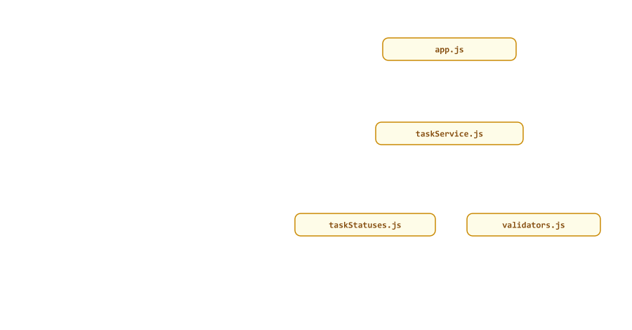
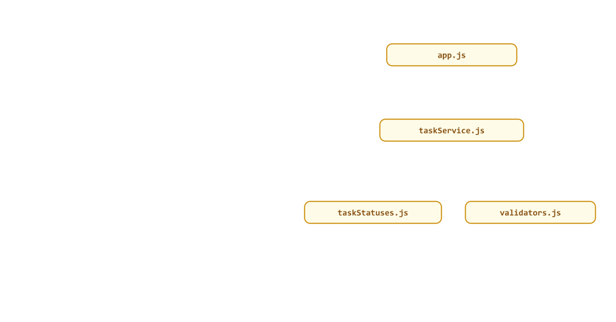

# Migrating JavaScript to TypeScript

> **Session 28 of 33** | Part 6: Real Programs | [All sessions](README.md#course-outline)

## Table of Contents
- [Your Folder for This Session](#your-folder-for-this-session)
- [The Plan](#the-plan)
- [Step 1: From require to import](#step-1-from-require-to-import)
- [Step 2: A tsconfig.json with allowJs](#step-2-a-tsconfigjson-with-allowjs)
- [Step 3: Rename the Leaves First](#step-3-rename-the-leaves-first)
- [Step 4: The Service, and the First Real Bug](#step-4-the-service-and-the-first-real-bug)
- [Postponing an Error with @ts-expect-error](#postponing-an-error-with-ts-expect-error)
- [Step 5: The Last File](#step-5-the-last-file)
- [Step 6: Remove allowJs and Build](#step-6-remove-allowjs-and-build)
- [Mini Example 1: A JavaScript File That Stays JavaScript](#mini-example-1-a-javascript-file-that-stays-javascript)
- [Mini Example 2: The Node.js Course's config Module](#mini-example-2-the-nodejs-courses-config-module)
- [Beginner Mistakes](#beginner-mistakes)
- [Practice Exercises](#practice-exercises)
- [Interview Questions](#interview-questions)

---

## Your Folder for This Session

This session's folder **is** the project you migrate: a small task service, written in JavaScript the way the Node.js course writes it, with CommonJS (`require`). Make a folder `28-migration` inside `ts-practice` with these files. It has its own `package.json` (no `tsconfig.json` yet: do not run `tsc` here until Step 2, Session 27 explained why)

28-migration/package.json

```json
{
  "name": "task-service",
  "type": "commonjs"
}
```

src/constants/taskStatuses.js

```javascript
const TASK_STATUSES = ["pending", "in-progress", "done"];

module.exports = { TASK_STATUSES };
```

src/utils/validators.js

```javascript
const validateTitle = (title) => typeof title === "string" && title.trim().length >= 3;

const validateDate = (date) => typeof date === "string" && !Number.isNaN(new Date(date).getTime());

module.exports = { validateTitle, validateDate };
```

src/services/taskService.js

```javascript
const { TASK_STATUSES } = require("../constants/taskStatuses");
const { validateTitle, validateDate } = require("../utils/validators");

const tasks = [];
let nextId = 1;

function createTask(title, dueDate) {
  if (!validateTitle(title) || !validateDate(dueDate)) {
    throw new Error("a task needs a title of 3+ characters and a valid due date");
  }
  const task = { id: nextId++, title: title.trim(), dueDate, status: "pending" };
  tasks.push(task);
  return task;
}

function findTask(id) {
  return tasks.find((task) => task.id === id);
}

function setStatus(id, status) {
  if (!TASK_STATUSES.includes(status)) {
    throw new Error(`unknown status "${status}"`);
  }
  const task = findTask(id);
  task.status = status;
}

function listTasks(status) {
  return status ? tasks.filter((task) => task.status === status) : tasks;
}

module.exports = { createTask, findTask, setStatus, listTasks };
```

src/app.js

```javascript
const { createTask, setStatus, listTasks } = require("./services/taskService");

createTask("Write report", "2026-11-05");
createTask("Call the bank", "2026-11-03");
setStatus(2, "in-progress");

for (const task of listTasks()) {
  console.log(`#${task.id} ${task.title}: ${task.status}, due ${task.dueDte}`);
}
console.log(`in progress: ${listTasks("in progress").length}`);
```

```bash
node src/app.js
```

```text
#1 Write report: pending, due undefined
#2 Call the bank: in-progress, due undefined
in progress: 0
```

It runs, and it is wrong twice: every due date is `undefined`, and one task is in progress but the count says 0. This is what JavaScript projects look like: the code runs, and small mistakes hide in it. Keep reading the output as you migrate, and watch TypeScript find them.

---

## The Plan

Big projects are not rewritten in one go. They are moved **one file at a time**, and the program keeps running after every step

| Step | What you do                                                      | How you check it            |
| ---- | ---------------------------------------------------------------- | --------------------------- |
| 1    | Switch from `require` to `import`, still in JavaScript           | `node src/app.js`           |
| 2    | Add a `tsconfig.json` with `allowJs`, so JavaScript and TypeScript files can live together | `npx tsc --noEmit` |
| 3    | Rename the **leaves**, the files that import nothing of yours, from `.js` to `.ts`, and fix their errors | `tsc` and `node` |
| 4    | Rename the files that use them, one at a time                    | `tsc` and `node`            |
| 5    | Rename the entry file last                                       | `tsc` and `node`            |
| 6    | Remove `allowJs`, and build                                      | `npx tsc`, `node dist/app.js` |

The import graph of this project decides the order: `app.js` uses `taskService.js`, which uses `taskStatuses.js` and `validators.js`.



---

## Step 1: From require to import

This course writes ES modules (Session 24), so the first step happens in JavaScript: switch the module system, and nothing else

| CommonJS                                       | ES modules                                        |
| ---------------------------------------------- | ------------------------------------------------- |
| `const { a, b } = require("./x")`              | `import { a, b } from "./x.js"`                   |
| `module.exports = { a, b }`                    | `export` in front of each function or constant    |
| `require("./config")` (finds `index.js`)       | `"./config/index.js"`: always the full path (Session 24) |
| `__dirname`                                    | `import.meta.dirname` (Session 24)                |
| `require("dotenv").config()`                   | `node --env-file=.env` (Session 10)               |
| `"type": "commonjs"` in `package.json`         | `"type": "module"`                                |

The files are still JavaScript, so the paths end in `.js`. The converted project

28-migration/package.json

```json
{
  "name": "task-service",
  "type": "module"
}
```

src/constants/taskStatuses.js

```javascript
export const TASK_STATUSES = ["pending", "in-progress", "done"];
```

src/utils/validators.js

```javascript
export const validateTitle = (title) => typeof title === "string" && title.trim().length >= 3;

export const validateDate = (date) => typeof date === "string" && !Number.isNaN(new Date(date).getTime());
```

src/services/taskService.js (the first lines; every function gets `export`)

```javascript
import { TASK_STATUSES } from "../constants/taskStatuses.js";
import { validateTitle, validateDate } from "../utils/validators.js";

const tasks = [];
let nextId = 1;

export function createTask(title, dueDate) {
```

src/app.js (the first line)

```javascript
import { createTask, setStatus, listTasks } from "./services/taskService.js";
```

`node src/app.js` prints exactly the same three lines as before (bugs included: this step changes nothing else). If you forget an extension, Node.js tells you at once

```text
Error [ERR_MODULE_NOT_FOUND]: Cannot find module 'D:\ts-practice\28-migration\src\services\taskService' imported from D:\ts-practice\28-migration\src\app.js
```


---

## Step 2: A tsconfig.json with allowJs

Start from the `tsconfig.json` of Session 27's `27-api` (the file for a Node.js API), and add one line at the end: `allowJs`

28-migration/tsconfig.json

```json
{
  "compilerOptions": {
    // Files: src/ in, dist/ out
    "rootDir": "./src",
    "outDir": "./dist",

    // Node.js 24 with ES modules, and no browser types
    "module": "nodenext",
    "target": "esnext",
    "lib": ["esnext"],
    "types": ["node"],

    // Run .ts files with node, build them with tsc
    "erasableSyntaxOnly": true,
    "rewriteRelativeImportExtensions": true,
    "verbatimModuleSyntax": true,
    "isolatedModules": true,
    "moduleDetection": "force",
    "noUncheckedSideEffectImports": true,

    // Checks
    "strict": true,
    "noUncheckedIndexedAccess": true,
    "exactOptionalPropertyTypes": true,
    "noImplicitReturns": true,
    "noImplicitOverride": true,
    "noFallthroughCasesInSwitch": true,

    // Output
    "sourceMap": true,
    "noEmitOnError": true,
    "skipLibCheck": true,

    // Migration: JavaScript files are part of the project until they are renamed
    "allowJs": true
  },
  "include": ["src"]
}
```

`allowJs` makes `.js` files part of the project: `.ts` files may import them (without it, that is TS7016, Session 25), and a build copies them into `dist`. `npx tsc --noEmit` finds nothing, because JavaScript files are part of the project but are not **checked**.


What would a check of the JavaScript say? Try it for a moment, by adding a second option below `allowJs`

```json
    "allowJs": true,
    "checkJs": true
```

```text
src/services/taskService.js:4:7 - error TS7034: Variable 'tasks' implicitly has type 'any[]' in some locations where its type cannot be determined.

4 const tasks = [];
        ~~~~~

src/services/taskService.js:7:28 - error TS7006: Parameter 'title' implicitly has an 'any' type.

7 export function createTask(title, dueDate) {
                             ~~~~~
```

and ten more errors of the same kind, ending with

```text
Found 12 errors in 2 files.

Errors  Files
    10  src/services/taskService.js:4
     2  src/utils/validators.js:1
```

Every error says "implicitly has an 'any' type": `strict` asks for types, and plain JavaScript has none, so `tsc` cannot even see the real bugs yet. Types can be written two ways: as **JSDoc comments** in a `.js` file (Mini Example 1), or as TypeScript in a `.ts` file. For files you are moving to TypeScript, renaming is simpler. Remove `"checkJs": true` again.


---

## Step 3: Rename the Leaves First

A **leaf** is a file that imports none of your other files. Start there: once a leaf is TypeScript, every file that imports it gets real types from it. Rename `src/constants/taskStatuses.js` to `taskStatuses.ts`, and use what Sessions 13 and 15 taught for a list of allowed values

src/constants/taskStatuses.ts

```typescript
export const TASK_STATUSES = ["pending", "in-progress", "done"] as const;
export type TaskStatus = (typeof TASK_STATUSES)[number];
```

`npx tsc --noEmit` is quiet, but run the program

```text
Error [ERR_MODULE_NOT_FOUND]: Cannot find module 'D:\ts-practice\28-migration\src\constants\taskStatuses.js' imported from D:\ts-practice\28-migration\src\services\taskService.js
```

`taskService.js` still imports `taskStatuses.js`, which no longer exists, and `tsc` did not say so because it does not check JavaScript files. After every rename, fix the imports of the renamed file, and **run the program**, not only `tsc`. In `taskService.js`

```javascript
import { TASK_STATUSES } from "../constants/taskStatuses.ts";
```

A JavaScript file may import a TypeScript file: Node.js runs both. The program works again.

The second leaf: rename `src/utils/validators.js` to `validators.ts`, and change its import in `taskService.js` to `"../utils/validators.ts"`

```text
src/utils/validators.ts:1:31 - error TS7006: Parameter 'title' implicitly has an 'any' type.

1 export const validateTitle = (title) => typeof title === "string" && title.trim().length >= 3;
                                ~~~~~

src/utils/validators.ts:3:30 - error TS7006: Parameter 'date' implicitly has an 'any' type.

3 export const validateDate = (date) => typeof date === "string" && !Number.isNaN(new Date(date).getTime());
                               ~~~~


Found 2 errors in the same file, starting at: src/utils/validators.ts:1
```

What type should the parameters have? These functions exist to check values that might be anything, so `unknown` (Session 04) is honest, and the `typeof` checks inside narrow it (Session 10)

src/utils/validators.ts

```typescript
export const validateTitle = (title: unknown): boolean =>
  typeof title === "string" && title.trim().length >= 3;

export const validateDate = (date: unknown): boolean =>
  typeof date === "string" && !Number.isNaN(new Date(date).getTime());
```

`tsc` is quiet, and the program runs. Two of four files are TypeScript now.



---

## Step 4: The Service, and the First Real Bug

Rename `src/services/taskService.js` to `taskService.ts`, and in `app.js` import `"./services/taskService.ts"`. Unchanged, it gives ten errors, again all "implicitly has an 'any' type"

```text
src/services/taskService.ts:4:7 - error TS7034: Variable 'tasks' implicitly has type 'any[]' in some locations where its type cannot be determined.

4 const tasks = [];
        ~~~~~

src/services/taskService.ts:7:28 - error TS7006: Parameter 'title' implicitly has an 'any' type.

7 export function createTask(title, dueDate) {
                             ~~~~~
```

```text
Found 10 errors in the same file, starting at: src/services/taskService.ts:4
```

Answer them by describing the data. A task becomes an interface, and the statuses come from the leaf you migrated first

src/services/taskService.ts

```typescript
import { TASK_STATUSES } from "../constants/taskStatuses.ts";
import type { TaskStatus } from "../constants/taskStatuses.ts";
import { validateTitle, validateDate } from "../utils/validators.ts";

export interface Task {
  id: number;
  title: string;
  dueDate: string;
  status: TaskStatus;
}

const tasks: Task[] = [];
let nextId = 1;

export function createTask(title: string, dueDate: string): Task {
  if (!validateTitle(title) || !validateDate(dueDate)) {
    throw new Error("a task needs a title of 3+ characters and a valid due date");
  }
  const task: Task = { id: nextId++, title: title.trim(), dueDate, status: "pending" };
  tasks.push(task);
  return task;
}

export function findTask(id: number): Task | undefined {
  return tasks.find((task) => task.id === id);
}

export function setStatus(id: number, status: TaskStatus): void {
  if (!TASK_STATUSES.includes(status)) {
    throw new Error(`unknown status "${status}"`);
  }
  const task = findTask(id);
  task.status = status;
}

export function listTasks(status?: TaskStatus): Task[] {
  return status ? tasks.filter((task) => task.status === status) : tasks;
}
```

```text
src/services/taskService.ts:33:3 - error TS18048: 'task' is possibly 'undefined'.

33   task.status = status;
     ~~~~
```

The first real bug, found by typing the data (Session 11). Is it real? `app.js` is still JavaScript, so add a call for a task that does not exist at its end

```javascript
setStatus(7, "done");
```

```text
TypeError: Cannot set properties of undefined (setting 'status')
    at setStatus (file:///D:/ts-practice/28-migration/src/services/taskService.ts:33:15)
```

Real. Handle the missing task, and remove that line from `app.js` again

```typescript
  const task = findTask(id);
  if (task === undefined) {
    throw new Error(`task ${id} not found`);
  }
  task.status = status;
```

One more choice in this file: `setStatus` keeps its run-time check `TASK_STATUSES.includes(status)`, although the type `TaskStatus` makes it look unnecessary. The type only protects TypeScript callers, and `app.js` is still JavaScript. Keep such checks for as long as JavaScript code, or data from outside (Session 26), can reach the function.


---

## Postponing an Error with @ts-expect-error

In a real project, a renamed file can bring errors you cannot fix today: the fix needs a decision, or another team's code. Instead of switching checks off, mark the line, with a reason

```typescript
  // @ts-expect-error TODO(migration): what if the task does not exist?
  task.status = status;
```

`tsc` is quiet. `@ts-expect-error` (Session 05) hides the error on the next line, and the comment says why. Its advantage over `@ts-ignore`: when someone fixes the problem, `tsc` reports the comment itself

```text
src/services/taskService.ts:36:3 - error TS2578: Unused '@ts-expect-error' directive.

36   // @ts-expect-error TODO(migration): what if the task does not exist?
     ~~~~~~~~~~~~~~~~~~~~~~~~~~~~~~~~~~~~~~~~~~~~~~~~~~~~~~~~~~~~~~~~~~~~~
```

so old markers never pile up silently. Searching the project for `TODO(migration)` shows how much is left. Use it for single lines; a file full of them is a file that is not migrated yet.

What not to do

| Shortcut                                 | Why not                                                     |
| ---------------------------------------- | ----------------------------------------------------------- |
| `"strict": false` for the migration      | Every file loses its checks, the migrated ones too (Session 27) |
| `title: any` to silence TS7006           | The error is gone, and so is every check on `title`         |
| `// @ts-nocheck` at the top of a `.ts` file | The whole file is unchecked, and nobody notices            |
| `// @ts-ignore`                          | Stays forever, even after the problem is fixed              |


---

## Step 5: The Last File

Only `app.js` is left. Rename it to `app.ts`

```text
src/app.ts:8:70 - error TS2551: Property 'dueDte' does not exist on type 'Task'. Did you mean 'dueDate'?

8   console.log(`#${task.id} ${task.title}: ${task.status}, due ${task.dueDte}`);
                                                                       ~~~~~~

  src/services/taskService.ts:8:3 - 'dueDate' is declared here.
    8   dueDate: string;
        ~~~~~~~

src/app.ts:10:39 - error TS2345: Argument of type '"in progress"' is not assignable to parameter of type '"done" | "in-progress" | "pending" | undefined'.

10 console.log(`in progress: ${listTasks("in progress").length}`);
                                         ~~~~~~~~~~~~~


Found 2 errors in the same file, starting at: src/app.ts:8
```

Both bugs from the first run, found without running anything: the misspelled `dueDte`, and `"in progress"` with a space where the status is `"in-progress"`. That is why the leaves came first: `app.ts` could only find these because `taskService.ts` already described a `Task` and its statuses. Fix both

src/app.ts

```typescript
import { createTask, setStatus, listTasks } from "./services/taskService.ts";

createTask("Write report", "2026-11-05");
createTask("Call the bank", "2026-11-03");
setStatus(2, "in-progress");

for (const task of listTasks()) {
  console.log(`#${task.id} ${task.title}: ${task.status}, due ${task.dueDate}`);
}
console.log(`in progress: ${listTasks("in-progress").length}`);
```

```bash
node src/app.ts
```

```text
#1 Write report: pending, due 2026-11-05
#2 Call the bank: in-progress, due 2026-11-03
in progress: 1
```

Correct output, for the first time.


---

## Step 6: Remove allowJs and Build

No `.js` files are left in `src`, so delete the migration lines from `tsconfig.json` (the comment and `"allowJs": true`, and the comma after `"skipLibCheck": true`). The project now has exactly the configuration of Session 27's API. Build it

```bash
npx tsc --listEmittedFiles
```

```text
TSFILE: D:/ts-practice/28-migration/dist/constants/taskStatuses.js.map
TSFILE: D:/ts-practice/28-migration/dist/constants/taskStatuses.js
TSFILE: D:/ts-practice/28-migration/dist/utils/validators.js.map
TSFILE: D:/ts-practice/28-migration/dist/utils/validators.js
TSFILE: D:/ts-practice/28-migration/dist/services/taskService.js.map
TSFILE: D:/ts-practice/28-migration/dist/services/taskService.js
TSFILE: D:/ts-practice/28-migration/dist/app.js.map
TSFILE: D:/ts-practice/28-migration/dist/app.js
```

```bash
node dist/app.js
```

```text
#1 Write report: pending, due 2026-11-05
#2 Call the bank: in-progress, due 2026-11-03
in progress: 1
```

Six steps, the program worked after each of them, and three bugs were found on the way. On a big project the steps are the same; only Steps 3 to 5 take weeks instead of minutes, and the team keeps shipping meanwhile.


---

## Mini Example 1: A JavaScript File That Stays JavaScript

Sometimes a file has to stay JavaScript: another team owns it, or a tool only reads `.js`. You can still check it, with JSDoc comments for the types and `// @ts-check` at the top. Add a report file

src/reports/overdue.js

```javascript
// @ts-check
/** @import { Task } from "../services/taskService.ts" */

/**
 * Tasks that are not done and were due before `today`.
 * @param {Task[]} tasks
 * @param {string} today a date like "2026-11-04"
 * @returns {Task[]}
 */
export function overdueTasks(tasks, today) {
  return tasks.filter((task) => task.status !== "finished" && task.dueDate < today);
}
```

| Comment                        | Meaning                                                       |
| ------------------------------ | ------------------------------------------------------------- |
| `// @ts-check`                 | Check this JavaScript file, like `checkJs` but for one file   |
| `/** @import { Task } from "..." */` | Import a type from a TypeScript file, for comments only  |
| `@param {Task[]} tasks`        | The type of a parameter                                       |
| `@returns {Task[]}`            | The return type                                               |

The project needs `allowJs` again for this file: put `"allowJs": true` back into `tsconfig.json`. Then use the report from `app.ts`: add an import below the first line

```typescript
import { overdueTasks } from "./reports/overdue.js";
```

and two lines at the end, with a mistake in the call

```typescript
const late = overdueTasks(listTasks(), new Date());
```

```text
src/app.ts:13:40 - error TS2345: Argument of type 'Date' is not assignable to parameter of type 'string'.

13 const late = overdueTasks(listTasks(), new Date());
                                          ~~~~~~~~~~

src/reports/overdue.js:11:33 - error TS2367: This comparison appears to be unintentional because the types '"done" | "in-progress" | "pending"' and '"finished"' have no overlap.

11   return tasks.filter((task) => task.status !== "finished" && task.dueDate < today);
                                   ~~~~~~~~~~~~~~~~~~~~~~~~~~


Found 2 errors in 2 files.

Errors  Files
     1  src/app.ts:13
     1  src/reports/overdue.js:11
```

Both directions work: the TypeScript file sees the JSDoc types of the JavaScript function (a `Date` is not a `string`), and the JavaScript file sees the `Task` type from TypeScript (there is no status `"finished"`). Without `// @ts-check`, the second error disappears: `allowJs` alone never checks a `.js` file. Fix both, so the end of `app.ts` is

```typescript
const late = overdueTasks(listTasks(), "2026-11-04");
console.log(`overdue: ${late.map((task) => task.title).join(", ")}`);
```

and the `filter` in `overdue.js` compares with `"done"`

```text
#1 Write report: pending, due 2026-11-05
#2 Call the bank: in-progress, due 2026-11-03
in progress: 1
overdue: Call the bank
```

A build copies `overdue.js` into `dist/reports/` next to the compiled files. One trap with JSDoc: an object literal in a variable widens its strings, exactly as in Session 09. `const task = { ..., status: "pending" }` in a `.js` file has `status: string`, which is not a `TaskStatus`; write `/** @type {Task} */` above the `const`, as you would write `const task: Task` in TypeScript.


---

## Mini Example 2: The Node.js Course's config Module

Every file of the Node.js course's projects reads its settings from `src/config/index.js`. Here it is, as the Node.js course wrote it

```javascript
const path = require("path");

// The project folder: two levels up from src/config/
const rootDir = path.join(__dirname, "..", "..");

// Read .env from the project folder, wherever node was started (Session 16)
require("dotenv").config({ path: path.join(rootDir, ".env"), quiet: true });

const config = {
  env: process.env.NODE_ENV || "development",
  isProduction: process.env.NODE_ENV === "production",
  isTest: process.env.NODE_ENV === "test",
  port: Number(process.env.PORT) || 5000,
  mongodbUri: process.env.MONGODB_URI,
  dbName: process.env.DB_NAME,
  logLevel: process.env.LOG_LEVEL || "http",

  // Folders at the project root. Files use these paths, so moving a file never breaks them
  rootDir,
  uploadsDir: path.join(rootDir, "uploads"),
  logsDir: path.join(rootDir, "logs")
};

module.exports = config;
```

Renaming it and adding types would compile, and keep a quiet bug. Look at one line on its own, with `PORT=abc` in `.env`

```javascript
const port = Number(process.env.PORT) || 5000;
console.log(`port: ${port}`);
```

```text
port: 5000
```

`Number("abc")` is `NaN`, and `NaN || 5000` is `5000`: a typo in `.env` silently starts the server on another port. A migration is the moment to fix such things, not only to add types. The TypeScript version uses the tools of the last sessions: `import.meta.dirname` instead of `__dirname` (Session 24), `node --env-file` instead of `dotenv`, and Joi to check the environment (Session 26). Copy `validation.ts` from `26-validation` into `src/utils/validation.ts`

src/config/index.ts

```typescript
import path from "node:path";
import Joi from "joi";
import { validate } from "../utils/validation.ts";

const NODE_ENVS = ["development", "production", "test"] as const;
const LOG_LEVELS = ["error", "warn", "info", "http", "debug"] as const;

interface Env {
  NODE_ENV: (typeof NODE_ENVS)[number];
  PORT: number;
  LOG_LEVEL: (typeof LOG_LEVELS)[number];
}

const envSchema = Joi.object<Env, true>({
  NODE_ENV: Joi.string().valid(...NODE_ENVS).default("development"),
  PORT: Joi.number().port().default(5000),
  LOG_LEVEL: Joi.string().valid(...LOG_LEVELS).default("http")
});

const env = validate(envSchema, process.env, "environment");

// The project folder: two levels up from src/config/
const rootDir = path.join(import.meta.dirname, "..", "..");

export const config = {
  env: env.NODE_ENV,
  isProduction: env.NODE_ENV === "production",
  isTest: env.NODE_ENV === "test",
  port: env.PORT,
  logLevel: env.LOG_LEVEL,

  // Folders at the project root. Files use these paths, so moving a file never breaks them
  rootDir,
  uploadsDir: path.join(rootDir, "uploads"),
  logsDir: path.join(rootDir, "logs")
};
```

src/server.ts

```typescript
import { config } from "./config/index.ts";

console.log(`${config.env} mode, port ${config.port}, log level ${config.logLevel}`);
console.log(`uploads go to ${config.uploadsDir}`);
```

.env

```text
PORT=8080
```

```bash
node --env-file=.env src/server.ts
```

```text
development mode, port 8080, log level http
uploads go to D:\ts-practice\28-migration\uploads
```

The database settings (`mongodbUri`, `dbName`) are left out until Session 32. Now the broken `.env`

```text
PORT=abc
LOG_LEVEL=verbose
```

```text
InvalidDataError: environment is invalid: PORT must be a number; LOG_LEVEL must be one of [error, warn, info, http, debug]
```

What changed, line by line

| Node.js course (JavaScript)               | TypeScript version                                    |
| ----------------------------------------- | ----------------------------------------------------- |
| `require("path")`                         | `import path from "node:path"`                        |
| `__dirname`                               | `import.meta.dirname`                                 |
| `require("dotenv").config(...)`           | `node --env-file=.env`                                |
| `process.env.X \|\| "default"` everywhere | One schema with `.default()`, checked once at startup |
| `Number(process.env.PORT) \|\| 5000`      | `Joi.number().port()`: `"abc"` is an error, not `5000` |
| `module.exports = config`                 | `export const config`, with types inferred from the values |
| `require("./config")`                     | `import { config } from "./config/index.ts"`          |

Session 33 moves the whole Task API of the Node.js course this way, starting with this file.


---

## Beginner Mistakes

### Mistake 1: Renaming every file at once

A big project gives hundreds of errors in one go, and the program does not run until all are fixed. Rename one file, fix it, run the program, then the next.

---

### Mistake 2: Starting with the entry file

`app.ts` importing untyped JavaScript gets `any` from it, so it finds almost nothing. Start with the leaves; every file renamed later gets real types from them.

---

### Mistake 3: Trusting tsc while JavaScript files remain

`allowJs` does not check `.js` files, so a JavaScript import of a renamed file passes `tsc` and fails with `ERR_MODULE_NOT_FOUND`. Run the program after every rename.

---

### Mistake 4: Switching strict off to make the errors go away

The migrated files lose their checks too, and the bugs stay hidden. Keep `strict`, and fix one file at a time.

---

### Mistake 5: Answering TS7006 with any

`title: any` removes the error and every check on `title`. Use the real type, or `unknown` for values that must be checked first.

---

### Mistake 6: Forgetting @ts-expect-error markers

A marker with a reason is fine for a day or a sprint. Search for `TODO(migration)` regularly; `tsc` reports a marker with TS2578 once its line is fixed.

---

### Mistake 7: Expecting checkJs to find bugs in plain JavaScript

Under `strict`, `checkJs` on untyped JavaScript reports mainly "implicitly has an 'any' type". The real bugs appear once the data has types, in JSDoc or in TypeScript.

---

### Mistake 8: A JavaScript file without // @ts-check

`allowJs` makes a `.js` file part of the project but never checks it. A file that stays JavaScript needs `// @ts-check` (or `checkJs` for all of them) and JSDoc types.

---

### Mistake 9: An object literal in JSDoc code without a type

`const task = { status: "pending" }` in a `.js` file has `status: string`, and passing it as a `Task` fails. Write `/** @type {Task} */` above the `const`.

---

### Mistake 10: Copying old patterns unchanged

`Number(process.env.PORT) || 5000` has a correct type and a quiet bug. When you migrate a file, also fix what the types reveal, and check outside data with Joi.

---

## Practice Exercises

### Exercise 1

Convert this CommonJS module to an ES module, and then to TypeScript: `const SECRET_LENGTH = 32; function maskEmail(email) { const [name, domain] = email.split("@"); return name[0] + "***@" + domain; } module.exports = { SECRET_LENGTH, maskEmail };`. Which errors does `noUncheckedIndexedAccess` add, and how do you handle an email without `@`?

### Exercise 2

Migrate the Node.js course's `src/constants/statusCodes.js` and `src/constants/errorMessages.js` (Session 29 of the Node.js course) to TypeScript, with `as const` and a type for the allowed status codes.

### Exercise 3

Migrate the Node.js course's `src/utils/validators.js` without `validateObjectId` (that one needs Mongoose, Session 32). Give the parameters the type `unknown`, and make `validateEmail` a type predicate (`email is string`).

### Exercise 4

Add a `priority` (`"low" | "normal" | "high"`) to the task service: first in `taskStatuses.ts` style as a constant list, then in `Task`, `createTask` and `listTasks`. Let `tsc` show you every place that needs a change.

### Exercise 5

Instead of renaming `validators.js` in Step 3, keep it JavaScript with JSDoc and `// @ts-check`. Which is shorter? Which would you choose for a file that another team owns?

### Exercise 6

Write a JavaScript file `src/reports/summary.js` (with `// @ts-check`) that returns `{ total, done, open }` counts for a `Task[]`, with a `@typedef` for the return type, and use it from `app.ts`.

### Exercise 7

Write a migration plan for the Node.js course's Task API (Session 30 of the Node.js course): list its folders and files, draw the import graph, and number the files in the order you would rename them.

### Exercise 8

In Mini Example 2, add `JWT_SECRET` (required, at least 16 characters) and `JWT_EXPIRES_IN` (Session 26's pattern) to the schema and to `config`, and start `server.ts` once without `JWT_SECRET` in `.env`.

---

## Interview Questions

### How would you migrate a JavaScript project to TypeScript?

Gradually: switch to ES modules first, add a `tsconfig.json` with `allowJs`, rename files from `.js` to `.ts` one at a time starting with the leaves, fix each file's errors and run the program after each step, and remove `allowJs` at the end.

### What does allowJs do?

It makes `.js` files part of the TypeScript project: TypeScript files can import them, and a build copies them to the output folder. It does not check them.

### What is the difference between allowJs and checkJs?

`allowJs` includes JavaScript files; `checkJs` also type-checks them, using inference and JSDoc comments. `// @ts-check` turns checking on for one file, `// @ts-nocheck` turns it off.

### Why rename the leaves first?

A leaf imports none of your files, so it can be typed on its own. Once it is TypeScript, every file that imports it gets real types instead of `any`, and the checks in the files renamed later become stronger.

### Can a JavaScript file import a TypeScript file?

Yes: Node.js runs both, and with `allowJs` `tsc` accepts it. After renaming a file, its importers must use the new `.ts` path.

### How do you give a JavaScript file types without renaming it?

With JSDoc comments: `@param`, `@returns`, `@type`, `@typedef`, and `@import` for types from TypeScript files. With `// @ts-check` or `checkJs`, TypeScript checks the file against them.

### What is the difference between @ts-expect-error and @ts-ignore?

Both hide the error on the next line. `@ts-expect-error` reports TS2578 when there is no error any more, so it cannot be forgotten; `@ts-ignore` stays silently.

### Should you turn strict off while migrating?

No. It removes the checks from the files that are already migrated too. Keep `strict` on and migrate file by file, using `@ts-expect-error` with a reason for the rare line that must wait.

### What is the first step when the project uses CommonJS?

Switch to ES modules while still in JavaScript: `import`/`export`, full paths with extensions, `import.meta.dirname`, and `"type": "module"`. Then add TypeScript.

### What do you do with code that checks data at run time when its types now look sure?

Keep the check while JavaScript code or outside data can still reach it. A type only protects TypeScript callers.

### Why might a migration find bugs in code that "works"?

Because typing the data makes every use of it checkable: a misspelled property, a value outside a set of allowed values, or a possibly missing object. These bugs already existed; the program just did not crash on them.

### How do you know when a migration is finished?

No `.js` files are left (except those meant to stay, with `// @ts-check`), `allowJs` can be removed, no `TODO(migration)` markers remain, and `tsc` builds the project cleanly with the full strict configuration.

---

| Previous | All sessions | Next |
| :--- | :---: | ---: |
| [27. tsconfig Deep Dive](27-tsconfig-deep-dive.md) | [Course outline](README.md#course-outline) | [29. Linting, Testing and Debugging](29-linting-testing-debugging.md) |
